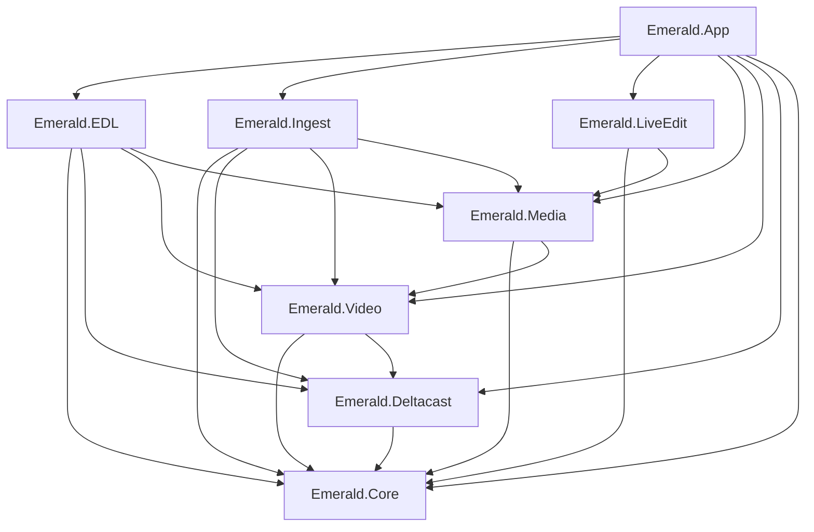

# 2. Project structure

Line references are to commit `dd8e4a7`. "Depended on by" names real callers found by searching the source.

## Top level

```
Emerald.sln                 solution, maps Any CPU to x64 for every project
Directory.Build.props       one version number (1.0.0) for all projects
readme.md                   long design notes; partly out of date
PROTOCOL.md                 the EDL record JSON format
CLAUDE.md                   instructions for coding assistants
build.bat                   build the solution
run.bat                     build then open the capture deck
run-edl.bat                 ... the EDL Generator (--edl)
run-ingest.bat              ... the Ingest Controller (--ingest)
run-monitor.bat             ... the Monitor (--monitor)
publish.bat                 self-contained build into dist\Emerald
publish-edl.bat             wrapper: publish.bat -edl into dist\Emerald-EDL
installer\                  install.bat, update.bat, uninstall.bat, READ-ME-FIRST.txt
installer\edl\              the same set for the EDL-only product
media\                      default recording store; contents not in git
tools\check-xaml-styles.sh  checks Style/TargetType matches, which the compiler does not
src\                        eight projects
tests\                      four test projects
dist\                       publish output; not in git
assets\                     logo, icon and wordmark PNGs; not in git, but Emerald.App and
                            Emerald.LiveEdit include them as resources, so a fresh clone
                            needs this folder supplied
ico.png                     source artwork for the icon, tracked at the root
graphify-out\               generated code graph; not in git
```

`.gitignore` excludes build output, all common video formats, the contents of `media\`, `graphify-out\` and `assets\`.

## Dependency rules



- References run one way. The code graph reports no import cycles.
- `Emerald.LiveEdit` uses `Emerald.Video` and `Emerald.Deltacast` types without declaring them. They reach it transitively through Media, as `obj/project.assets.json` confirms. Removing Video from Media would break Live Edit with nothing in its project file to warn you.
- `IDelayLine` lives in Core so that Core's state objects can hold a ring without referencing Video. `IEdlPlayback` is implemented by `LiveAir`, also in Core. It is an interface so that `EdlLedger` can be tested against a fake playback.
- Every project must be x64, because `VideoMasterHD.dll` is 64-bit. All 12 projects set `<Platforms>x64</Platforms>`, and `Emerald.sln` maps Any CPU to x64 for each. The readme says a project without it fails the build. That was not tested for this document.

## Entry points

| Entry | Location | Role |
|---|---|---|
| Process | `src/Emerald.App/App.xaml.cs:61` `App_Startup` | Argument parsing, single instance, first window |
| Command line | `--edl`, `--ingest`, `--monitor`, or nothing | Chooses the first window. Anything else starting with `--` is refused. |
| Second launch | Named pipe `Emerald.App.Activate` | Hands the request to the running process |
| Installer | `installer/install.bat` | Installs a published folder |
| Web page | `src/Emerald.Core/MonitorServer.cs`, when switched on | Read-only monitoring on TCP 8787 by default (`monitorApiPort` in settings) |

## Configuration files

| File | Purpose |
|---|---|
| `%APPDATA%\Emerald\settings.json` | All operator settings. See [data and storage](08_DATA_AND_STORAGE.md#settings). |
| `Directory.Build.props` | Version |
| `src/*/*.csproj` | Framework, platform, references |
| `src/Emerald.App/app.manifest` | Per-monitor DPI and supported Windows versions. Its assembly identity still reads `EdlGenerator.app`. |
| `Emerald.sln` | Project list and platform mapping |

No `appsettings.json`, `.env` or `app.config` was found. The Emerald-specific environment variables are `EMERALD_SOFTWARE_RENDER` (`src/Emerald.App/App.xaml.cs:102`) and `EMERALD_NOPAUSE` (scripts only). `PATH` is also searched for ffmpeg (`src/Emerald.Video/Ffmpeg.cs:26`).

## src/Emerald.Core

The bottom layer. It has no project references and uses WPF only for `TimecodeMask`.

| File | Purpose and why it exists | Depended on by |
|---|---|---|
| `AppSettings.cs` | The one settings file for all modules. Load, save, migrate. | All windows, `RecordingProfile`, `RecordingSetup`, `MediaLibrary` |
| `ActivityLog.cs` | The application's record: an in-memory ring plus JSONL on disk, written on a background thread so real-time threads never wait on a disk. | Almost everything |
| `MonitorServer.cs` | Hand-written HTTP/1.1 server on `TcpListener`. `HttpListener` would need elevation or a URL reservation for non-localhost. | `MonitorWindow` |
| `MonitorFeed.cs` | Builds the JSON the server returns, separated so it can be tested without a socket. | `MonitorServer`, `MonitorWindow` |
| `MonitorPage.cs` | The whole remote web page as one string constant. | `MonitorServer` |
| `TimecodeService.cs` | Polls the timecode service and free-wheels between polls. | `TimecodeLink` and its consumers |
| `TimecodeLink.cs` | Process-wide owner of one `TimecodeService`, replacing three per-window clients. | Shell, Playback, EDL, Ingest, Monitor, Live Edit, App, `ActivityLog` |
| `Timecode.cs` | `Timecode(TotalFrames, Rate)`, non-drop. Parse and format. | Everywhere |
| `TimecodeCalculation.cs` | EOM and duration arithmetic, wrapping at midnight. | Ingest |
| `TimecodeMask.cs` | WPF attached property: an overwrite-style `HH:MM:SS:FF` text box. | XAML in Shell, EDL, Ingest |
| `FramePick.cs` | Parses typed positions: `+50`, `-2s`, frame number, full or partial timecode. | `BookmarkDialog`, `IngestDropDialog`, `LiveEditWindow` |
| `PipelineState.cs` | Current status of each stage, overwritten in place. | Shell, Playback, EDL, Monitor, `MonitorFeed`, `MonitorServer`, `SdiCapture`, `DelayTransmitter`, `LiveEditWindow` |
| `TidalLock.cs` | State machine coordinating the capture and playback decks. Carries no video. | Shell, Playback, Monitor, Live Edit, `MonitorFeed`, `MonitorServer`. `DelayTransmitter` and `LiveAir` use only its `Describe` helper. |
| `LiveAir.cs` | Live Edit's transmission state, plus pure cue-firing rules (`LiveCues`). Separate from `TidalLock` by design. | Shell, Live Edit, `LiveAirTransmitter` |
| `LiveEdl.cs` | The EDL handshake types and `EdlDiff.EarliestChange`. | `LiveAir`, `EdlLedger`, Live Edit |
| `EdlLedger.cs` | Sender side of the handshake: versions, retries, per-edit conform state. No clock or UI. | `LiveEditWindow.Live.cs` |
| `EdlLogger.cs` | The EDL log: memory, activity log and `edl-yyyyMMdd.jsonl`. | `EdlLedger`, `LiveEditWindow.Live.cs` |
| `EdlSources.cs` | Resolves a frame range to capture files. | `LiveEditWindow.Live.cs` |
| `IngestPlacement.cs` | Placement modes and pure planning rules. | `IngestDropDialog`, Live Edit |
| `IngestTimeline.cs` | Converts ruler frames to what plays, allowing for inserts and cuts. | Live Edit |
| `AudioEdits.cs` | Non-overlapping level changes. | Live Edit, `LiveAirTransmitter`, `LiveAir`, `LiveEdl.cs` |
| `Bookmarks.cs` | One note per frame per day. | `BookmarkDialog`, Live Edit |
| `DropMarks.cs` | In-memory list of frame-loss moments. | `SdiCapture`, `DelayTransmitter`, Live Edit |
| `RecordingSequence.cs` | Folder and file naming, midnight frame count. | `SdiCapture`, `MediaLibrary`, `PruneLedger`, `SegmentWatch`, `StorageWarden`, Shell, EDL |
| `RecordingPicture.cs` | Hands the newest preview frame across assemblies; also exposes the ready ring. | Shell, Live Edit |
| `IDelayLine.cs` | Read-only view of the ring. | `TidalLock`, `LiveAir`, `RecordingPicture`, `HeldPicture`, `LiveEditWindow.Held`. Implemented by `DelayLine`. |
| `TransmissionTally.cs` | Folds log lines into "what aired, per message, per track". | `MonitorFeed`, `MonitorWindow` |
| `PlayoutDrift.cs` | Measures frames lost against the wall clock. It measures only and does not correct. | `PlayoutService` |
| `CaptureSync.cs` | The lip-sync rule for pipes with no timestamps: write audio only up to the video count. | `SdiCapture` |
| `Settled.cs` | Debouncer with injected time, added because a flapping reading flooded the log. | Shell |
| `SdiPorts.cs` | Advisory TX port ownership. Explicitly not a lock. | `PlayoutService`, both transmitters, Playback, `GoLiveDialog` |
| `TimelineZoom.cs` | 14-step zoom ladder and pixel conversions. | Live Edit, Shell |
| `EmeraldVersion.cs` | Version string from assembly metadata. | Shell and Live Edit XAML |

## src/Emerald.Deltacast

| File | Purpose | Depended on by |
|---|---|---|
| `VideoMasterHD.cs` | All VideoMaster P/Invoke and SDK constants. `SpeakerOutput` has its own `winmm.dll` imports. | `BoardService`, `SdiOutput`, `SdiCapture`, `SdiAudioReader`, `RxPreview` |
| `BoardService.cs` | Enumerates boards. Translates a missing DLL into a sentence. | Shell, Playback, EDL, `GoLiveDialog`, `IngestHardware` |
| `BoardInfo.cs` | `BoardInfo`, `ChannelPort`. (`BoardScanResult` is in `BoardService.cs`.) | Board pickers |
| `RxLease.cs` | Per-process referee of the single RX handle. | `SdiCapture`, `RxPreview` |
| `SdiOutput.cs` | One TX port: open, push frame, embed audio. | `SdiOutputFan`, `PlayoutService`, both transmitters |
| `SdiOutputFan.cs` | Several TX ports presented as one output. Defines `ISdiOutput`. | Both transmitters, `PlayoutService` |
| `VideoFormat.cs` | Frame rate to SDI standard, interface and size. It lives here because it is an SDI table. | `SdiOutput`, `SdiOutputFan`, transmitters, `PlayoutService`, `DelayFormats`, `FrameSource` |

## src/Emerald.Video

For the engine threads the third column lists what they call. For the other files it lists their callers.

| File | Purpose | Connected to |
|---|---|---|
| `SdiCapture.cs` | The recording engine: RX slot loop, encoder pipes, midnight rollover. Defines `CaptureFormat`, `CapturedFrame`, `CaptureResult`. | SDK, ffmpeg, `RxLease`, `DelayLine` via its `Frame` event |
| `RecordingProfile.cs` | Output definitions and the ffmpeg encoder argument builder. | `SdiCapture` |
| `RecordingSetup.cs` | Validates and builds `CaptureRequest`, returning a sentence rather than throwing. | Shell, EDL, `IngestRecorder` |
| `DelayLine.cs` | The ring: memory-mapped file, writer thread, lock-free reads. | `SdiCapture`, transmitters, `HeldPicture` |
| `DelayFormats.cs` | Which formats the delay can carry (progressive 1080 only). | Shell, transmitters |
| `DelayPacer.cs` | Pure decision for each output frame: Fill, Advance, Repeat, Skip, Resync, Finish, Fail. | Transmitters |
| `DelayTransmitter.cs` | Tidal lock output thread. | `DelayLine`, `SdiOutput`, `PipelineState` |
| `LiveAirTransmitter.cs` | Live Edit output thread, adding cues, blanks and levels. | `DelayLine`, `SdiOutput`, `LiveAir`, decoders |
| `FrameSource.cs` | ffmpeg decoding to raw UYVY on stdout. | `PlayoutService`, `LiveAirTransmitter`, `FrameReadahead` |
| `FrameReadahead.cs` | Decodes ahead on its own thread with reused buffers. | `LiveAirTransmitter` |
| `AudioSource.cs` | ffmpeg decoding to PCM with a rolling buffer, so trims need no restart. | `PlayoutService`, `LiveAirTransmitter` |
| `HeldPicture.cs` | Lets a viewer read recent ring frames that an open segment cannot yet serve. | Live Edit |
| `SdiAudioReader.cs` | Extracts embedded audio from an RX slot. | `SdiCapture`, `RxPreview`, `AudioMonitor`. `RecordingProfile` and Shell read its channel limits. |
| `UyvyPreview.cs` | UYVY to BGRA conversion for display. | `SdiCapture`, `RxPreview`, `HeldPicture` |
| `AudioMeter.cs` | Peak and RMS meter maths, no audio API. Also defines `AudioLevel`. | `AudioMonitor`, `AudioPairRow` (reads `AudioLevel`) |
| `SpeakerOutput.cs` | `waveOut` monitoring. Not in the air or record path. | `AudioMonitor` |
| `Ffmpeg.cs` | Finds `ffmpeg.exe`. | All ffmpeg users |

## src/Emerald.Media

| File | Purpose | Depended on by |
|---|---|---|
| `MediaLibrary.cs` | The store's single source of truth: lists clips, pairs proxy with master, works out when each segment starts. | Shell, Live Edit, EDL, Ingest |
| `MediaProbe.cs` | Runs ffprobe, caches the result. | `MediaLibrary`, `RangeExport`, EDL, Live Edit, `IngestMediaRegistrar`, Shell (unreachable clip path) |
| `MediaCodec.cs` | Managed MOV/MP4 atom walker, roughly 8 ms (comments in `MediaLibrary.cs`, `SegmentWatch.cs`) against 200 ms for ffprobe (comment in `MediaCodec.cs`). No native code. | `MediaLibrary`, `SegmentWatch`, `StorageWarden` |
| `MediaScanner.cs` | Extension list; turns a dropped path into a selection. | EDL, Live Edit, `MediaLibrary`, `RangeExport`, `StorageWarden` |
| `RangeExport.cs` | Cuts a marked range from the masters with ffmpeg stream copy (proxies if a master is missing), then writes a JSON sidecar and an encoded H.264 preview, which is the slow part. Output goes to `<store>\ingest`. Also lists that folder and finds previews for Live Edit's Ingest tab. | Live Edit, `ExportDialog` |
| `SegmentWatch.cs` | Polls for finished segments. | Shell |
| `StorageWarden.cs` | Deletes the oldest segments past the size limit. | Shell |
| `PruneLedger.cs` | Records what was deleted so survivors keep their clock position. | `StorageWarden`, `MediaLibrary` |
| `Waveform.cs` | Peak data from ffmpeg, cached in memory. | Live Edit |

## src/Emerald.EDL

| File | Purpose |
|---|---|
| `EdlWindow.xaml(.cs)` | Operator form, validation on every edit, queue display, optional on-air recording. Key members: `BuildCommand` (`EdlWindow.xaml.cs:667`), `SendEdl_Click` (`EdlWindow.xaml.cs:888`), `StartPlayout` (`EdlWindow.xaml.cs:1320`). |
| `PlayoutService.cs` | Queue and real-time engine. One thread owns one output for the whole queue. |
| `EdlCommand.cs` | The JSON record of a command. It is a record, not a network protocol. |
| `AudioTrackRow.cs` | View model for one audio row. |

## src/Emerald.Ingest

| File | Purpose |
|---|---|
| `Models/IngestJob.cs` | Database row and observable object in one. |
| `Models/IngestRecording.cs` | What a job actually produced. |
| `Models/IngestRequest.cs` | Raw form values and the validation result. |
| `Models/IngestStatus.cs` | Status enum and legal transitions. |
| `Services/IngestControllerService.cs` | The single façade for the UI: validation, recovery. |
| `Services/IngestSchedulerService.cs` | Queue, 20 ms loop, roll decision, finalisation. |
| `Services/IngestRecorder.cs` | `SdiIngestRecorder` over `SdiCapture`, and `MockIngestRecorder`. |
| `Services/IngestStore.cs` | `SqliteIngestStore` and the EF `IngestDbContext`. |
| `Services/IngestMediaRegistrar.cs` | Turns a recorder result into a recording row. |
| `Services/IngestClock.cs` | Clock seam: station time, or PC time when simulating. |
| `Services/IngestHardware.cs` | Hardware seam: real or two simulated boards. |
| `Services/ClipNameService.cs` | Generates and validates clip names. |
| `Services/DiskSpace.cs` | Free space, write probe, size estimate. |
| `Services/IngestLog.cs` | Log adapter. |
| `ViewModels/IngestRows.cs` | Immutable row records. |
| `Views/IngestControllerWindow.xaml(.cs)` | The form, queue and log. Builds the whole service stack. |
| `Views/IngestHistoryWindow.xaml(.cs)` | Read-only history. |

## src/Emerald.LiveEdit

`LiveEditWindow` is one class split across six partial files, about 7,750 lines of C#. It is the most connected node in the code graph.

| File | Contents |
|---|---|
| `LiveEditWindow.xaml` | Layout: header, big screen (`PlayerA`, `PlayerB`, `HeldView`, `RecordingView`), right panel, transport, timeline canvases. |
| `LiveEditWindow.xaml.cs` | Store watching, day navigation, seek, frame loop `OnTick`, on-air reading, chase, drag and drop, keys, drawing, export, bookmarks, the small monitor. |
| `LiveEditWindow.Live.cs` | No edit zone, Go Live, EDL send and conform, ruler to recording conversion, delay counter, `DeleteScene`. |
| `LiveEditWindow.Audio.cs` | Audio lanes, levels, preview gain, waveforms, blank drawing. |
| `LiveEditWindow.Held.cs` | Showing an open segment from ring frames. |
| `LiveEditWindow.Recording.cs` | The REC view. |
| `LiveEditWindow.Undo.cs` | Whole-state undo and redo, 50 levels. |
| `GoLiveDialog` | Board, TX ports, delay, headroom. |
| `IngestDropDialog` | Mode, tracks, start timecode, live preview of the effect. |
| `BookmarkDialog`, `ExportDialog`, `LiveLogWindow` | As named. |

## src/Emerald.App

| File | Purpose |
|---|---|
| `App.xaml.cs` | Startup, single instance, shared `App.Settings`, exit. |
| `App.xaml` | Shared palette and about 40 styles used by every window. They are one reason `publish.bat -edl` ships the same binaries under a separate product rather than a smaller build: a split would need a second copy of this file. |
| `ShellWindow.xaml(.cs)` | Capture deck, 2,731 lines of C#. Board selection, preview, record, three ring lifecycles, segment logging, storage limit, module opening. |
| `PlaybackWindow.xaml(.cs)` | Tidal lock transmitter and a separate RX monitor. |
| `MonitorWindow.xaml(.cs)` | Status strip, log, transmitted view, remote toggle. |
| `RxPreview.cs` | Direct SDK preview of an RX port. |
| `AudioMonitor.cs` | Meters and speaker routing. |
| `AudioPairRow.cs`, `CaptureAudioRow.cs`, `TxPortRow.cs` | Row view models. |
| `ClipThumbnails.cs` | ffmpeg thumbnails in `%TEMP%\Emerald\thumbs`. Unreachable today, because its UI is collapsed. |
| `AppIcon.cs` | Icon, loaded once. |

## tests

| Project | Covers | Hardware needed |
|---|---|---|
| `Emerald.Core.Tests` | Nearly all pure rules in Core: timecode, tidal lock, monitor server, ingest timeline, placement and tracks, EDL editing, live cues, audio edits, scene cut, activity log, bookmarks, drop marks, frame pick, capture sync, pipeline state, playout drift, recording picture and sequence, SDI ports, settled, timeline zoom, transmission tally | None |
| `Emerald.Edl.Tests` | Queue countdown, track levels, embedded audio labels | None |
| `Emerald.Ingest.Tests` | Status rules, validation, store, recovery, queue and scheduler decisions driven by hand, clip names, ingest audio, recording arguments, plus Core's `TimecodeCalculationService` and `TimecodeMask` | None |
| `Emerald.Video.Tests` | Encoder, audio and segment arguments, delay ring and formats, pacer, frame read-ahead, segment watch, storage warden, prune ledger, range planning, export and the export listing, picture duration, meters, speaker latency, UYVY preview, SDK stream-type table. Also covers Emerald.Media and part of Deltacast, which have no test project of their own. `MediaLibrary.List` has no direct test. | None. Tests that decode or export use ffmpeg from wherever `Ffmpeg.Locate` finds it, and pass without checking anything when there is none, so a green run with no ffmpeg proves less. Ring tests need free disk space, and fail on the guard when the temp drive is full. |

Not covered by tests: anything inside a window class; the play loop in `PlayoutService`; the ingest scheduler loop; the real-time threads in `SdiCapture`, `DelayTransmitter` and `LiveAirTransmitter`; everything that opens a card (`SdiOutput`, `RxPreview`, `BoardService`), plus `RxLease`; `AudioSource`, `HeldPicture`, `Waveform` and `MediaLibrary.List`. Only the pure rules those engines delegate to are tested.

There are no test projects for Media, Deltacast or Live Edit. Live Edit's logic is tested only where it was moved into Core.

## Names that don't match files

Searching for a file's name can find no callers. These are the cases that catch people out:

| File | Defines |
|---|---|
| `Bookmarks.cs` | `BookmarkBook` |
| `TimecodeCalculation.cs` | `TimecodeCalculationService` |
| `IngestMediaRegistrar.cs` | `MediaLibraryRegistrar` |
| `IngestRecorder.cs` | `SdiIngestRecorder` and `MockIngestRecorder` |
| `IngestStore.cs` | `SqliteIngestStore` and `IngestDbContext` |
| `SdiOutputFan.cs` | `SdiOutputFan` and the `ISdiOutput` interface |

The project `Emerald.EDL` has the root namespace `Emerald.Edl`, and its test project is `Emerald.Edl.Tests`.

## Storage, API and hardware modules at a glance

| Asked for | Where |
|---|---|
| API routes | `src/Emerald.Core/MonitorServer.cs`, `MonitorFeed.cs` |
| Services and background processes | [System architecture](03_SYSTEM_ARCHITECTURE.md#threads-and-background-work) |
| Database models | `src/Emerald.Ingest/Models`, `Services/IngestStore.cs` |
| Other storage | `AppSettings`, `ActivityLog`, `EdlLogger`, `Bookmarks`, `PruneLedger`, `DelayLine`, `RangeExport` sidecars |
| Hardware communication | `src/Emerald.Deltacast/*`, `SdiCapture`, `RxPreview`, `SdiAudioReader` |
| Reusable UI | `src/Emerald.App/App.xaml` styles, `TimecodeMask` |
