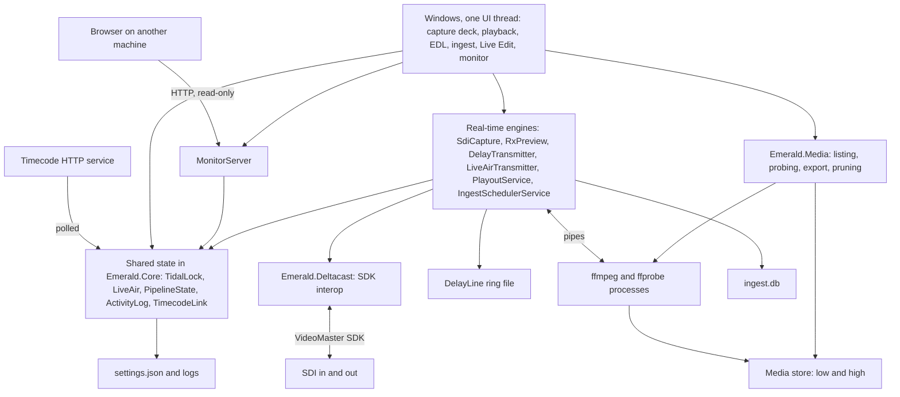
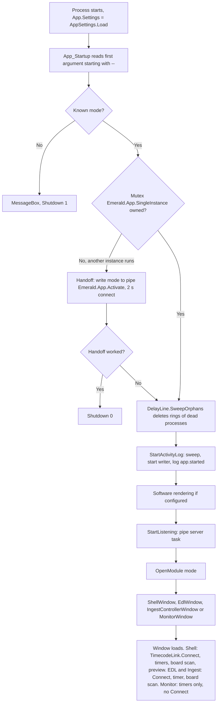
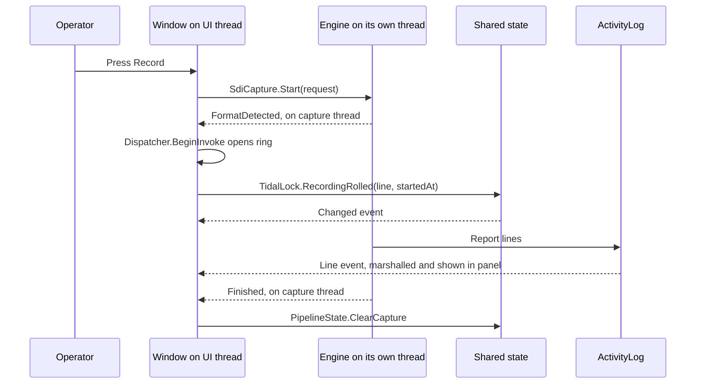
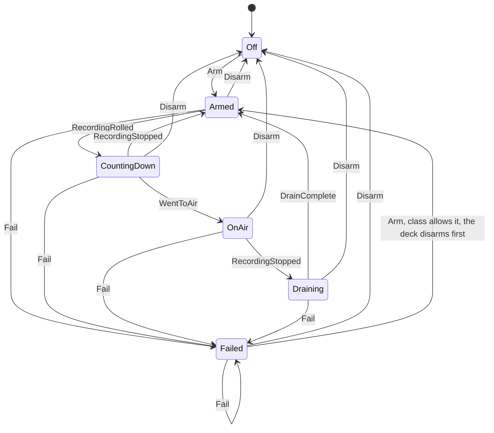
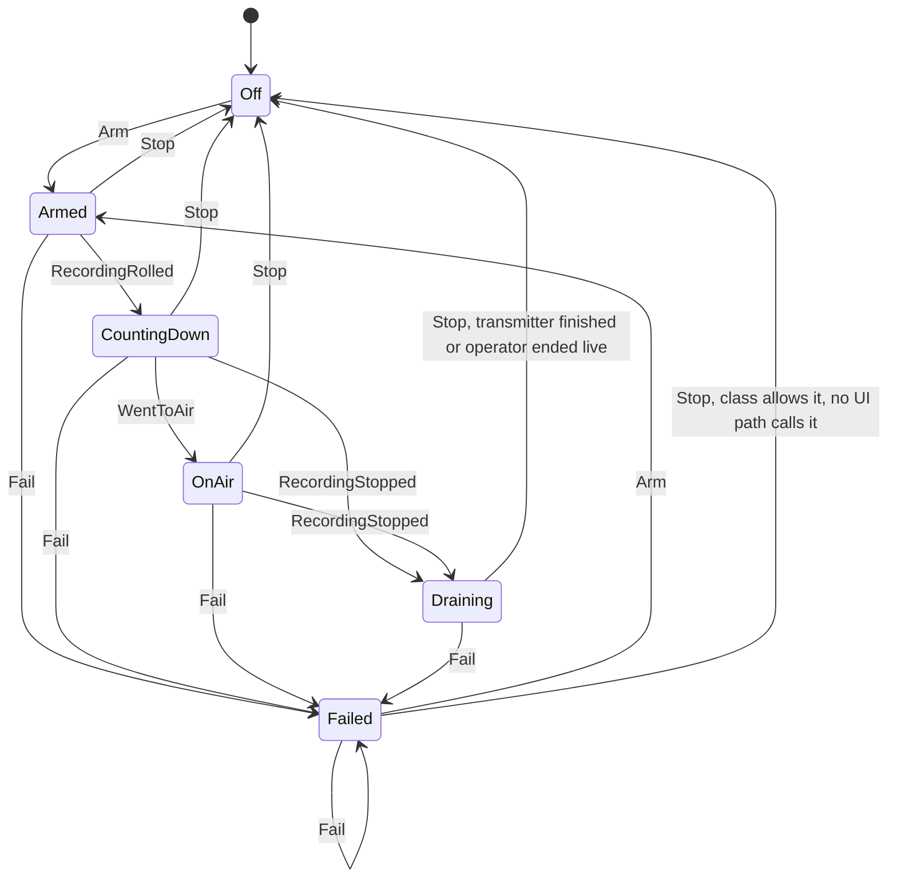
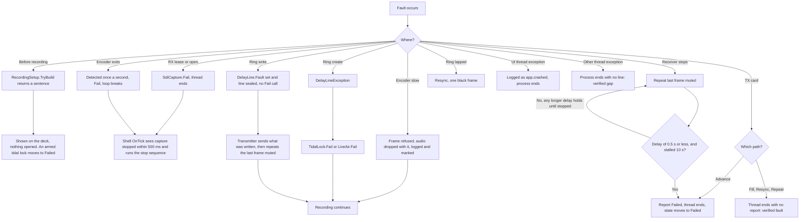

# 3. System architecture

Line references are to commit `dd8e4a7`.

## Where each requested diagram is

| # | Diagram | Location |
|---|---|---|
| 1 | Overall system architecture | [below](#1-overall-system-architecture) |
| 2 | Application startup | [below](#2-application-startup) |
| 3 | Complete data flow | [below](#3-complete-data-flow) |
| 4 | Frontend to backend communication | [below](#4-frontend-to-backend-communication) |
| 5 | Video capture and recording | [Media processing](05_MEDIA_PROCESSING.md#recording-flowchart) |
| 6 | Video playback and streaming | [Media processing](05_MEDIA_PROCESSING.md#playback-and-output-flowchart) |
| 7 | Hardware RX and TX | [Hardware integration](06_HARDWARE_INTEGRATION.md#rx-and-tx-workflow) |
| 8 | Media processing | [Media processing](05_MEDIA_PROCESSING.md#media-processing-workflow) |
| 9 | API and communication | [API and communication](07_API_AND_COMMUNICATION.md#communication-diagram) |
| 10 | Error handling and recovery | [below](#10-error-handling-and-recovery) |

## 1. Overall system architecture

Who drives what:

| Window | Owns or drives | Shared state it writes |
|---|---|---|
| `ShellWindow` | `SdiCapture`, `RxPreview`, `AudioMonitor`, the rings | `TidalLock`, `LiveAir`, `PipelineState` |
| `PlaybackWindow` | `DelayTransmitter`, its own `RxPreview`, an idle `PlayoutService` | `TidalLock` |
| `EdlWindow` | `PlayoutService`, its own `SdiCapture` | `PipelineState` |
| `IngestControllerWindow` | `IngestSchedulerService`, one `SdiCapture` per job, `ingest.db` | None |
| `LiveEditWindow` | `LiveAirTransmitter`, players, `MediaLibrary` | `LiveAir` |
| `MonitorWindow` | `MonitorServer` | None |

`LiveAirTransmitter` also opens ffmpeg decoders for cue media and writes its position to `LiveAir`. `DelayTransmitter` writes `PipelineState`.

### Why it is built this way

| Decision | Why |
|---|---|
| One process | A receiver allows one open handle. `RxLease` only works in-process (`src/Emerald.App/App.xaml.cs:26`). |
| ffmpeg as a child process | Encoding cannot stall the card's slot loop, and a codec fault does not take down the transmitter. |
| Ring on disk, not in memory | A 7-minute delay of raw 1080p25 is about 44 GB. |
| Raw frames in the ring | The transmitter needs uncompressed UYVY anyway, and the delay stays independent of the encoder. |
| Two recording qualities | Media Foundation cannot decode DNxHD, so viewing needs the H.264 proxy. The master keeps broadcast quality. |
| State objects with no video in them | `TidalLock` and `LiveAir` let windows coordinate without referencing each other. |
| Windows not owned by the shell | They can sit behind it and be arranged freely. |

## 2. Application startup

Sources: `src/Emerald.App/App.xaml.cs:61`, `:80`, `:95`, `:126`, `:159`, `:204`, `:223`. Shared services are not constructed in one place. They are process-wide statics, created on first use.

## 3. Complete data flow

```mermaid
flowchart LR
    subgraph In["Input"]
        RX["RX slot: UYVY video and ANC audio"]
    end
    subgraph Capture["SdiCapture slot loop"]
        Copy["Copy frame to byte array"]
        Aud["SdiAudioReader interleave"]
    end
    RX --> Copy
    RX --> Aud

    Copy --> VQ["Video queue, 8 frames"]
    Aud --> AQ["Audio queue, 200 chunks"]
    VQ -->|"stdin"| Enc["ffmpeg encoder"]
    AQ -->|"named pipe"| Enc
    Enc --> Low["low: H.264 mp4 segments"]
    Enc --> High["high: DNxHD mov segments"]

    Copy --> Tap["Frame event"]
    Aud --> Tap
    Tap --> DQ["Ring hand-off queue, 8 frames"]
    DQ --> Ring["DelayLine memory-mapped ring"]

    Ring --> DTx["DelayTransmitter"]
    Ring --> LTx["LiveAirTransmitter"]
    Cues["LiveAir cues and levels"] --> LTx
    Decode["FrameSource and AudioSource for placed media"] --> LTx
    DTx --> TX["TX slot: UYVY and embedded audio"]
    LTx --> TX

    Low --> Lib["MediaLibrary.List"]
    High --> Lib
    Lib --> Timeline["Live Edit timeline and player"]
    Timeline -->|"edits"| Ledger["EdlLedger"]
    Ledger -->|"EdlRevision"| Cues
    Low --> Export["RangeExport"]
    High --> Export
    Export --> Ingestdir["store ingest folder"]
    Ingestdir --> Timeline

    RX --> Prev["Preview conversion, every Nth frame"]
    Prev --> Screens["Deck and REC view"]
```

A frame's route has two independent branches: the encoder (to files) and the ring (to air). A slow encoder drops frames from the files without affecting the ring, and the other way round. Both queues refuse rather than wait, so nothing can stall the slot loop.

## 4. Frontend to backend communication

There is no network boundary between the UI and the engines. Windows call engine methods directly and subscribe to C# events. Handlers raised on engine threads must marshal to the UI thread with `Dispatcher.BeginInvoke`.

The only real client-server boundary is the optional monitoring web page.

Marshalling is by convention, not enforced. Every event handler that touches a control has to do it. For the full event table see [API and communication](07_API_AND_COMMUNICATION.md#in-process-events).

## Shared state

| Object | Holds | Written by | Read by |
|---|---|---|---|
| `App.Settings` | Settings instance for most windows | Windows | Windows. `LiveEditWindow` loads its own copy (see the assessment). |
| `ActivityLog.Shared` | Log ring | Everything | Monitor, deck panels, server |
| `TimecodeLink.Service` | Station clock | HTTP poll | All decks |
| `TidalLock.Shared` | Tidal state | Shell, Playback | Shell, Playback, Monitor, Live Edit, server |
| `LiveAir.Shared` | Live Edit state, cues, levels, position | Shell, Live Edit, transmitter | Same |
| `PipelineState.Shared` | Stage status, frame ledgers, on-air time | Shell, EDL, `SdiCapture`, `DelayTransmitter` | Monitor, Playback, Live Edit, server |
| `SdiPorts.Shared` | Advisory TX ownership | Engines | Playback, `GoLiveDialog` |
| `RecordingPicture.Shared` | Newest preview frame, ready ring | Shell | Live Edit |
| `DropMarks.Shared` | Frame-loss moments | `SdiCapture`, `DelayTransmitter` | Live Edit |
| `RxLease` (static) | Who holds each receiver | `SdiCapture`, `RxPreview` | Same |

## State machines

### Tidal lock

`src/Emerald.Core/TidalLock.cs`. `RecordingRolled`, `WentToAir`, `RecordingStopped` and `DrainComplete` do nothing and announce nothing outside the states shown. `Arm` and `Disarm` have no guard: `Arm` goes to Armed from any state and `Disarm` goes to Off from any state, announcing even if already Off. `Fail` is ignored only in Off, so a second `Fail` announces again, and it keeps `Line`.

The playback deck only arms from Off, so in the application a failed lock goes Failed, Off, Armed, and takes two presses of the button. After a drain the lock is meant to return to Armed, ready for the next recording, though a drain with a long delay does not finish: see [A2](11_TECHNICAL_ASSESSMENT.md).

### Live Air

`src/Emerald.Core/LiveAir.cs`. It differs from tidal lock in three ways: a stop during countdown drains rather than re-arming, a finished drain goes to Off, and `Fail` clears the ring reference.

`Arm` has no guard in the class. Live Edit only calls it from Off or Failed, so a failed Live Air can be re-armed directly, unlike the playback deck's tidal lock.

## Threads and background work

| Thread or task | Priority | Created by | Stopped by |
|---|---|---|---|
| UI dispatcher (shared by all windows) | Normal | WPF | Exit |
| Pipe listener task | Pool | `App.StartListening` | `OnExit` cancels |
| `activity log` writer | BelowNormal | `ActivityLog.StartWriting` | Never explicitly; ends with the process |
| `SDI capture` | Normal | `SdiCapture.Start` | `Stop`: 2 s join, close pipes, 6 s join |
| `capture video writer`, `capture audio writer` | Normal | `Encoder` | `Drain`, `Finish` |
| `RX preview` | Normal | `RxPreview.Launch` | `StopWorker`, 3 s join |
| `tidal delay writer` | Normal | `DelayLine` constructor | `Dispose`, 5 s join |
| `tidal lock TX` | AboveNormal | `DelayTransmitter.Start` | `Dispose`, 5 s join |
| `live edit TX` | AboveNormal | `LiveAirTransmitter.Start` | `Dispose`, 5 s join |
| `cue decode ahead`, `audio decode` | Normal | `FrameReadahead`, `AudioSource` | `Dispose`, 2 s joins |
| `SDI playout` | AboveNormal | `PlayoutService.Enqueue` | `StopAll`, 5 s join |
| Ingest scheduler task, 20 ms loop | Pool | `IngestSchedulerService.Start` | `Stop`, 3 s wait (`Dispose` calls it) |
| Timecode poll, 500 ms | Pool | `TimecodeService.Start` | `Stop`, 2 s wait |
| `MonitorServer` accept loop and one task per connection | Pool | `TryStart` | `Stop` |
| Short pool tasks: ring release, warden, segment poll (shell); transmitter release (playback, Live Edit); media listing, export, waveform (Live Edit); next-day encoder open and old encoder finish (`SdiCapture`); cue pre-roll (`LiveAirTransmitter`); held picture (`HeldPicture`); spent-source disposal (`PlayoutService`) | Pool | As listed | Not tracked. Most are not cancellable. |

Timers: the shell runs `_clock` at 25 ms, `_tick` at 500 ms and `_cue` at 400 ms. Playback runs `_clock` at 25 ms. Monitor runs `_drain` at 25 ms and `_strip` at 200 ms. EDL runs a 25 ms timer. Ingest runs `_uiTimer` at 25 ms. Live Edit runs `_tick` at one frame, `_watch` at 2 s and `_monitorTick` at 250 ms. `LiveLogWindow` runs `_timer` at 500 ms.

## 10. Error handling and recovery

The rules behind this design:

- **A failure of the delay must not stop a recording.** `DelayLineException` on creation becomes a state change on the lock. A failure to create the shared ready ring is only logged (`delay.readyfailed`), and the locks make their own. A write fault seals the ring without telling the lock.
- **Subscribers must not stop a recording, but three still can.** `Audio`, `Frame`, `Rolled` and `Finished` swallow a handler's exception. A `FormatDetected` handler that throws fails the recording deliberately. `PreviewFrame` and `Message` have no try/catch of their own, so an exception from those handlers reaches the capture thread's outer catch or unwinds further.
- **There is no automatic restart** of the encoder or of a transmitter.
- **Sentences, not exceptions, for operator errors.** `RecordingSetup.TryBuild`, `IngestPlacement.TryPlan` and `BoardService.Scan` return a reason.

For symptoms and their fixes see [troubleshooting](10_TROUBLESHOOTING.md). For the gaps in this design see the [assessment](11_TECHNICAL_ASSESSMENT.md).
