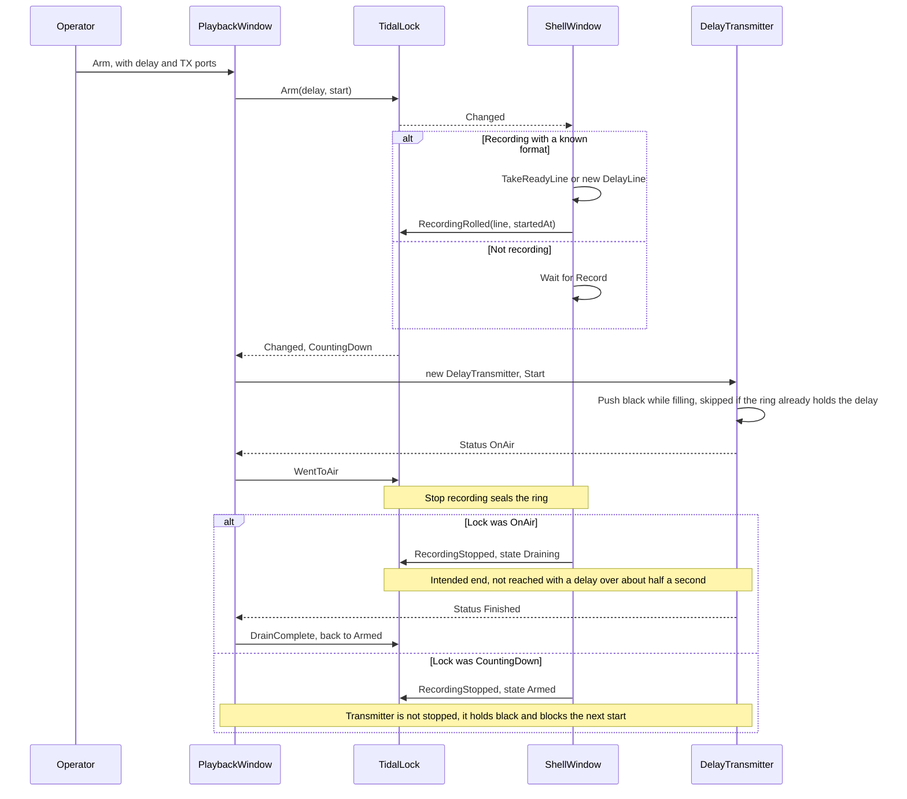
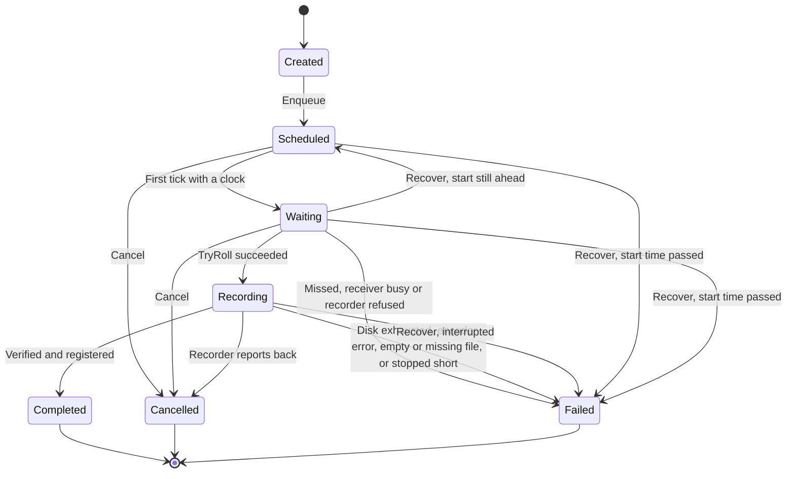
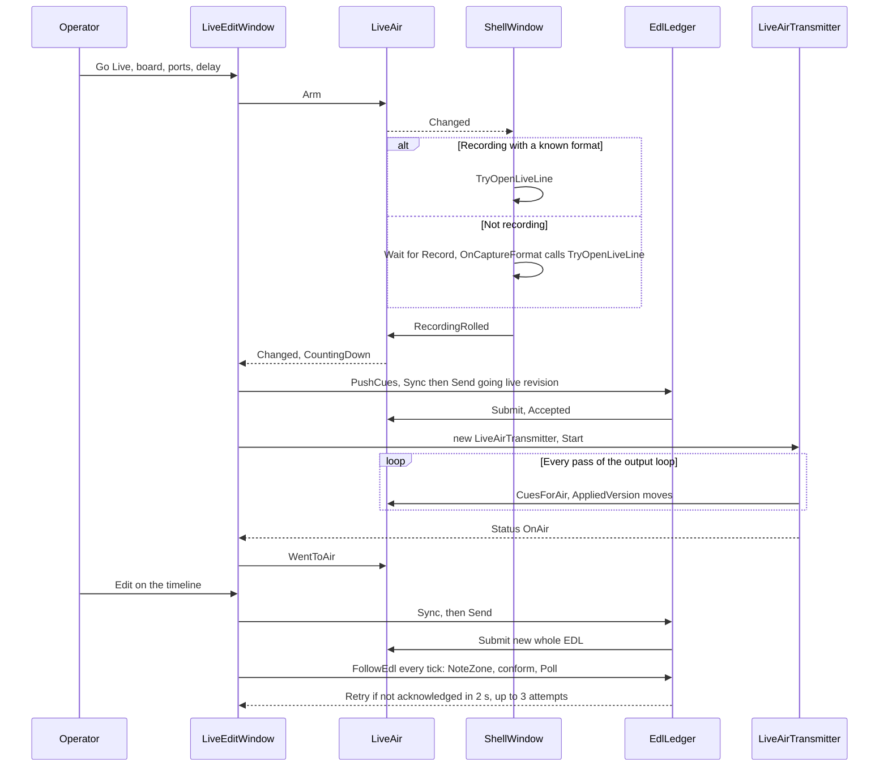

# 4. System workflows

Each workflow is in chronological order. Line references are to commit `dd8e4a7`. Where a step behaves differently from what its comments or UI suggest, it links to the [assessment](11_TECHNICAL_ASSESSMENT.md).

## Starting up

`src/Emerald.App/App.xaml.cs`:

1. `App.Settings` is initialised from `AppSettings.Load()` (`:49`).
2. `App_Startup` takes the first argument starting with `--`, lower-cased (`:63`). It allows nothing, `--edl`, `--ingest` or `--monitor`. Anything else shows a message and exits with code 1.
3. It takes the named mutex `Emerald.App.SingleInstance` (`:80`). If another process owns it, `Handoff` connects to the pipe `Emerald.App.Activate` with a 2 second timeout and writes the mode as one line. On success this process exits. On failure it carries on as a second instance (`:90`).
4. `DelayLine.SweepOrphans` deletes `tidal-<pid>-*.ring` files whose process is gone (`:95`).
5. `StartActivityLog` (`:126`) sweeps old logs, starts the writer, hooks `DispatcherUnhandledException` and logs `app.started`.
6. Software rendering applies if `softwareRendering` is set or `EMERALD_SOFTWARE_RENDER=1` (`:101`).
7. `StartListening` starts the pipe server (`:223`).
8. `OpenModule` shows the window (`:159`). If a shell exists it delegates to `shell.OpenModule`.

**When the shell loads** (`ShellWindow_Loaded`, `src/Emerald.App/ShellWindow.xaml.cs:204`), it fills fields from settings, loads the profile, shows storage use, connects `TimecodeLink`, starts `_clock` and `_tick`, starts the capture log panel, then awaits `ScanBoards`, which picks a board and port and calls `StartPreview`.

Modules open through `ShowModule<T>` (`:2550`), which creates the window or activates the existing one.

**Standalone modes.** `--edl`, `--ingest` and `--monitor` open through `App.OpenModule` with no shell, so `ShowModule<T>` does not apply. Playback and Live Edit can be reached only from the shell, and rings only open when the shell records.

## Shutting down

`ShellWindow_Closing` (`src/Emerald.App/ShellWindow.xaml.cs:2583`):

1. Stops timers and closes the player.
2. Calls `_capture.Stop()` synchronously. A running recording stops with **no confirmation**.
3. Disposes the preview and audio monitor.
4. Unsubscribes from `TimecodeLink`, `TidalLock`, `LiveAir` and `ActivityLog`.
5. Saves deck settings.
6. Closes `_edl`, `_liveEdit`, `_ingest`, `_playback` and `_monitor`.

`App.OnExit` (`src/Emerald.App/App.xaml.cs:259`) shuts down the timecode link, cancels the listener and releases the mutex. WPF's default `OnLastWindowClose` applies, so a window that refuses to close keeps the process alive.

Each module has its own close behaviour:

| Window | On close |
|---|---|
| Playback | Disarms tidal lock, stops the feed, saves TX board and ports |
| EDL | Stops capture and playout with no confirmation |
| Ingest | Prompts if a job is recording. Pending jobs do not run while it is closed. |
| Live Edit | Prompts if armed, filling, on air or draining, then ends the transmission. If the prompt cannot be shown, which the code expects when the shell is closing it, the transmission ends with no prompt. |
| Monitor | Stops timers and the remote server |

Gaps here are [verified issues](11_TECHNICAL_ASSESSMENT.md): rings are left on disk when the shell closes during a recording, and the activity log is never flushed.

The shell stops its capture before asking modules to close, and never cancels its own close. If a module then refuses to close, the recording has already stopped, the shell still closes, and the process stays alive for that window.

## Capture deck: recording

`StartRecording` (`src/Emerald.App/ShellWindow.xaml.cs:995`):

1. Requires a board and port.
2. Resolves `StoreFolder` and creates it.
3. Writes the profile, rate, folder and limit into settings, then `AppSettings.SaveCaptureFolder` so Live Edit can follow.
4. Collects added audio beds with `CurrentCaptureAudio`.
5. `RecordingSequence.Next(DateTime.Now, title)` produces the folder name and file stem.
6. `RecordingSetup.TryBuild` validates and builds the `CaptureRequest`. Failure shows a sentence and, if tidal lock is Armed, calls `TidalLock.Fail`. An armed Go Live is left waiting.
7. `_capture.Start(request with { Names = naming })` starts the `SDI capture` thread.
8. A `SegmentWatch` starts following the new folder.
9. `PipelineState` is updated and the UI shows RECORDING.

**On the capture thread**, `SdiCapture.Run` takes the receiver, displacing the preview, and locks to the signal. It then raises `FormatDetected`.

`OnCaptureFormat` (`:1597`) sets `PipelineState.RecordingStart`, then posts three actions in order: `OpenReadyLine`, `TryOpenDelayLine`, `TryOpenLiveLine`.

**While recording:**

- The preview tap draws frames to the deck, with at most one in flight.
- `_capture.Audio` feeds the meters.
- `OnTick` runs every 500 ms. Every 20 ticks it calls `EnforceStorageLimit`, `ShowStorage` and `AnnounceSegments`.
- Set Duration is checked against the wall clock in `OnTick`, so it stops within about 500 ms rather than on a frame.

**Stopping** (`StopRecording`, `:1483`):

1. Marks the deck as not recording.
2. `await Task.Run(_capture.Stop)`.
3. `ReleaseDelayLine`, `ReleaseLiveLine`, `ReleaseReadyLine`, in that order. The first two tell their lock (`RecordingStopped`) and release their claim on a task. A private ring is sealed first. A claim on the shared ready ring is not sealed there: `ReleaseReadyLine` seals it afterwards and tells no lock. The transmitter holds its own reference, so the delayed programme is meant to keep going.
4. Restarts the preview.

`OnCaptureFinished` (`:1549`) runs on the capture thread after ffmpeg closes. It clears the recording picture, logs `capture.finished` and makes a final segment announcement.

**If the capture dies on its own**, `OnTick` notices within 500 ms (`:2404`) and runs a copy of the stop sequence.

See [media processing](05_MEDIA_PROCESSING.md) for what happens inside `SdiCapture`.

## The three rings

Up to three ring references exist per recording, and they can be the same file:

| Field | Purpose | Opened by | Size |
|---|---|---|---|
| `_readyLine` | Always filling, so a lock armed mid-recording goes straight to air | `OpenReadyLine` (`:1257`) if `keepDelayReady` | Tries `max(300, liveDelay + headroom)` seconds, then 300, then 120 |
| `_delayLine` | Tidal lock | `OpenDelayLine` (`:1113`) | Takes the ready ring if it is big enough, otherwise its own |
| `_liveLine` | Live Edit | `TryOpenLiveLine` (`:1406`) | Delay plus headroom, same reuse |

Rings are reference counted. Each holder calls `AddRef` and `Release`, and the last release deletes the file.

## Playback deck: tidal lock

- `Arm_Click` is at `src/Emerald.App/PlaybackWindow.xaml.cs:595`, `StartDelayTransmitter` at `:656`, `OnDelayStatus` at `:700`.
- Delay options come from `RenderDelayOptions` (`:517`): 30 s, 1, 2 or 5 minutes, From first segment, When first segment is ready, and No delay only while recording.
- The deck's `PlayoutService` instance is never given a message. It is used only for its ffmpeg check and `StopAll`, so `OnPlayoutProgress` and the close prompt at `PlaybackWindow.xaml.cs:146` can never run. Clip audition does not exist in this window: the class comment describing it (`PlaybackWindow.xaml.cs:23`) is stale.
- **Disarm and Stop Output** both disarm the lock and call `StopDelayedFeed`. The shell then runs `ReleaseDelayLine` on Off or Failed (`ShellWindow.xaml.cs:1661`).
- **Closing the deck** while the delayed feed is on air takes it off air with no prompt.

There is a [verified fault](11_TECHNICAL_ASSESSMENT.md) in the drain, in both transmitters. After sealing, `DelayPacer` returns Repeat once the remaining lag is more than half a second below target, so the feed freezes on a silent frame about half a second after the recording stops, rather than finishing. It then reports Holding, not Draining.

Tidal lock and Live Air stop differently. From CountingDown, tidal lock returns to Armed and Live Air goes to Draining. They can share a ring while their states stay separate.

## EDL Generator: composing and playing out

**Composition** (`src/Emerald.EDL/EdlWindow.xaml.cs`):

1. The operator sets boards and ports, start timecode, SOM, EOM or duration, post play, media and audio tracks. SOM and EOM are offsets from the head of the media, and `duration = EOM - SOM`. EOM equal to SOM means open-ended.
2. Choosing media creates one audio row per embedded stream, up to 8 tracks. List order sets the channel pair.
3. Every edit runs `UpdatePreviewAndValidation` (`:648`), which calls `BuildCommand` (`:667`). The first problem shows under SEND.
4. SEND (`:888`) builds the command, logs it and calls `StartPlayout` (`:1320`), which builds a `PlayoutEntry` and calls `Enqueue`. `RecordManifest` writes `edl.queued`, `edl.video` and `edl.audio` to the activity log.

**Playout** (`src/Emerald.EDL/PlayoutService.cs`):

1. `Enqueue` (`:279`) adds the entry and starts the `SDI playout` thread if needed.
2. `Run` (`:331`) takes the next queued entry. With nothing queued and an output open, `HoldFill` carries the post-play picture.
3. The output opens when the `(board, tx)` pair changes (`:366`).
4. `WaitForCue` (`:897`) computes the frames until the start once, then pushes exactly that many filler frames, paced by the card. A start more than 12 hours ahead, or a missing clock, means it plays immediately.
5. Audio beds open, then the video decoder. There is no pre-roll.
6. `PlayWithVideo` (`:662`) loops: read frame, `AdvanceBeds` (`:594`), `PushFrame`. Track *n*, counted from 1, goes on channels 2n-1 and 2n. A message with no video runs `PlayAudioOnly` (`:852`) instead: black picture, the same `AdvanceBeds` and `PushFrame`.
7. Gain, solo, mute and offset are read per frame from lock-free arrays, so changes apply to air immediately.
8. A message with a duration ends when `framesOut == DurationFrames` (`:702`). Files loop as needed to fill the duration. An open-ended message has no target and loops until STOP, so nothing queued behind it starts.
9. Post play holds black or the last frame until the next cue or STOP.

**Recording the return feed** is UI logic. `UpdateCapture` (`EdlWindow.xaml.cs:1522`) starts a recording on the first Playing status of a message if the tick box is on and the capture folder box is filled in, with no retry during that message. It stops on Finished, Stopped or Failed. Each message gets its own folder.

## Ingest Controller: scheduled recording

The rules also allow Created to Cancelled or Failed, but no code path does it: a job is Scheduled in the call that queues it. `Recover` writes the status directly rather than through `Move`. `IngestStatus` forbids Waiting to Scheduled, so the code comment that `Move` is "the only way" a status changes is untrue.

1. Every form change runs `IngestControllerService.Build` (`src/Emerald.Ingest/Services/IngestControllerService.cs:216`). It checks board and port, frame rate, reference timecode, SOM, EOM or duration (up to 12 hours, warning over 2), audio tracks (at most 8, each file must exist), clip name, write access, existing files, disk space, the clock and clashes.
2. START enqueues. There is no date field: `FramesUntil` counts forward, so a time just past means tomorrow.
3. `IngestSchedulerService.RunAsync` (`src/Emerald.Ingest/Services/IngestSchedulerService.cs:217`) loops every 20 ms: `DrainCompletions`, `EvaluateWaiting`, `UpdateRunning`.
4. `Due` (`:296`) decides. More than 3 s away means waiting, and more than 5 s past means missed. Then it compares timecode.
5. `TryRoll` (`:328`) creates a recorder, starts it, and sets a deadline of length plus 30 s.
6. `SdiIngestRecorder.TryStart` (`src/Emerald.Ingest/Services/IngestRecorder.cs:73`) builds a request with `frameLimit`, `singleFile: true` and `startTimecode: SOM`, then starts its own `SdiCapture`.
7. `UpdateRunning` (`IngestSchedulerService.cs:382`) copies progress, enforces the deadline, and every 5 s checks disk: under 1 GiB stops the job and under 5 GiB warns. Passing the deadline stops the recorder without marking the job cancelled, so it ends as Failed for stopping short.
8. `DrainCompletions` (`IngestSchedulerService.cs:438`) disposes the recorder, calls `Register`, saves the recording and moves the job. "Registered" means a database row and a log line.
9. **Recovery** (`IngestControllerService.Recover`, `IngestControllerService.cs:128`) runs when the window opens, and again when SIMULATE is toggled. Jobs that were recording become Failed. Jobs whose time has passed become Failed. The rest are re-queued.

The scheduler lives only while the window is open. This is [a verified limitation](11_TECHNICAL_ASSESSMENT.md). Closing the window with a job recording prompts first. Answering Yes drops the recorder with no result row, and the job stays Recording in the store until the next open marks it Failed.

## Live Edit: building the timeline

1. `_watch` runs `CheckStore` (`src/Emerald.LiveEdit/LiveEditWindow.xaml.cs:587`) every 2 seconds.
2. `FollowTheDate` runs first, then `FollowCaptureFolder`, then a `Signature` of the proxy folder (file count, plus the count and size of everything but the newest file).
3. A changed signature calls `LoadClips` (`:670`), which runs `MediaLibrary.List` on a task and then `Place` (`:739`).
4. `Place` keeps clips of the current day, plus the later segments of any recording with a clip on that day, so a recording past midnight stays whole. It narrows to one recording folder (the on-air one, otherwise the newest). It creates a `Placed(clip, FrameOn(StartsAt), frames)` for each.

**Coordinates.** Three frame numbers are in use. Confusing them is the most likely source of bugs here.

| Coordinate | Origin | Used by |
|---|---|---|
| Ruler frame | Midnight of the day shown, at `_rate`, including inserts | `_at`, marks, bookmarks, on-air mark, zone |
| Captured frame | Same origin, ignoring inserts and cuts | `Placed.StartFrame`, `IngestPlan.StartFrame`, `_audioEdits` |
| Recording frame | Since the recording rolled, at the ring's rate | `LiveCue`, air-side `AudioEdit`, `LiveAirPosition` |

Conversions are `IngestTimeline.At`, `IngestTimeline.RulerFrameOf`, and `DayToRecording`/`RecordingToDay` (`LiveEditWindow.Live.cs:532-534`).

**Day changes.** `FollowTheDate` calls `FollowAir`, which moves the timeline when the on-air mark leaves it for a later day. Otherwise, while `_followToday` holds, it moves to today once no mark, hand playback or pending segment holds it back. `RollOver` calls `GoToDay`, which shifts overlays and audio edits by whole days and clears undo.

## Live Edit: viewing

- **Player:** `PlayerA` and `PlayerB` are WPF `MediaElement`s playing proxies. `_standby` opens the next segment ahead of time and swaps by opacity, for seamless cuts.
- **Growing files:** an open segment is never opened by the player. If a ring still holds the frame, `ShowHeld` draws it through `HeldPicture`, picture only. Further back than the ring reaches, the screen shows a "still being recorded" sentence.
- **REC view:** key R shows newest preview frames from `RecordingPicture`.
- **Chase:** `PlayOnAir` locks the playhead to the on-air mark. `Chase` re-seeks when more than half a second off.

## Live Edit: editing

| Action | What happens |
|---|---|
| Marks | Keys `I` and `O` set `_markIn` and `_markOut` in ruler frames, logged through `LogMark`. |
| Place ingest | Drag to the timeline. `Overlay_Drop` probes the length and shows `IngestDropDialog` (mode, tracks, start timecode). |
| Delete Scene | `DeleteScene` (`LiveEditWindow.Live.cs:743`) creates or changes a `Blank` overlay. |
| Levels | `[` and `]` move by 1 dB. On a piece of the audio lane (key `C` divides the sound at the playhead) the change is sent as `AudioEdit`s. On a selected ingest item it changes the item's `GainDb`, sent on its `LiveCue`. |
| Undo | Whole-state, 50 levels. Refused if it would change the no edit zone. |
| Export | `Export_Click` (`LiveEditWindow.xaml.cs:4570`) cuts a range with `RangeExport`. The recording only: edits are not applied, and a segment still being written is left out. `PlanRange` compares ruler-frame marks with captured frames with no conversion, so after an insert the range does not match the ruler. |
| Bookmarks | One JSON file per day, `B` opens the dialog. |

Placement modes are in `src/Emerald.Core/IngestPlacement.cs`:

| Mode | Starts | Delay | Reachable |
|---|---|---|---|
| Overlay | Typed timecode, pre-filled with the drop point | Unchanged | Yes, drop dialog |
| Fit to fill | Mark in, retimed to the range | Unchanged | Yes, drop dialog, only with a marked range |
| Replace | Mark in, own speed | Unchanged | Yes, drop dialog, only with a marked range |
| Insert | Typed timecode, pre-filled with the drop point | Grows by the length, refused past the room chosen at Go Live | Yes, drop dialog |
| Blank | Marked range | Unchanged | Yes, the Delete Scene button only, not the dialog. Refused over an ingest item. |
| Cut | | Shrinks | No: kept in the model, nothing creates it |

Nothing placed on the timeline is saved to disk. Closing the window loses it.

### Live Edit keys

Ignored while a text box has focus (`LiveEditWindow.xaml.cs:3381`).

| Key | Action |
|---|---|
| Space | Play or pause |
| Arrows | One frame. Ctrl: one second. Shift: one zoom step. |
| Home, End | Start or end |
| Plus, Minus | Zoom |
| A | Go to air |
| Shift+A | Play on air |
| Shift+S | Sync to air |
| I, O | Mark in, mark out. Pressing again on the same frame clears the mark, and a conflicting opposite mark is cleared. A day change clears both. |
| R | REC view |
| B | Bookmark dialog |
| Up, Down | Step through bookmarks |
| M | Mute |
| C | Cut the sound at the playhead. Local only: it changes nothing on air. |
| `[`, `]` | Level down, up |
| Delete, Backspace | Remove the selected item |
| Ctrl+Z, Ctrl+Y, Ctrl+Shift+Z | Undo and redo |
| Ctrl+Shift+E | Resend the EDL |

## Live Edit: Go Live and the EDL

- **Every edit that changes air** calls `PushCues` (`LiveEditWindow.Live.cs:273`), which calls `_edl.Sync` and `SendEdl`. Cutting the sound with `C` does not, and neither does a day change, which leaves the ledger's selections in the old day's frames until the next push. `SendEdl` does nothing unless Live Air is active, so edits made before going live reach air only through the going-live send.
- **A revision is the whole EDL** with a rising version and a unique transaction ID. See [the handshake](07_API_AND_COMMUNICATION.md#edl-handshake).
- **Accepted is not applied.** `AppliedVersion` moves only when the transmitter reads the list.
- **Conform:** while on air or draining, when an edit's first frame reaches air plus 10 seconds and its last frame has not gone by, the EDL is sent as a CONFORM. Each revision of an edit is conformed once, even if refused. An Update sent while an edit is due also goes as a CONFORM.
- **No edit zone:** the UI refuses changes inside the next 10 seconds. `LiveAir.Submit` is the second guard (`TooLate`). A refusal shows "PLAYBACK REFUSED THE EDL", and air stays on the last accepted version, so the timeline can differ from air until the change is undone.

**Going off air:**

- By the operator: `EndLive` then `LiveAir.Stop`.
- Recording stopped: state Draining, from OnAir or CountingDown. `DelayPhase.Finished` is meant to lead to `LiveAir.Stop`, but with a delay over about half a second the drain fault freezes the picture, and a recording stopped during the fill holds black. The operator then ends it with End Live.
- Failure: `DelayPhase.Failed` leads to `LiveAir.Fail`.

Overlays stay on the timeline after going off air.

## Monitor and remote monitoring

1. The strip redraws at 200 ms and on change, from `PipelineState` and `TidalLock`.
2. The Activity tab queues `ActivityLog.Line` events and drains them every 25 ms, with filters by source, level, search text and correlation ID.
3. The Transmitted tab folds today's log file plus new lines through `TransmissionTally`.
4. The remote toggle (`MonitorWindow.xaml.cs:433`) starts a `MonitorServer`. If `monitorApi` is true the server starts when this window loads, not when the app starts, and stops when it closes.

## Files and media

The recorder writes files directly. Nothing is copied or transcoded afterwards. Files are discovered by listing folders rather than through a database, except ingest jobs. See [data and storage](08_DATA_AND_STORAGE.md).

## Error handling

The patterns, with a diagram, are in [the architecture document](03_SYSTEM_ARCHITECTURE.md#10-error-handling-and-recovery).

| Pattern | Example |
|---|---|
| Operator problem: a sentence | `SetStatus(text, true)` logs `capture.problem` |
| Engine problem: a status event, then a state change | `DelayPhase.Failed` then `TidalLock.Fail` |
| Real-time subscriber exception: swallowed | `SdiCapture.cs:434` |
| UI thread crash: logged, then process ends | `App.xaml.cs:134` |
