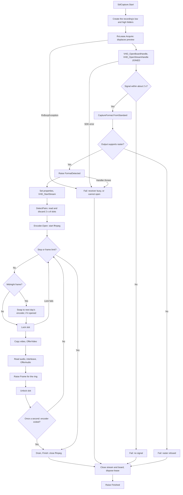
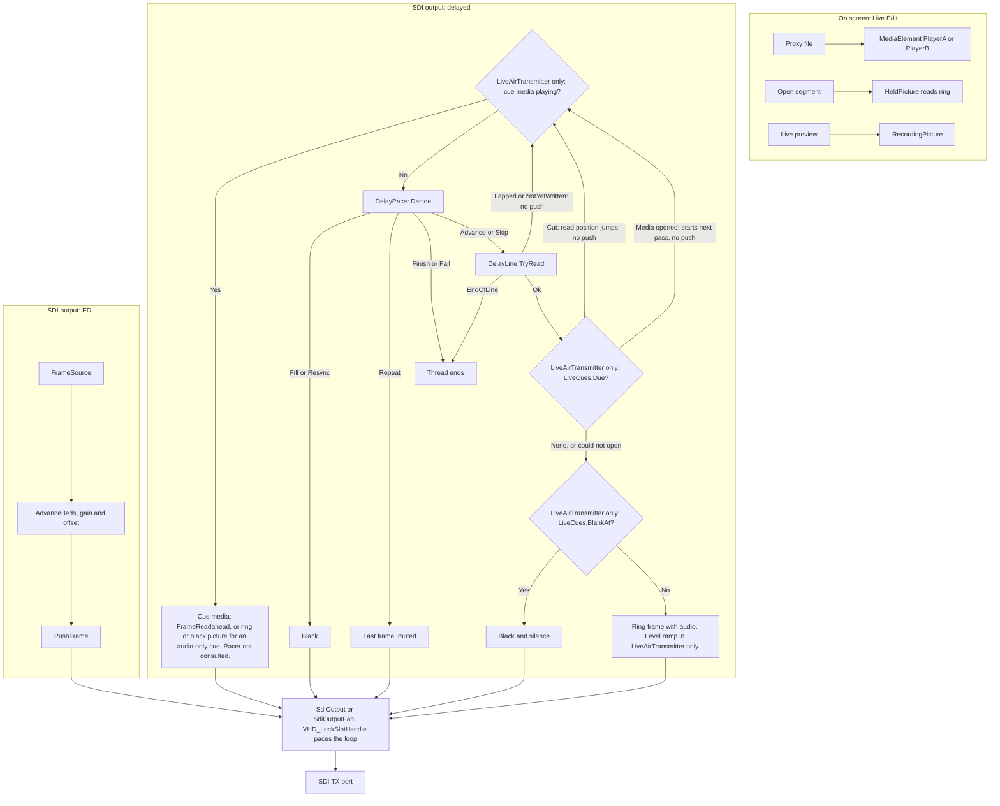
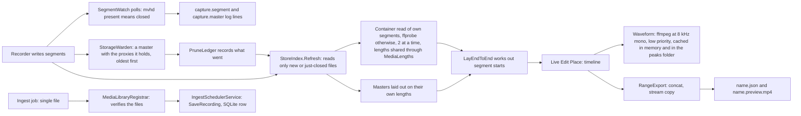

# 5. Video and media processing

Line references are to commit `dd8e4a7`. Unless stated, nothing here was measured on hardware: figures are read or calculated from the code.

## Inputs and outputs

| Direction | Source or destination | Format |
|---|---|---|
| In | SDI receiver | UYVY 8-bit 4:2:2 plus embedded audio |
| In | Media files, through ffmpeg | Anything ffmpeg reads, conformed to the output format |
| In | Audio bed files, through ffmpeg | Playout and cues: 48 kHz stereo after conversion. Recording: encoded at the file's own channel count, and its own rate unless a non-48 kHz output rate is chosen. |
| Out | SDI transmitter | 1080p UYVY plus embedded audio |
| Out | `low\` | H.264 and AAC in MP4 |
| Out | `high\` | DNxHD 145 and AAC in MOV |
| Out | Speakers | 48 kHz stereo, monitoring only |

**There is no network streaming.** No RTMP, SRT, HLS, NDI or similar code exists. "Streaming" in this project means SDI stream handles on the card. The only network output is the [read-only monitoring page](07_API_AND_COMMUNICATION.md), which carries status text and no media.

## Recording flowchart



## Capture in order

`SdiCapture.Run`, `src/Emerald.Video/SdiCapture.cs:194`:

1. **Folders** (`:215`). Created by hand, because ffmpeg's segment muxer does not create directories.
2. **Lease** (`:231`). `RxLease.Acquire(board, rx, "recording")`.
3. **Open** (`:239`). Board and stream with `VHD_SDI_STPROC_JOINED`, so slots carry audio. Error 18 becomes "already open in another application - close dCARE".
4. **Detect** (`:262`). Up to 20 tries, 100 ms apart.
5. **Format** (`:277`, table at `:1098`). Unknown standards are assumed to be 1920x1080.
6. **Raster check** (`:284`). DNxHD accepts 1920x1080, 1440x1080 and 1280x720, so PAL and NTSC are refused.
7. **`FormatDetected`** (`:295`), before any frame.
8. **Properties** (`:298`). YUV422_8, slaved transfer, queue depth 4, 2000 ms IO timeout.
9. **Audio pairs** (`:321`). `DetectPairs` reads slots for a full 2 seconds and discards them. The count fixes the encoder's channel layout.
10. **Encoder** (`:345`).
11. **Slot loop** (`:392`):
    - Lock a slot. On failure, count it and `continue`. If no frame has arrived more than 3 seconds after the loop began, `Fail` is called once ("no slots arriving"). This sets `LastError`, so the recording reports as failed even if frames arrive later. After the first frame, lock failures are silent.
    - Copy the video into a new array (`:471`), and call `encoder.OfferVideo`. A refusal is a dropped frame.
    - Convert a preview if due, and raise `PreviewFrame`.
    - If the pipe is attached or anything subscribes to `Frame` or `Audio`: read and interleave audio, raise `Audio` with the reader, then substitute silence if the slot was empty. `OfferAudio` runs only once ffmpeg has attached the pipe. Slots before that are paid back later, up to 3 a slot, by repeating the current chunk.
    - Raise `Frame` with video, audio and frame number.
    - Unlock.
    - Once a second: update `PipelineState` and check `Ffmpeg.HasExited`.
    - At most once per 5 s: log drops and add a `DropMark`. Every 30 s: log a `REC` line.
12. **Finish** (`:646`). Drain, report the closing lip-sync figure, then `finally` closes everything and raises `Finished` last.

### Encoder pipes

`SdiCapture.Encoder` (`:780`) is one ffmpeg with two inputs:

| Input | Transport | Writer thread | Queue |
|---|---|---|---|
| Video | ffmpeg stdin, raw UYVY | `capture video writer` | 8 frames |
| Audio | Named pipe `\\.\pipe\edlcap_<pid>_<guid>`, raw PCM | `capture audio writer` | 200 chunks |

**Why two threads and two transports:**

- A process has one stdin.
- ffmpeg opens input 1 only after identifying input 0, so waiting for the pipe connection first would deadlock.
- ffmpeg will not drain more video until it has matching audio, so one writer thread would also deadlock.

**Lip sync.** The pipes carry no timestamps. Alignment is only "how many of each were written". `CaptureSync.AudioChunksDue` (`src/Emerald.Core/CaptureSync.cs`) allows audio only up to the video count, catching up by at most 3 chunks a slot. So a dropped picture drops its sound.

### Audio capture

`SdiAudioReader` asks the card for up to 16 mono channels, at 48 kHz in 16-bit samples, and interleaves them. A failed read steps the request down from 16 to 12, 8, 4, then 2. The encoder gets `pairs × 2` channels, with each pair split into its own AAC track by the filter graph when there is more than one. See [hardware](06_HARDWARE_INTEGRATION.md#audio-on-the-wire).

## ffmpeg commands

All paths go through `ProcessStartInfo.ArgumentList`, so there is no shell quoting. `Ffmpeg.Locate` (`src/Emerald.Video/Ffmpeg.cs:16`) searches the configured path, then beside the executable, then `PATH`, then `C:\ffmpeg\bin`, then `C:\Program Files\ffmpeg\bin`.

### Recording

Built by `RecordingProfile.EncoderArguments`, `src/Emerald.Video/RecordingProfile.cs:274`.

Inputs:

```
-hide_banner -loglevel error -nostdin
-f rawvideo -pix_fmt uyvy422 -s {W}x{H} -r {FrameRate} -i pipe:0
-f s16le -ar {inputSampleRate} -ac {pairs*2} -i \\.\pipe\{pipeName}
-stream_loop -1 -i {bedPath}          (once per added bed)
```

Filter graph, only if needed (`:515`):

```
-filter_complex {chains joined with ;}
[1:a]pan=stereo|c0=c{p*2}|c1=c{p*2+1},asplit=2[p{p}o0][p{p}o1]     (each pair, when pairs > 1)
[{i+2}:a]{bedFilters},asplit=2[b{i}o0][b{i}o1]                      (each adjusted bed)
```

Bed filters (`:555`): `adelay={ms}:all=1` for a positive offset, `atrim=start={s},asetpts=N/SR/TB` for a negative one, `volume={gain}dB`, or `anull`.

Each output, proxy first:

```
-map 0:v:0
-map 1:a:0  or  -map [p{p}o{out}]
-map {i+2}:a:0  or  -map [b{i}o{out}]
-c:v {libx264|hevc_nvenc|h264_nvenc|hevc_qsv|h264_qsv|dnxhd}
-preset p4 -no-scenecut 1 -forced-idr 1 -rc vbr     (NVIDIA)
-preset medium                              (Intel)
-profile:v {main|high} -bf 0 -g {max(1,rate/2)}     (GPU: main for HEVC, high for H.264)
-tag:v hvc1                                 (GPU, HEVC)
-cq {30 HEVC|28 H.264} -b:v 0               (NVIDIA, automatic bitrate)
-global_quality {28 HEVC|25 H.264}          (Intel, automatic bitrate)
-b:v {k}k -maxrate {k}k -bufsize {k*2}k     (GPU, only if a bitrate is chosen)
-threads 6                                  (libx264)
-threads 8 -thread_type slice               (master)
-b:v 145M                                   (master)
-preset veryfast -profile:v high -bf 0 -g {max(1,rate/2)} -sc_threshold 0     (libx264)
-b:v {k}k -maxrate {k}k -bufsize {k*2}k     (libx264, only if a bitrate is chosen)
-pix_fmt {yuv420p|nv12|yuv422p}             (nv12 for Intel)
-c:a aac -b:a {AudioBitrateKbps}k
-ar {AudioSampleRate}                       (only if not 48000)
-metadata:s:a:{p} title=...   -disposition:a:{p} {default|0}          (each pair, only if pairs > 1 or beds exist)
-metadata:s:a:{pairs+i} title={label}   -disposition:a:{pairs+i} 0    (each bed)
-shortest                                   (only if beds exist)
-timecode {HH:MM:SS:FF}                     (single file with a start timecode)
```

Then one of three destinations:

```
-f segment -segment_time {proxy s | 300} -segment_format {mp4|mov} -reset_timestamps 1
    -segment_start_number {start} {root}\{low|high}\{folder}\{prefix}_{MMddyyHHmm}_%d.{ext}

-f {mp4|mov} {root}\{low|high}\{prefix}.{ext}       (single file, no -y, refuses to overwrite)

-f segment -segment_time {s} -segment_format {mp4|mov} -reset_timestamps 1
    -strftime 1 {root}\{low|high}\{prefix}_%Y-%m-%d_%H-%M-%S.{ext}     (legacy: no Names given; only tests reach it)
```

`{root}\low` and `{root}\high` stand for the low-res and high-res folders (`StorePaths.Low` and `StorePaths.High`, `src/Emerald.Video/StorePaths.cs`). Each can be chosen apart, on a drive of its own. `StorePaths.Under(root)` gives the old layout, `low` and `high` inside one folder, and every caller that still has one folder goes through it.

Worked example: 1080p25, one audio pair, default settings.

```
ffmpeg -hide_banner -loglevel error -nostdin -filter_threads 2
 -f rawvideo -pix_fmt uyvy422 -s 1920x1080 -r 25 -i pipe:0
 -f s16le -ar 48000 -ac 2 -i \\.\pipe\edlcap_<pid>_<guid>
 -map 0:v:0 -map 1:a:0 -c:v libx264 -threads 6 -preset veryfast -profile:v high -bf 0 -g 12 -sc_threshold 0
   -pix_fmt yuv420p -c:a aac -b:a 192k
   -f segment -segment_time 30 -segment_format mp4 -reset_timestamps 1 -segment_start_number 1
   <root>\low\<folder>\media_MMddyyHHmm_%d.mp4
 -map 0:v:0 -map 1:a:0 -c:v dnxhd -threads 8 -thread_type slice -b:v 145M -pix_fmt yuv422p -c:a aac -b:a 192k
   -f segment -segment_time 300 -segment_format mov -reset_timestamps 1 -segment_start_number 1
   <root>\high\<folder>\media_MMddyyHHmm_%d.mov
```

Why these flags:

| Flag | Reason in the code |
|---|---|
| `-threads`, `-thread_type slice`, `-filter_threads` | ffmpeg's defaults follow the CPU count. On 40 logical CPUs, the command without these limits peaked at 3,775 MB with 191 threads and dropped frames from frame 22. With them it peaked at 360 MB with 40 threads and dropped none (two 20-second runs of each, synthetic picture, no card). DNxHD output was identical by MD5. |
| `-r` on raw input | Raw video has no timestamps |
| `-g rate/2`, `-sc_threshold 0` | A keyframe every half second so the proxy seeks. The comment records an 11-second gap before this. |
| `-bf 0` | No frame reordering, for backward stepping |
| `veryfast` | Keeps CABAC and motion search, unlike `ultrafast` |
| `pan`, not `channelsplit` | The channel layout of raw PCM is a guess |
| `asplit` | A filter output can be mapped only once |
| `-reset_timestamps 1` | Each segment starts at zero |
| `-segment_time` per output | The proxy takes the deck's segment length; the master is always `RecordingProfile.MasterSegmentSeconds` (300 s). Changing the deck setting never changes the master. |
| No `-strftime` on segments | Under it `%d` means day of month, so every segment overwrites one file (`src/Emerald.Core/RecordingSequence.cs:27`) |

### Decoding for air

`FrameSource.Open`, `src/Emerald.Video/FrameSource.cs:67`:

```
-hide_banner -loglevel error -nostdin
[-accurate_seek -ss {seconds:F3}]
-threads 4 -i {mediaPath} -an
-vf [setpts=PTS/{speed},]scale={W}:{H}:force_original_aspect_ratio=decrease,pad={W}:{H}:(ow-iw)/2:(oh-ih)/2:color=black,fps={rate}
-pix_fmt uyvy422 -f rawvideo pipe:1
```

This letterboxes, conforms the rate and drops audio. There is no deinterlacer in the chain.

`AudioSource.Open`, `src/Emerald.Video/AudioSource.cs:96`:

```
-hide_banner -loglevel error -nostdin
[-ss {seconds:F3}]
-i {mediaPath}
[-af {atempo=2,...|atempo=0.5,...}atempo={rest}]          (chained above 2 or below 0.5)
[-map 0:a:{streamIndex}]
-vn -ar 48000 -ac 2 -f s16le pipe:1
```

`AudioSource` keeps a rolling 3-second buffer per channel and decodes up to 1.5 seconds ahead. `ReadFrame` takes a position **in samples** and returns silence for anything not decoded, so a live offset change needs no ffmpeg restart.

### Other commands

| Purpose | Location | Arguments |
|---|---|---|
| Probe | `src/Emerald.Media/MediaProbe.cs:170` | `ffprobe -v error -print_format json -show_format -show_streams {path}` |
| Export (below-normal CPU, very low disk priority) | `src/Emerald.Media/RangeExport.cs:165` | `ffmpeg -hide_banner -loglevel error -nostdin -y -f concat -safe 0 -i {list} -ss {from} -t {length} -c copy -avoid_negative_ts make_zero {output}` |
| Export preview (the same priorities) | `src/Emerald.Media/RangeExport.cs:299` | `ffmpeg -hide_banner -loglevel error -nostdin -y -i {export} -c:v libx264 -preset veryfast -profile:v high -crf 20 -pix_fmt yuv420p -bf 0 -g {max(1,rate/2)} -sc_threshold 0 -c:a aac -b:a 192k {name}.preview.mp4` |
| Waveform (the same priorities; one at a time; cached on disk) | `src/Emerald.Media/Waveform.cs:123` | `ffmpeg -v error -nostdin -i {path} -vn -ac 1 -ar 8000 -f s16le -acodec pcm_s16le -` |
| Thumbnail | `src/Emerald.App/ClipThumbnails.cs:73` | `ffmpeg -hide_banner -loglevel error -nostdin -y -threads 2 -ss 1 -i {clip} -frames:v 1 -vf scale=294:-1 {cache}.png` |

**Listing the store.** `MediaLibrary.List` does not start ffprobe for the recorder's own segments. `MediaCodec.ReadSegment` reads the same facts from the container when the file has one H.264 or HEVC video track and at most one AAC track. Anything else, including a recording with several audio tracks, a timecode track, a file outside a recording folder or the segment still being written, goes to ffprobe. Measured on a store of 686 proxies during a recording: a fresh process listed it in about 0.3 s, against 10.9 s before, and the 685 closed segments gave the same fields and lengths as ffprobe. The disk cache was already warm for the after figures. A file deleted during a listing is now skipped. Before, it ended the listing, and on a store at its size limit the first listing could come back empty.

**Reading the store gently.** The recording drive is often one spinning disk, where more readers mean more seeking, not more speed. So:

- `StoreIndex` opens 2 files at a time (it was 6).
- `MediaLengths` (`src/Emerald.Media/MediaLengths.cs`) reads each finished file's picture length once for the whole app, keyed on path, length and write time. `StoreIndex` and `StorageWarden` share it, so a master is not opened twice.
- `BackgroundPriority.Apply` (`src/Emerald.Core/BackgroundPriority.cs`) puts the waveform, export and export-preview ffmpegs at below-normal CPU priority and very low I/O priority (`NtSetInformationProcess`, `ProcessIoPriority` 0). Windows then serves the recorder's writes first. It is best effort, and never used for anything that feeds the air.
- Waveforms are kept on disk once read. See [waveforms](#waveforms).

### Waveforms

`src/Emerald.Media/Waveform.cs`. A waveform is read by decoding a whole file's sound, which reads the whole file.

- **Disk cache.** `<data folder>\peaks\`, one `.peaks` file per file, named by a hash of its path, length and write time. 50 peaks a second, one byte a peak, so a 30-second segment is about 1.5 KB. A file that changes is read again.
- **Kept while used.** Reading a cached waveform touches the file. `SweepCache` runs at startup and deletes `.peaks` files not used for `max(30, logRetentionDays)` days.
- **One at a time.** Live Edit runs one waveform ffmpeg at a time (it was two).
- **Overlays.** An overlay's waveform is read from its `.preview.mp4` when there is one, not from a DNxHD export of gigabytes.

## Recording profile

`src/Emerald.Video/RecordingProfile.cs:99`. One ffmpeg writes both outputs in one pass.

| | `LowRes`, proxy | `HighRes`, master |
|---|---|---|
| Folder and container | Low-res folder (`low` in the old layout), MP4 | High-res folder (`high` in the old layout), MOV |
| Video | H.264 High or HEVC Main, 4:2:0, **full raster**, on the video card or the CPU | dnxhd, 145 Mb/s, yuv422p, always on the CPU |
| Audio | AAC | AAC |

**Proxy encoder.** The Capture deck's **Proxy encoder** setting (`recordingGpuProxy`) offers *Auto (GPU if installed)*, the default on every installation, and *CPU only*. `GpuEncoder.Choose` settles the encoder once per recording, before the receiver stream starts, and the encoder started for the next day's folder uses the same choice. It takes these steps:

1. Read the display adapters from the registry and pick out NVIDIA and Intel. On a machine with both, NVIDIA is tried first.
2. Ask Media Foundation for an HEVC decoder. Without one, HEVC isn't tried, because every viewer in the application plays the proxy through `MediaElement`.
3. Try each candidate in order with two black frames and the recording's own options: HEVC then H.264. The first that works is used.
4. If none works, or no card is found, use `libx264`.

The log line that starts `Capture: proxy on` gives the encoder and the reason.

- **This plant today: `libx264`.** The RTX 3060 is found, but the installed ffmpeg (2026-07-23 build) needs NVIDIA driver 610 or newer and the driver is 560.94. After a driver update it would choose H.264 on the card.
- **HEVC can't be played here.** Media Foundation reports 0 HEVC decoders, and `MediaElement` fails on an HEVC proxy with "Cannot find the media file". An installed decoder is what would make HEVC eligible. Store-packaged decoders are not counted, so one may be missed. That leaves the proxy on H.264, which plays. Playback of an HEVC proxy with a decoder installed has not been tested.
- **Intel has not been run.** This plant has no Intel graphics. The Quick Sync options, quality values and keyframe spacing are untested, and only the failure path has been seen ("Error creating a MFX session"), which falls through as intended.
- **AMD** cards are not used. The proxy goes on the CPU.
- **ffmpeg 6.1.1 can't record here.** With the 8-frame queue it stops taking frames after about 10, with any encoder, because it waits for more audio than the recorder sends. It was used only to measure NVENC, with `-probesize 32 -analyzeduration 0` added on the audio input.
- **Measured.** Recorder's arguments under ffmpeg 6.1.1, synthetic picture, 20 s runs at 1080p25, 0 frames dropped in all of them: `libx264` about 5.3 cores and 361 MB; `h264_nvenc` about 2.4 cores and 435 MB; `hevc_nvenc` about 2.4 cores and 418 MB.
- **Size and quality.** On real 10-second segments, against `libx264` at 3,601 kb/s on the same 4 segments (SSIM 0.9892 on average): `h264_nvenc` at level 28 was 3,427 kb/s (0.9899), and `hevc_nvenc` at level 30 was 2,672 kb/s (0.9884). HEVC saves less than usual here because the proxy has no B-frames and a keyframe every half second.
- **Risk.** Both files come from one ffmpeg, so a GPU fault that ends that process stops both, the same as any other encoder exit. This has not been tested. *CPU only* removes that dependency.

Defaults: automatic proxy bitrate, 192 kb/s audio, 48 kHz, 30-second proxy segments, 5-minute master segments. Choices are limited to lists (`:166`), so an unlisted value in settings falls back to the default and never reaches ffmpeg:

| Setting | Offered values |
|---|---|
| Proxy bitrate | Auto (0), 1500, 3000, 5000, 8000 kb/s |
| Audio bitrate | 128, 192, 256, 320 kb/s |
| Sample rate | 48000, 44100, 32000 Hz |
| Proxy segment length | 10, 15, 30, 60, 120, 300 s. 600 was removed so a proxy is never longer than a master; a saved 600 falls back to 30. The master is fixed at 300 s. |

A title of `capture` silently becomes `media` (`RecordingSequence.cs:65`). `SanitisePrefix` replaces invalid characters and `%`, and caps the prefix at 60 characters.

## File segmentation

- Each recording has a folder stamped `yyyy-MM-dd_HH-mm-ss` when Record was pressed.
- Files are `<prefix>_<MMddyyHHmm>_<N>`, where N starts at 1 per folder and is not padded.
- A segment's position on the timeline is the folder's start plus the length of the segments before it, worked out by `StoreIndex.LayEndToEnd` (`src/Emerald.Media/StoreIndex.cs`). Proxies and masters are each laid out on their own lengths.
- **Master and proxy are cut at different lengths.** The master runs 5 minutes and the proxy 10 s to 5 min, so one master holds several proxies, and a proxy can straddle two masters. A proxy is given the masters its span of the clock falls in (`CapturedClip.Masters`). Recordings made when both were cut alike still pair one to one, because that is the same rule.
- **Why the split.** The proxy is cut short so the newest material can be played soon after it is recorded. The master is only read by an export, which can wait. Cut at the proxy's length, a 10 s proxy also meant 8,640 masters a day, each listed and tracked.
- The newest master is open for up to 5 minutes. While it is, `HasMaster` is false for the proxies inside it and the Capture Media list says "master in-progress".

An open segment has no index until it closes, so the player cannot read it. `HeldPicture` covers that gap from the ring.

## Midnight rollover

Segmented recordings only (`src/Emerald.Video/SdiCapture.cs:375`, `:395`).

- `RecordingSequence.FramesToNextDay` computes the frame at which folder start plus frames recorded reaches 00:00:00.
- Ten seconds ahead, `OpenForDay` starts the next encoder on a task, because starting ffmpeg on the slot loop would cost frames.
- At that frame, `encoder` swaps, `old.Finish` runs on a task, and `Rolled` is raised.
- The new folder is `yyyy-MM-dd_00-00-00` and numbering restarts at 1.
- The receiver, frame count and rings carry on.
- If `OpenForDay` fails, `capture.rollfailed` is logged and the recording stays in the old folder until the next midnight.

The count starts from the folder stamp, while frame 0 comes at least 2 seconds later because of `DetectPairs`. So the new folder's "00:00:00" picture is captured at least 2 seconds after real midnight. The timeline stays self-consistent but sits behind the station clock. This is a [verified issue](11_TECHNICAL_ASSESSMENT.md).

## Delay line

A ring of raw frames in a memory-mapped file: `src/Emerald.Video/DelayLine.cs`.

- **Location:** `tidalLockRingFolder`, default `%LOCALAPPDATA%\Emerald\delay`, named `tidal-<pid>-<guid>.ring`. A folder on the same drive as either recording folder is refused: `App.TidalLockRingFolder` uses the default instead and logs `delay.samedisk` once (unless the default is on that drive too).
- **Write load:** while a delay is held the ring takes roughly 80 to 100 MB/s of writes (measured on the plant machine, 420 s ready line on C:). That is inherent to holding that much picture. Only a shorter delay and headroom, or **Delay ready** Off, reduce it. Creating the ring takes milliseconds: it does not zero-fill the file first (tested).
- **Memory:** about 4 s of the ring stays in the working set, plus up to 15 s for a reader close behind the writer. A flusher thread writes the ring to its file half a second behind the writer, so nothing piles up as dirty memory, and a transmitter a delay behind reads its frames back from the standby cache. `FlushedThrough` and the Memory gauge "ring not yet on disk" show how far behind the disk is.
- **Disk:** the ring file is sparse (`FSCTL_SET_SPARSE`), so it takes disk only for the frames it holds, not its whole length. The flusher thread gives back the space of frames nothing will read again (`ReleaseBehind`, `FSCTL_SET_ZERO_DATA`): everything older than the line's keep distance plus 2 s, but never at or past a transmitter's `DelayHold` (each transmitter holds its read position, including while it plays an insert), never a frame not yet written to disk, and never within 5 s of the writer's next slots. A line keeps its delay (`TargetFrames`); the ready line keeps only the longest delay a transmitter could start with (`ShellWindow.ReadyKeepFrames`: the larger of `liveDelaySeconds`, the deck's delay and Live Edit's resolved delay), not the headroom for inserts. A read of a given-back frame is `Lapped`. At the default 120 s delay with 300 s headroom the ready line takes about 13 GB of C: instead of 41 GB; while Live Edit holds the picture back for inserts it grows by what is held, and shrinks again after. Free space for the whole length is still checked when the ring is made (`Validate`). Measured with a 1080p25 ring on C: (10 s delay, 50 s headroom, 6.2 GB long): about 1.2 to 1.4 GB on disk, flat, every read correct.
- **Layout:** 4096-byte header with magic `EMLDLY01`, then slots at `header + seq % SlotCount * stride`. Each slot has a 64-byte header, video and audio.
- **Audio capacity:** four frames of stereo.
- **Free-space guard:** requires size plus 2,000,000,000 bytes, for the whole length, although a sparse ring takes much less.

Sizes at 1080p25 (stride 4,182,016 bytes, 50 guard slots):

| Holds | Slots | File size |
|---|---|---|
| 60 s | 1,550 | 6.04 GiB |
| 120 s | 3,050 | 11.9 GiB |
| 300 s | 7,550 | 29.4 GiB |
| 420 s (default ready ring) | 10,550 | 41.1 GiB |

**Writing.** `Offer` runs on the capture thread and never waits: a full 8-frame queue counts as a drop. The `tidal delay writer` thread sets the slot's sequence to -1, copies the data and writes the sequence last.

**Reading.** `TryRead` (`:524`) is lock-free. It checks the sequence, copies into the caller's buffer, applies a memory barrier and re-checks. A mismatch means the frame was overwritten during the read (`Lapped`).

**Pacing.** `DelayPacer.Decide` (`src/Emerald.Video/DelayPacer.cs:65`) is a pure function evaluated in this order:

| # | Condition | Action |
|---|---|---|
| 1 | Sealed and read at or past the end | Finish |
| 2 | Writer has lapped the reader | Resync |
| 3 | Nothing to read, not sealed, stalled 10 s | Fail |
| 4 | Nothing to read otherwise | Fill if below target, else Repeat |
| 5 | Written below target | Fill |
| 6 | Lag above target plus deadband | Skip |
| 7 | Lag below target minus deadband | Repeat |
| 8 | Otherwise | Advance |

The deadband is half a second of frames, at least 1.

Rules 1, 3 and 4 are reached in steady state only when the target is at or below the deadband. With a longer delay, once `written` stops, rule 7 returns Repeat before the reader arrives at the end, so the line neither finishes nor fails. See [A2](11_TECHNICAL_ASSESSMENT.md). `StalledMs` is 0 until the first frame is written, so a line that never receives a frame does not fail either.

**Which formats:** `DelayFormats.TryMatch` allows only progressive 1080 at standards 0, 1, 8, 9 and 10, because there is no scaler in this path.

## Playback and output flowchart



The transmitters use no software timer. `PushFrame` blocks until the card frees a slot, and that is what paces the loop.

### DelayTransmitter

`src/Emerald.Video/DelayTransmitter.cs`. Startup sets `readSeq = max(0, written - target)`, so a ring already holding the delay goes straight to air. Each pass acts on the pacer's decision, as in the flowchart. Each time another second's worth of frames has gone out, it publishes frame counts and, at most once per 5 s, logs `delay.trouble` and adds a `DropMark` for repeats or skips since the last line. Nothing is published while it is sending only fill or repeats.

### LiveAirTransmitter

`src/Emerald.Video/LiveAirTransmitter.cs`. It has the same pacing loop. It does not publish to `PipelineState`, log `delay.trouble`, add a `DropMark` or announce segments, so its repeats and skips reach only `Counters`. It also refuses to start on a failed port hold, and adds:

- **A moving target.** Inserts add to it, cuts subtract.
- **The EDL.** `CuesForAir` is read at the top of every pass, even while filling. That read is the acknowledgement.
- **Cues.** `LiveCues.Due` chooses. Replace, overlay and fit-to-fill consume the ring underneath, while insert does not, so the recording waits.
- **Preparation.** `Prepare` opens decoders 6 seconds ahead on tasks. `PreRolled` waits for half a second of decoded frames.
- **Blanks.** `LiveCues.BlankAt` is checked on every frame against the newest list, so a changed end takes effect on the next frame.
- **Levels.** A per-frame linear gain ramp from `AudioEdits`.

### PlayoutService

See [the EDL workflow](04_SYSTEM_WORKFLOW.md#edl-generator-composing-and-playing-out).

## Media processing workflow



Export uses masters only if every segment in the range has one, otherwise proxies. DNxHD is all-intra, so a master export is frame-exact. A proxy export starts at a keyframe.

- **Masters are cut at their own offsets.** `RangePlan.FromMasters` plans the cut on the recording's masters as laid out on the clock, narrowed to the span its proxies cover.
- **An open master is waited for.** If the range reaches into the master still being written, Live Edit waits for it to close (at most 5 minutes) and then cuts from it. See [the Live Edit guide](13_LIVE_EDIT_GUIDE.md#export-a-range).
- **The capture deck announces proxies and masters apart.** `SegmentWatch` reports a proxy as soon as it closes (`capture.segment`) and a master when it closes (`capture.master`). A proxy no longer waits for a master.

## Timecode handling

- **Station clock:** `TimecodeService` polls every 500 ms and free-wheels on a `Stopwatch` between polls. Small errors correct at most 1 frame per poll. Larger ones snap.
- **No timecode travels with frames.** Ring slots carry a frame number. Segments have no timecode track; they are placed from the folder name.
- **Single-file ingest** writes `-timecode` from the job's SOM.
- **Drop-frame is not implemented.** 29.97 is treated as 30.

## Buffering

At 1080p25:

| Stage | Depth | Reference |
|---|---|---|
| RX card slots | 4 | `src/Emerald.Video/SdiCapture.cs:303` |
| Encoder video queue | 8 frames, 320 ms | `src/Emerald.Video/SdiCapture.cs:28` |
| Encoder audio queue | 200 chunks, 8 s | `src/Emerald.Video/SdiCapture.cs:29` |
| Ring hand-off queue | 8 frames | `src/Emerald.Video/DelayLine.cs:205` |
| Ring | Delay + headroom + guard | `src/Emerald.Video/DelayLine.cs:120` |
| Cue video read-ahead | 1 s plus 2 buffers | `src/Emerald.Video/LiveAirTransmitter.cs:612` |
| Cue and bed audio | Up to 1.5 s ahead in 3 s | `src/Emerald.Video/AudioSource.cs:29` |
| TX card slots | 4 | `src/Emerald.Deltacast/SdiOutput.cs:12` |
| Speakers | 2 queued, of 8 buffers | `src/Emerald.Video/SpeakerOutput.cs:30` |

## Synchronisation

| Where | How audio and video stay together |
|---|---|
| Recording | Equal counts of frames and audio chunks per encoder |
| Ring | A slot holds both, so sync is structural. A skip loses both and a repeat is mute. |
| Cues | Separate decoders. The position passed to `ReadFrame` has a [verified fault](11_TECHNICAL_ASSESSMENT.md). |
| Playout | Picture and each bed advance frame by frame on one thread |
| Speakers | Queue depth is capped at 80 ms, dropping when the clocks drift |

## Error recovery

| Stage | Failure | Behaviour |
|---|---|---|
| Setup | Bad folder, ffmpeg or bed | Sentence, nothing opened |
| RX open | Lease, handle, no signal, raster | `Fail` and return |
| Slot lock | Timeout | Retry until stopped. Before the first frame and after 3 s, one `Fail`, which marks the result failed. After the first frame, silent. |
| Encoder slow | Queue full | Frame and its audio dropped, logged, recording continues |
| Encoder stalled | No frame taken for 10 s, process still alive (for example a full disk) | `EncoderWatch` raises one error with ffmpeg's last message. The recording is not stopped, so the delay line and anything on air carry on. Said again when frames are taken. |
| Disk low | Under 10 GB free, checked every 30 s on both recording drives; the one with less room is reported | One warning, repeated only if the space returns and goes again |
| Encoder dead | Process exit | Detected within about a second of frames, recording stops, no restart |
| Midnight encoder | Open fails | Stays in old folder, tries again next midnight |
| Ring create | No space or IO | `DelayLineException`, lock fails, recording continues |
| Ring write | Exception | `Fault` set, ring seals, recording continues |
| TX underrun | Receiver stops | Delay of 0.5 s or less: the reader catches the writer, mute repeat, Fail after 10 s stalled. Longer delay: plays on until lag falls half a second below target, then mute repeat indefinitely. Fail is not reached. |
| TX lapped | Overwritten | Resync, one black frame |
| TX card | Push fails | Thread ends, no restart |
| Cue open | Throw or null | Logged, the recording carries on |
| Cue decode slow | | Hold last frame, muted, insert target grows by one |
| Bed file bad, playout or cue | | Silence, `playout.audiofailed` |
| Bed file missing, recording | | Sentence at setup, nothing opened |
| Bed file present but unreadable, recording | | ffmpeg exits: as "Encoder dead" |
