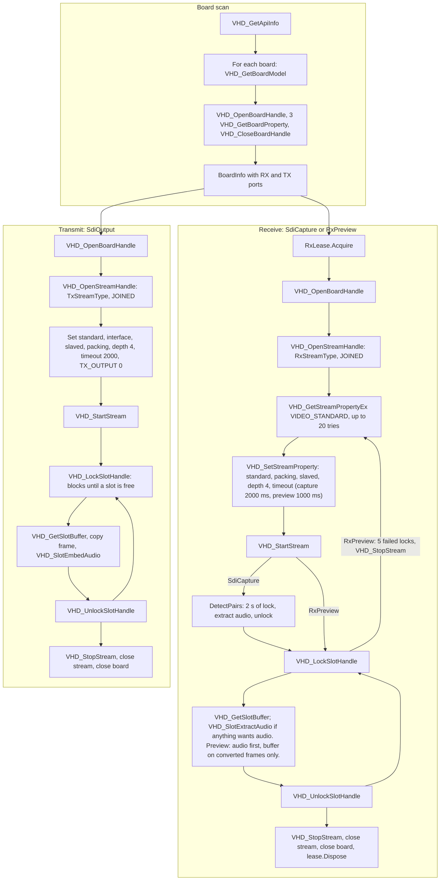
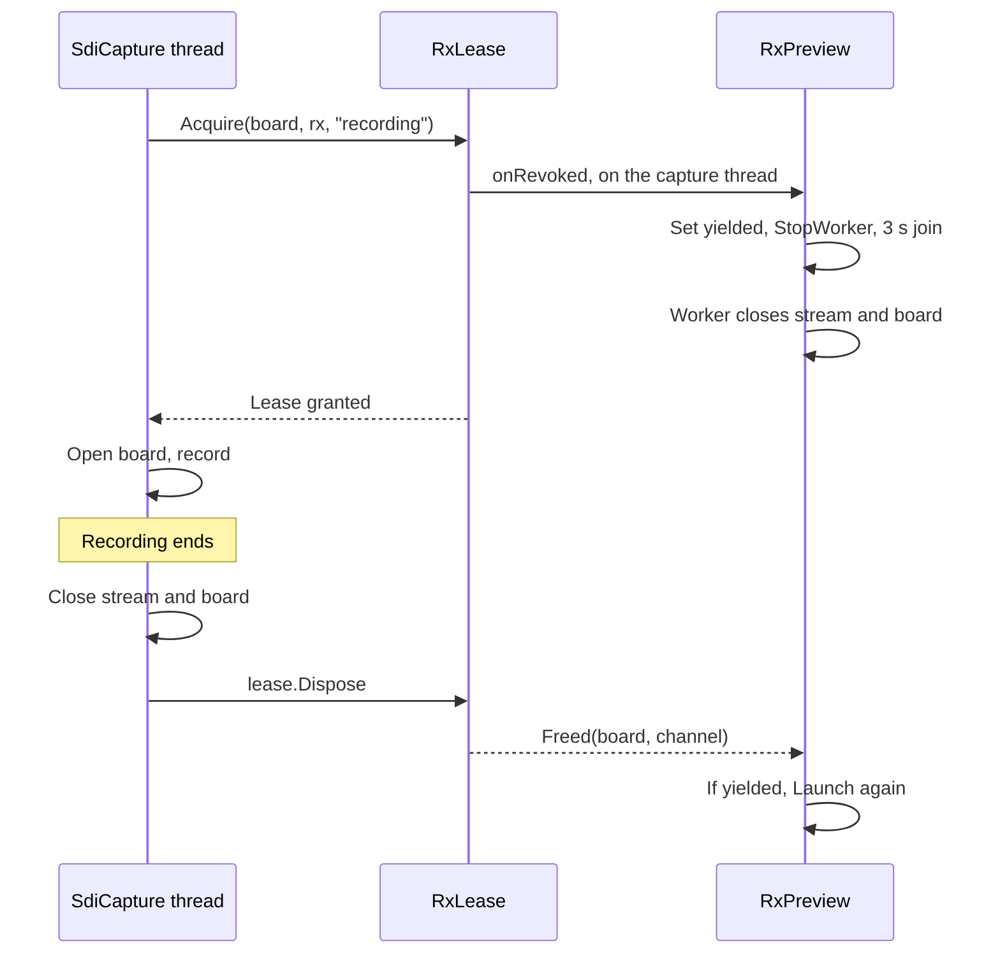

# 6. Hardware integration

Line references are to commit `dd8e4a7`. **No DELTACAST SDK headers are in this repository.** Numeric values are as written in the code. SDK behaviour is marked "Not verified" unless the code states it, and nothing here was run on a card for this document.

## Devices and SDK

| Item | Detail | Evidence |
|---|---|---|
| Vendor SDK | DELTACAST VideoMaster | `src/Emerald.Deltacast/VideoMasterHD.cs:13` |
| Video library | `VideoMasterHD.dll`, installed in `System32` by DELTACAST's own driver installer | `installer/READ-ME-FIRST.txt` |
| Audio library | `VideoMasterHD_Audio.dll`, used for two calls. Its install location: Not verified. `install.bat` checks only the video DLL. | `src/Emerald.Deltacast/VideoMasterHD.cs:166` |
| Binding | Plain `DllImport` by name, StdCall | `src/Emerald.Deltacast/VideoMasterHD.cs:121` |
| Bitness | x64 only. `BadImageFormatException` is translated to a sentence. | `src/Emerald.Deltacast/BoardService.cs:34` |
| Models named | `DELTA-3G-elp-d 22`, `DELTA-3G-elp-h-22`, `DELTA-12G-elp-h-20` | `src/Emerald.Deltacast/BoardInfo.cs:12`, `src/Emerald.Ingest/Services/IngestHardware.cs:63` |
| Other tool | dCARE, DELTACAST's utility. It must be closed to free a receiver. | `src/Emerald.Deltacast/RxLease.cs:14` |

Board types known to `VideoMasterHD.BoardTypeName`: 0 DELTA-hd, 5 Mixed interfaces, 6 DELTA-3G, 7 DELTA-key 3G, 8 DELTA-h4k, 10 DELTA-asi, 11 DELTA-ip, 12 DELTA-h4k2, 13 FLEX-dp, 14 FLEX-sdi, 15 DELTA-12G, 16 FLEX-hmi.

The readme says the DELTA-12G-elp-h 20 has 8 RX. The ingest simulator gives it 4 RX. Not verified which is right.

## RX and TX workflow

## P/Invoke surface

`src/Emerald.Deltacast/VideoMasterHD.cs:121-173`. Only `BoardService`, `SdiOutput`, `SdiCapture`, `RxPreview` and `SdiAudioReader` call the SDK.

| Import | Purpose, from how it's used | Callers |
|---|---|---|
| `VHD_GetApiInfo` | API version and board count | `BoardService` |
| `VHD_GetBoardModel` | Model string | `GetBoardModelString` |
| `VHD_OpenBoardHandle`, `VHD_CloseBoardHandle` | Open and close a board | `BoardService`, `SdiOutput`, `SdiCapture`, `RxPreview` |
| `VHD_GetBoardProperty` | Type and channel counts | `BoardService` |
| `VHD_OpenStreamHandle`, `VHD_CloseStreamHandle` | Open and close an RX or TX stream | `SdiOutput`, `SdiCapture`, `RxPreview` |
| `VHD_SetStreamProperty` | Configure a stream | `SdiOutput`, `SdiCapture`, `RxPreview` |
| `VHD_GetStreamProperty` | Slot counters | `SdiOutput.SlotCounters`, which has no callers |
| `VHD_GetStreamPropertyEx` | Signal and standard detection | `SdiCapture`, `RxPreview` |
| `VHD_StartStream`, `VHD_StopStream` | Run and stop | `SdiOutput`, `SdiCapture`, `RxPreview` |
| `VHD_LockSlotHandle`, `VHD_UnlockSlotHandle` | Take and return one frame slot | `SdiOutput`, `SdiCapture`, `RxPreview` |
| `VHD_GetSlotBuffer` | Video buffer of a slot | `SdiOutput`, `SdiCapture`, `RxPreview` |
| `VHD_SlotEmbedAudio` (audio DLL) | Embed audio into a TX slot | `SdiOutput` |
| `VHD_SlotExtractAudio` (audio DLL) | Extract audio from an RX slot | `SdiAudioReader` |

Not imported: `VHD_SetBoardProperty`, any event-based API, direct ANC access.

## Constants

Bases: `EnumBaseCore = 0x01000000`, `EnumBaseSdi = 0x02000000` (`src/Emerald.Deltacast/VideoMasterHD.cs:15-77`).

| Group | Values |
|---|---|
| Board properties | `BOARD_TYPE` Core+4, `NB_RXCHANNELS` Core+13, `NB_TXCHANNELS` Core+14 |
| Stream properties | `TRANSFER_SCHEME` +2, `IO_TIMEOUT` +3, `TX_OUTPUT` +4, `SLOTS_COUNT` +5, `SLOTS_DROPPED` +6, `BUFFERQUEUE_DEPTH` +7, `BUFFER_PACKING` +10 |
| SDI properties | `VIDEO_STANDARD` Sdi+1, `INTERFACE` Sdi+5 |
| Processing | `VHD_SDI_STPROC_JOINED` Sdi+1 (always used), `DISJOINED_VIDEO` Sdi+2 (unused) |
| Audio | `VHD_AM_OFF` 0, `VHD_AM_MONO` 1, `VHD_AF_16` 1 |
| Other | `VHD_TRANSFER_SLAVED` 1, `VHD_BUFPACK_VIDEO_YUV422_8` 0, `VHD_SDI_BT_VIDEO` 0 |
| Errors | `VHDERR_NOERROR` 0. Code 18 is hard-coded as "channel in use". |

Stream types are not contiguous, so they are a table:

| Channel | 0 | 1 | 2 | 3 | 4 | 5 | 6 | 7 | 8 | 9 | 10 | 11 |
|---|---|---|---|---|---|---|---|---|---|---|---|---|
| TX | 2 | 3 | 11 | 12 | 33 | 34 | 35 | 36 | 48 | 49 | 50 | 51 |
| RX | 0 | 1 | 9 | 10 | 20 | 21 | 22 | 23 | 44 | 45 | 46 | 47 |

`MaxChannels` is 12. Channels past that throw `ArgumentOutOfRangeException`. The scan warns and filters them out of the port lists, so this is not normally reachable from the UI.

## Device initialisation

`BoardService.Scan` (`src/Emerald.Deltacast/BoardService.cs:18`), with `ScanAsync` wrapping it in a task:

1. `VHD_GetApiInfo`. A missing DLL, wrong bitness or SDK error becomes a sentence.
2. Zero boards returns "No DELTACAST board detected on this system."
3. For each board, read the model, open it, read 3 properties, close it. A board that cannot be opened stays listed with 0 RX and 0 TX, plus a warning.

There is no shared board handle. The scan, each `SdiOutput`, `SdiCapture` and `RxPreview` each open their own, so a fan of N ports holds N handles. All close in `finally` or `Dispose`, stream before board.

## Receive

Used by `SdiCapture.Run` (thread `SDI capture`) and `RxPreview.Run` (thread `RX preview`).

**Signal detection.** Up to 20 calls of `VHD_GetStreamPropertyEx(VIDEO_STANDARD, allowSignalDetection=1)`, 100 ms apart. Capture then fails with "no signal on RXn after 2s". Preview keeps trying and reports "No signal on RXn." once per dark period.

Only the standard is detected. The interface is never read on RX. There is no clock-divisor property, so 1080p30 and 29.97 cannot be told apart in this layer.

| Standard | Name | Raster | Rate |
|---|---|---|---|
| 0 | 1080p25 | 1920x1080 | 25 |
| 1 | 1080p30 | 1920x1080 | 30 |
| 2 | 1080i50 | 1920x1080 | 25, interlaced |
| 3 | 1080i60 | 1920x1080 | 30, interlaced |
| 4 | 720p50 | 1280x720 | 50 |
| 5 | 720p60 | 1280x720 | 60 |
| 6 | PAL | 720x576 | 25 |
| 7 | NTSC | 720x486 | 30 |
| 8 | 1080p24 | 1920x1080 | 24 |
| 9 | 1080p60 | 1920x1080 | 60 |
| 10 | 1080p50 | 1920x1080 | 50 |
| other | `standard n` | 1920x1080 assumed | fallback |

Table: `CaptureFormat.FromStandard`, `src/Emerald.Video/SdiCapture.cs:1098`. `FrameBytes = W × H × 2`.

**Pixel format.** UYVY: bytes `U Y0 V Y1`. `UyvyPreview.ToBgra` converts for display using BT.709 limited range. Defaults are half size and every frame up to 50 fps. Comments elsewhere saying 4:1 and twelve frames a second are out of date.

**Preview signal loss.** Five failed locks in a row mean signal lost. The worker stops the stream and detects again on the same handle, so a format change is picked up.

**Capture signal loss** is not reported once frames have arrived. See the [assessment](11_TECHNICAL_ASSESSMENT.md).

**Relays and loopback.** No bypass or relay code exists. The board's default relay state: Not verified.

## Transmit

`SdiOutput.Open` (`src/Emerald.Deltacast/SdiOutput.cs:37`). Every step goes through `Check()`, which throws `SdiOutputException("<call> failed (error n).")`, and `Open` disposes on failure.

Output formats, `src/Emerald.Deltacast/VideoFormat.cs:34`. All are 1920x1080 at 4,147,200 bytes per frame.

| Rate | Name | Standard | Interface | Samples per frame at 48 kHz |
|---|---|---|---|---|
| 24 | 1080p24 | 8 | 2, HD-292 | 2000 |
| 30 | 1080p30 | 1 | 2, HD-292 | 1600 |
| 50 | 1080p50 | 10 | 4, 3G-A | 960 |
| 60 | 1080p60 | 9 | 4, 3G-A | 800 |
| anything else | 1080p25 | 0 | 2, HD-292 | 1920 |

`VideoFormat.ForFrameRate` silently falls back to 1080p25. `DelayFormats.TryMatch` guards against that for raw delay.

**Pacing.** `PushFrame` (`SdiOutput.cs:99`) blocks in `VHD_LockSlotHandle`. A failure, usually the 2-second IO timeout per the code comment, returns false and no caller retries.

**Pre-roll.** There is no SDK-level pre-fill. `VHD_StartStream` runs before the first frame. Pre-roll exists only in the application: `PlayoutService.WaitForCue` and `LiveAirTransmitter.PreRolled`.

**Genlock.** Nothing configures it. "Every port is on the same board and therefore the same genlock" is an assertion in a comment (`SdiOutputFan.cs:28`), with no SDK property behind it in this repository. Effective clock reference: Not verified.

**Black.** `BlackFrame` (`SdiOutput.cs:219`) is U=128, Y=16, V=128, Y=16, cached.

**Fan-out.** `SdiOutputFan` (`src/Emerald.Deltacast/SdiOutputFan.cs`) implements `ISdiOutput` over several ports on one board. `Open` is all-or-nothing. `PushFrame` goes to each in turn and fails if any port fails.

| Driver | Thread | Fan-out in use |
|---|---|---|
| `PlayoutService` | `SDI playout` | No: `TxChannels` is never set by a caller |
| `DelayTransmitter` | `tidal lock TX`, AboveNormal | Yes |
| `LiveAirTransmitter` | `live edit TX`, AboveNormal | Yes |

## Arbitration

### RxLease: a real lock, per process

`src/Emerald.Deltacast/RxLease.cs`. A static table of `(board, channel)` to the current holder.

| Holder | Claimant | Result |
|---|---|---|
| None | Any | Granted |
| Not yielding | Any | `RxBusyException` |
| Yielding | Yielding | `RxBusyException` |
| Yielding | Not yielding | Holder is displaced |

Other applications appear as SDK error 18. Across Emerald processes, the single-instance mutex is the guard.

### SdiPorts: advisory, TX only

`src/Emerald.Core/SdiPorts.cs`. "A courtesy, not a lock": the driver is the authority.

Owners are `EDL playout`, `tidal lock (board n)` and `live edit (board n)`. Only `LiveAirTransmitter` treats a failed hold as a refusal. `PlaybackWindow` and `GoLiveDialog` use it to grey out ports.

## Port selection

There is no string parsing into an index. Single-port selectors are combo boxes bound to `ChannelPort` objects from `BoardInfo`. The playback deck uses `TxPortRow` toggles and Go Live uses check boxes. In every case `.Index` is passed down. Settings store names such as `RX0` and `TX0`, with several TX names separated by `|`, restored by name match.

## Audio on the wire

- **48 kHz**, 16-bit API sample format, mono per channel. The SDI word length: Not verified.
- **Up to 16 channels:** 4 groups of 4, so 8 stereo pairs. Channel `i` maps to group `i/4`, channel `i%4`.
- **`VHD_AUDIOINFO`** is hand-built: 1600 bytes, 400 per group, channel array at offset 64, 80 per channel, with `Mode` at +0, `Format` at +4, `DataSize` at +68 and `Data` at +72. A code comment says this was verified against the SDK on a DELTA-3G.

**TX embed** (`SdiOutput.EmbedAudio`, `SdiOutput.cs:155`). `PlayoutService` puts each bed on channels `i*2` and `i*2+1`. The delay and Live Edit transmitters send one stereo pair.

**RX extract** (`SdiAudioReader`). Unused channels return full zero buffers, so a pair counts as present only if a sample is non-zero. `SdiCapture.DetectPairs` watches for 2 seconds and takes the highest count, minimum 1. The count runs from the first pair and stops at the first silent one, so audio on pairs 1 and 3 with pair 2 empty records one pair. No caller passes `audioPairs`, so pairs are always auto-detected.

**Known fault.** On feeds with more than one pair, the delay paths treat multichannel audio as stereo. See the [assessment](11_TECHNICAL_ASSESSMENT.md).

## Error handling by layer

| Layer | Condition | Result |
|---|---|---|
| Scan | DLL missing | "VideoMasterHD.dll was not found. Install the DELTACAST VideoMaster driver." |
| Scan | Wrong bitness | "...could not be loaded. The application must run as 64-bit." |
| Scan | No board | "No DELTACAST board detected on this system." |
| Scan | Board will not open | Warning, board stays listed with 0 ports |
| RX open | Error 18 | Capture: "Capture: RXn is already open in another application - close dCARE and try again." Preview: "Preview: RXn is open in another application - close dCARE to see it here." |
| RX in-process | `RxBusyException` | Non-yielding holder: "RXn on board b is in use by owner." Yielding holder and claimant: "RXn on board b is already previewing in owner." Capture prefixes "Capture: ". |
| RX no signal | At start | Capture aborts; preview waits |
| RX signal lost | Running | Preview: "Signal lost on RXn." Capture: not reported. Tidal lock: at a delay of 0.5 s or less, fails after 10 s of no frames. At any longer delay, plays on for the buffered frames until lag falls half a second below target, then holds the last frame muted until stopped. |
| TX open | SDK failure | `SdiOutputException` naming the call. Error 18 is not translated on TX. |
| TX push | Returns false | Depends on the path: see the [assessment](11_TECHNICAL_ASSESSMENT.md) |

Stop timeouts: `SdiCapture` 2 s then 6 s, transmitters 5 s, preview 3 s. All abandon the thread on expiry.

## Simulated hardware

Only the Ingest Controller has it.

- `SimulateToggle` chooses `MockIngestHardware` or `DeltacastIngestHardware` (`src/Emerald.Ingest/Views/IngestControllerWindow.xaml.cs:187`).
- `MockIngestRecorder` runs for at most 20 real seconds, compressing long jobs, and writes text placeholder files at the real paths.
- It cannot be toggled while a job is pending or recording.

There is no simulator for the capture deck, EDL, playback deck or Live Edit, and no fake `ISdiOutput` in production code.
