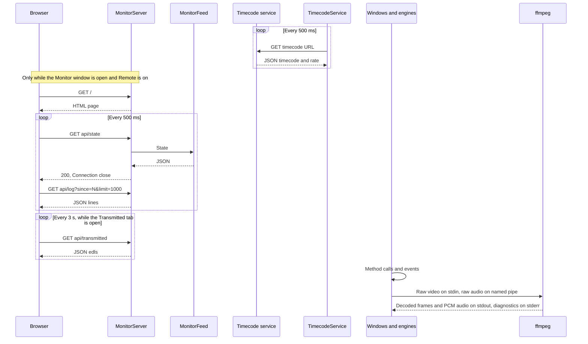

# 7. API and communication

Line references are to commit `dd8e4a7`. Example values are illustrative. The field names and shapes come from the code.

## Summary

| Channel | Type | Direction | Authentication |
|---|---|---|---|
| Monitoring server | HTTP/1.1 on TCP 8787, read-only | Other machines to Emerald | **None** |
| Timecode client | HTTP GET, every 500 ms | Emerald to the timecode service | None |
| Single-instance handoff | Named pipe `Emerald.App.Activate` | Second launch to first | None, local |
| ffmpeg recording video | stdin pipe | Emerald to ffmpeg | N/A |
| ffmpeg recording audio | Named pipe `edlcap_<pid>_<guid>` | Emerald to ffmpeg | N/A |
| ffmpeg decoded video and audio, waveform PCM | stdout pipe | ffmpeg to Emerald | N/A |
| ffprobe | stdout pipe, JSON | ffprobe to Emerald | N/A |
| ffmpeg diagnostics | stderr pipe | ffmpeg to Emerald | N/A |
| Everything else | In-process method calls and C# events | | N/A |

**WebSockets:** Not found in the codebase. **Server-sent events:** Not found. **UDP:** Not found. **Authentication anywhere:** Not found.

`readme.md` says Emerald has "no server, no network transport". That is out of date.

## Communication diagram



## Monitoring server

`src/Emerald.Core/MonitorServer.cs`, `MonitorFeed.cs`, `MonitorPage.cs`.

**Transport.** A raw `TcpListener` on `IPAddress.Any` (`src/Emerald.Core/MonitorServer.cs:115`), so all IPv4 interfaces. `HttpListener` was avoided because it needs elevation or a URL reservation for non-localhost.

**Switching it on.** The `RemoteToggle` in the Monitor window. If `monitorApi` is true it restarts when that window next opens. Closing the window stops it. It is off by default.

**Port.** `monitorApiPort`, default 8787. No UI edits it, so changing it means editing `settings.json` with Emerald closed. `installer/install.bat` opens TCP 8787 in Windows Firewall, and `installer/edl/install.bat` adds no rule. A different port needs its own rule, and the Monitor window shows the `netsh` command to run.

**Protocol.** One request per connection. Every response has `Content-Length`, `Cache-Control: no-store`, `Access-Control-Allow-Origin: *` and `Connection: close`. Paths are matched exactly and are case-sensitive, so `/API/state` and `/api/state/` return 404.

**Limits.** 8 KiB request head, 64 KiB body drain, 5-second read timeout, `limit` clamped to 1 to 2000. A head over the limit or a read timeout closes the connection with no HTTP status. There is no limit on connections and no write timeout.

### Routes

| Method | Route | Response |
|---|---|---|
| GET | `/`, `/index.html` | 200, `text/html`, the page |
| GET | `/api/health` | 200, JSON |
| GET | `/api/state` | 200, JSON |
| GET | `/api/log?since=&limit=` | 200, JSON. Defaults: since 0, limit 500. |
| GET | `/api/transmitted` | 200, JSON |
| GET | anything else | 404, `no such thing here` |
| | unparseable request line | 400, `bad request` |
| other | any | 405, `read-only` |

HEAD is routed like GET, and it wrongly returns a body too.

### GET /api/health

```json
{"ok":true,"name":"PLANT-PC","started":"2026-11-05T08:00:01.123+08:00","version":1}
```

`name` is the machine name. `version` is the feed's version, not the app's.

### GET /api/state

```json
{
  "at": "2026-11-05T20:57:26.5+08:00",
  "timecode": "20:57:26:12",
  "lastSeq": 1842,
  "dropped": 0,
  "recording": true,
  "capture": {"headline": "RECORDING", "detail": "media - board 0 RX0", "level": "Ok", "idle": false},
  "edl": {"headline": "idle", "detail": "", "level": "Info", "idle": true},
  "onAir": {"headline": "idle", "detail": "", "level": "Info", "idle": true},
  "ingest": {"headline": "idle", "detail": "", "level": "Info", "idle": true},
  "delay": {"phase": "OnAir", "detail": "On air, 2 min behind the receiver.", "behind": "2 min",
            "fill": 1, "framesToAir": 0, "targetFrames": 3000},
  "frames": {"recorded": 90000, "notEncoded": 0, "notDelayed": 0, "aired": 87000,
             "repeated": 0, "skipped": 0, "resyncs": 0}
}
```

`timecode` is omitted when the clock is unavailable. That includes a process started with `--monitor` alone, because the Monitor window does not call `TimecodeLink.Connect`. `level` is `Info`, `Ok`, `Warn` or `Error`. `delay.phase` is the `TidalLockState` name.

`ingest` is always idle, and Live Edit's transmission does not appear. See the [assessment](11_TECHNICAL_ASSESSMENT.md).

### GET /api/log?since=1840&limit=1

```json
{
  "lastSeq": 1842,
  "count": 1,
  "lines": [{
    "seq": 1841,
    "at": "2026-11-05T20:57:26.1+08:00",
    "time": "20:57:26.100",
    "timecode": "20:57:26:02",
    "source": "CAPTURE",
    "level": "Ok",
    "message": "SAVED segment 3 - ...",
    "event": "capture.segment",
    "id": "9f31c07a",
    "file": "media_1105262057_3.mov",
    "path": "D:\\store\\high\\...\\media_1105262057_3.mov",
    "detail": "segment 3\nduration 300.00 s\n..."
  }]
}
```

`timecode`, `event`, `id`, `path` and `detail` are omitted when null. `id` is the correlation ID. `file` is always present and is `""` when the line names no file. `lastSeq` is the newest line in the log, not the newest line returned. `Seq` restarts from 1 each time the process starts. Transient lines are included, though they are not in the log file.

### GET /api/transmitted

```json
{
  "edls": [{
    "id": "a1b2c3d4",
    "headline": "...",
    "files": [{
      "kind": "VIDEO", "track": 0, "label": "", "channels": "",
      "name": "promo.mxf", "path": "D:\\media\\promo.mxf",
      "state": "AIRED", "times": 1, "timesText": "once",
      "lastAired": "20:01:10", "queued": "2026-11-05T19:55:00+08:00"
    }]
  }]
}
```

`track` 0 is picture, 1 to 8 are audio. `state` is `QUEUED` or `AIRED`. `kind` is `VIDEO` or `AUDIO n`. `label` and `channels` are empty for video. `queued` is omitted when the queue line was not seen. `lastAired` and `timesText` are `"-"` until the file has aired. Files with no EDL come under `id` `""` and headline `Not under an EDL`. Only the in-memory log ring is folded, so items that age out of the ring disappear from this view.

### Security properties

Good:

- No route changes state, and no file serving exists, so there is nothing to traverse.
- It is off by default.

Weak:

- Anyone who can reach the port can read the log, including full media paths, file names, operator text and exception messages.
- `Access-Control-Allow-Origin: *` lets any web page in a browser on that network read it. Browser private-network rules: Not verified.
- Plain HTTP.

## Timecode client

`src/Emerald.Core/TimecodeService.cs`, with `TimecodeLink.cs` as the single process-wide owner.

**URL.** `timecodeApiUrl`, default `http://10.0.0.31:8888/api/timecode`. `TrySetUrl` requires an absolute `http` or `https` URI.

**Request.** `GET {url}` every 500 ms, 3-second timeout.

**Expected response.** Field matching is case-insensitive.

```json
{
  "timecode": "20:57:26:12",
  "frameRate": 25,
  "sourceStatus": "LOCKED",
  "timecodeType": "LTC",
  "mode": "...",
  "serverRole": "...",
  "timeSource": "...",
  "connectedReaders": 1,
  "localTime": "...",
  "serverIp": "...",
  "timestampUtc": "2026-11-05T12:57:26Z"
}
```

| Field | Use |
|---|---|
| `timecode` | Required. Parsed with `frameRate`. |
| `frameRate` | Rounded to an integer. 0 or below falls back to 25. |
| `sourceStatus` | Compared with `LOCKED` for display |
| `timecodeType`, `mode`, `serverRole`, `timeSource`, `connectedReaders` | Display only |
| `localTime`, `serverIp`, `timestampUtc` | Not used after parsing. A value of the wrong JSON type in any typed field, such as an unparseable `timestampUtc`, fails the whole poll and takes the link Offline. |

The real service's response was not available for this document, and `timecodeType`'s example value is illustrative.

**Free-wheeling.** Between polls the clock runs on a `Stopwatch`. On each sample, an error within a quarter second corrects by at most 1 frame. A larger one snaps. Displays never step backward by less than a second.

**Failure.** Any failed poll sets the state to Offline and clears the baseline, so `TryGetCurrent` returns false immediately. It retries on the next tick. Consumers react differently: the EDL plays immediately, and ingest waits.

## Single-instance handoff

`src/Emerald.App/App.xaml.cs:204`, `:223`. Mutex `Emerald.App.SingleInstance`, session-local. Pipe `Emerald.App.Activate`. The message is one UTF-8 line: `--edl`, `--ingest`, `--monitor` or empty. There is no acknowledgement.

## EDL record format

`src/Emerald.EDL/EdlCommand.cs`, documented in `PROTOCOL.md`. It is a JSON record of a playout command, for Copy JSON. It is **not** sent anywhere.

```json
{
  "type": "edl.command",
  "version": 3,
  "id": "0bf97576dc984246854faec55c53a688",
  "issuedAt": "2026-08-27T21:56:00.0000000+10:00",
  "capture": {"board": {"index": 1, "model": "DELTA-12G-elp-h 20", "type": 15}, "port": "RX3", "index": 3},
  "playback": {"board": {"index": 0, "model": "DELTA-3G-elp-d 22", "type": 6}, "port": "TX1", "index": 1},
  "timing": {"frameRate": 25, "startTimecode": "21:56:00:00", "som": "00:01:00:00", "eom": "00:11:00:00",
             "duration": "00:10:00:00", "postPlay": "blackScreen", "loop": true},
  "media": {"kind": "folder", "source": "D:\\media\\promo", "fileCount": 3, "files": ["a.mxf", "b.mov", "c.mp4"]},
  "audio": [{"label": "English", "kind": "file", "source": "D:\\audio\\en.wav", "fileCount": 1,
             "files": ["en.wav"], "offsetMs": 100, "channels": "1-2", "stream": -1}]
}
```

`timing` is shortened here. `PROTOCOL.md` differs from the code in these ways:

| PROTOCOL.md | Code |
|---|---|
| Audio table omits `stream` | Always written: -1 for a bed, 0 or above for an embedded stream |
| Main example has no `audio` key | `"audio": null` is written |
| Audio example has `"D:\audio\en.wav"` | Invalid JSON. The serialiser writes `\\`. |
| "Copy JSON" copies what was played | After SEND it copies the next pending command |
| `issuedAt` is when it was issued | The copied value is the last preview rebuild time |
| `capture` reads as what happened | Filled in even with recording off |

## EDL handshake

Between Live Edit's sender and the on-air state, in-process. `src/Emerald.Core/LiveEdl.cs`, `EdlLedger.cs`, `LiveAir.cs`.

```json
{
  "Version": 12,
  "TransactionId": "7a0c...",
  "Kind": "Conform",
  "Cues": ["...every LiveCue..."],
  "AudioEdits": ["...every AudioEdit..."],
  "IssuedAt": "2026-11-05T12:00:00Z",
  "EditIds": ["..."]
}
```

This is the shape of the `EdlRevision` record, shown as JSON for readability. It is not serialised on the wire. `Kind` is `Update`, `Conform` or `Retry`.

`LiveAir.Submit` (`src/Emerald.Core/LiveAir.cs:269`) answers in this order:

| Verdict | Condition | Effect |
|---|---|---|
| `Duplicate` | Same transaction as the last accepted | Nothing. Counts as taken. |
| `Stale` | Version not above the accepted version | Nothing |
| `NotLive` | State Off or Failed | Nothing |
| `TooLate` | Earliest change is at or before the committed frame | Nothing |
| `Accepted` | Otherwise | Replaces cues and levels |

**Accepted is not applied.** `AppliedVersion` moves in `CuesForAir`, which the transmitter calls on every pass.

**Retries.** `EdlLedger.Poll` allows 2 seconds per attempt, with 3 attempts. A retry sends the latest state at a new version. After that the header shows `NOT ACKNOWLEDGED`, and Ctrl+Shift+E resends.

A `Stale` verdict is reissued once, above the newer version, inside the same send. A manual resend continues the attempt count, so it gets no automatic retries. The next edit starts again at attempt 1. A late acknowledgement still clears the failure. Nothing is sent unless Live Air is CountingDown, OnAir or Draining.

**Edit status:** `NotConformed` to start with. When a conform is sent, a taken revision sets `Conforming` and a refused one sets `Rejected`. `Conforming` becomes `Conformed` when playback picks up that version. An edit changed after that keeps its status until its next conform is sent, which sets `Conforming` or `Rejected` again.

## In-process events

| Raiser | Event | Listeners | Handler's thread |
|---|---|---|---|
| `RxPreview` | `Status`, `FrameReady` | Shell, Playback | UI |
| `RxPreview` | `FormatChanged` | Shell | UI |
| `RxPreview` | `Audio` | `AudioMonitor.Push` | Preview |
| `SdiCapture` | `Message`, `Finished` | Shell, `IngestRecorder` | Capture |
| `SdiCapture` | `PreviewFrame`, `FormatDetected`, `Rolled` | Shell | Capture |
| `SdiCapture` | `Audio` | `AudioMonitor.Push`, wired by the shell | Capture |
| `SdiCapture` | `Frame` | `DelayLine.Offer` | Capture |
| `TidalLock.Shared` | `Changed` | Shell, Playback, Monitor, Live Edit | Raiser's; handlers marshal |
| `LiveAir.Shared` | `Changed` | Shell, Live Edit | Raiser's; handlers marshal |
| `PipelineState.Shared` | `Changed` | Playback, Monitor | Raiser's |
| `SdiPorts.Shared` | `Changed` | Playback | Raiser's |
| `ActivityLog.Shared` | `Line` | Shell, Playback, Monitor, EDL, Live Edit, `LiveLogWindow` | The thread that called `Write`, not the disk writer thread |
| `RxLease` (static) | `Freed` | Each `RxPreview` | Releaser's |
| `TimecodeLink` (static) | `UrlChanged` | Shell, EDL, Ingest | Raiser's |
| `DelayTransmitter`, `LiveAirTransmitter` | `Status` | Playback, Live Edit | Transmitter |
| `PlayoutService` | `Progress` | EDL, Playback | Worker |
| `PlayoutService` | `QueueChanged` | EDL | Worker, or the caller of `Enqueue` or `StopAll` |
| `IngestSchedulerService` | `QueueChanged`, `JobChanged` | Ingest window, which marshals | Scheduler, or the caller of `Enqueue`, `Cancel` or `Remove` |
| `IngestLog` | `Entry` | Ingest window, which marshals | Caller of `Write` |
| `IIngestRecorder` | `Message`, `Finished` | `IngestSchedulerService` | Capture, or the simulator task |
| `EdlLogger.Shared` | `Logged` | None | Caller of `Write` |
| `DropMarks.Shared` | `Changed` | Live Edit | Raiser's |

## Activity log as an event stream

Most windows treat the log as their display, filtering `ActivityLog.Line`. `TransmissionTally` even derives "what aired" from event tags, so **changing an event tag can break a feature**.

Tags in use:

| Area | Tags |
|---|---|
| App | `app.started`, `app.crashed`, `app.softwarerender`, `log.dropped`, `monitor.api.*`, `monitor.readfailed` |
| Board and RX | `board.scanned`, `board.scanfailed`, `rx.stuck`, `rx.taken` |
| Media | `media.limit`, `media.limitfailed`, `media.pruned`, `media.codecs` |
| Capture | `capture.started`, `.finished`, `.segment`, `.dropped`, `.format`, `.folder`, `.source`, `.problem`, `.newday`, `.rollfailed`, `.profile`, `.audio.pairs`, `.audio.added`, `.audio.removed`, `.audio.level`, `.audio.detected`, `.audio.pair`, `.audio.listen` |
| Delay | `delay.<phase>`, `delay.ready`, `.readyfailed`, `.dropped`, `.segment`, `.fromstart`, `.trouble`, `.releasefailed`, `.stopfailed` |
| Lock | `tidallock.<state>`, `liveair.<state>`, `liveair.<phase>`, `liveair.cue.*`, `liveair.releasefailed` |
| EDL | `edl.queued`, `edl.video`, `edl.audio`, `edl.recordonair`, and `edl.<action>` from `EdlLogger` |
| Playout | `playout.video`, `.audio`, `.audiofailed`, `.audioonair`, `.videoload`, `.drop`, `.frames`, `.videoend`, `.<state>` |
| Preview | `preview.audiodrift` |
| Live Edit | `liveedit.*`, around 30 tags |
| Untagged | Every `IngestLog` line and every `SdiCapture.Report` and `Fail` line |

## Adding to the API

See the [developer guide](12_DEVELOPER_GUIDE.md#add-a-new-api-endpoint).
