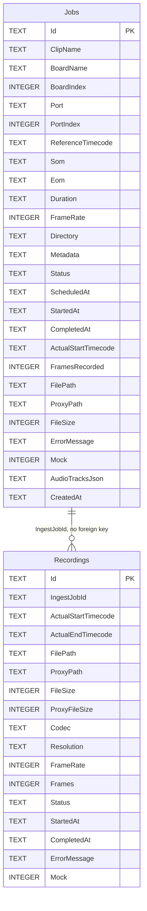

# 8. Data and storage

Line references are to commit `dd8e4a7`.

## How persistence works

Emerald uses a mix. There are **two SQLite databases**, both in the data folder: `emerald.db` for the log, recordings and resource samples, and `ingest.db` for ingest jobs. Everything else is plain files. Recordings are discovered by listing folders, so the file system is the catalogue of media.

| Data | Store |
|---|---|
| Ingest queue and history | SQLite, `ingest.db` |
| Settings | JSON |
| Logs, recording sessions, resource samples | SQLite, `emerald.db` |
| Bookmarks | JSON, one file per day |
| Recordings | Media files in dated folders |
| Delay | Memory-mapped ring file |
| Live Edit placements and levels | **Memory only. Lost when the window closes.** |
| EDL queue | **Memory only. Lost when the window closes.** |
| Waveforms | Memory, and one small `.peaks` file per media file in `<data folder>\peaks` |
| Probe results, codec names, picture lengths | Memory only |
| Drop marks | Memory only |

## The data folder

`dataFolder` in settings, or `%APPDATA%\Emerald` when empty (`AppSettings.DataFolderOrDefault`). The installer asks for it. It holds `emerald.db`, `ingest.db` and the `peaks` folder. `settings.json` stays in `%APPDATA%\Emerald` whatever the data folder is.

If `emerald.db` cannot be opened in the chosen folder (a drive that is not there today), Emerald tries `%APPDATA%\Emerald`. If that fails too, the record is kept in memory only: `app.started` says so and `app.databasefailed` gives the reason.

## Log database (emerald.db)

`src/Emerald.Core/LogDatabase.cs`. SQLite through `Microsoft.Data.Sqlite.Core` 8.0.11, with `SQLitePCLRaw.bundle_e_sqlite3` 2.1.6. No EF.

- **Mode.** WAL, `synchronous=NORMAL`, `busy_timeout=5000`. A power cut loses at most the last batch and does not corrupt the file. `emerald.db-wal` and `emerald.db-shm` sit beside it.
- **One writer.** The activity log's writer thread and the resource sampler write through one connection under a lock, a batch per transaction. The Monitor reads on connections of its own, opened read-only and closed after each read, so readers and the writer never wait for each other.
- **Schema.** `create table if not exists` at open. No migrations.

| Table | Holds |
|---|---|
| `log_capture`, `log_playback`, `log_liveedit`, `log_edl`, `log_onair`, `log_ingest`, `log_app` | Every stored line, in the table of its area |
| `log_error` | Every `Warn` and `Error` line again, with an `area` column naming its area table |
| `recording_session` | One row per recording: `id` (the capture's correlation ID), started, finished, the start message |
| `resource_sample` | While recording, every 5th sample: CPU %, RAM used and total, Emerald's and its ffmpegs' private bytes, GPU %, GPU encode %, GPU memory, and the session ID |
| `resource_disk` | One row per physical disk per sample: active %, read and write bytes/s, queue, free and total bytes |
| `resource_process` | Developer memory snapshots from `MemoryMonitor`, one JSON row every 10 s, only when switched on |

The log tables share one shape: `id`, `at_ms` (Unix ms, indexed), `at` (local text with offset), `seq`, `timecode`, `level`, `source`, `event`, `correlation`, `file`, `message`, `detail`. `detail` is stored whole. Only the in-memory ring trims it to 4096 characters.

**Which table.** `LogDatabase.AreaOf` looks at the event tag first, then the source:

| Event starts with | Area |
|---|---|
| `edl.` | EDL |
| `delay.`, `tidallock.` | On air |
| `liveair.` | Live Edit |
| `capture.`, `rx.`, `board.` | Capture |
| `playout.` | Playback |

| Otherwise, source | Area |
|---|---|
| `Capture`, `Preview`, `Board`, `Media` | Capture |
| `Playout`, `Playback` | Playback |
| `LiveEdit` | Live Edit |
| `Edl` | EDL |
| `TidalLock` | On air |
| `Ingest` | Ingest |
| anything else | App |

**Retention.** `logRetentionDays` (14). The writer thread deletes rows older than that once a day, including the first time it idles after start, 5000 rows at a time, from every log and resource table. Recording sessions go when they finished (or started) before the cutoff. Negative keeps everything. The file does not shrink when rows go; SQLite reuses the space.

## Ingest database (ingest.db)

**Technology.** SQLite through EF Core 8.0.11, at `ingest.db` in the data folder (`AppSettings.IngestDatabasePath`). The first time a data folder other than the default is used, an `ingest.db` already in `%APPDATA%\Emerald` is copied across, not moved. The old default is `SqliteIngestStore.DefaultDatabasePath` (`src/Emerald.Ingest/Services/IngestStore.cs:54`). The connection string is `Data Source={path}`, with no options of Emerald's own. The EF Core provider puts a database it creates into WAL mode during `EnsureCreated`, so `ingest.db-wal` and `ingest.db-shm` can sit beside `ingest.db`. Emerald sets no busy timeout.

**Schema management.** `EnsureCreated()`, plus one manual upgrade `AddColumnIfMissing(db, "Jobs", "AudioTracksJson", "TEXT NOT NULL DEFAULT ''")`. There are no EF migrations.

**Concurrency.** Each operation takes a store-wide lock and a new `DbContext`. `Save` upserts a clone, so the UI's object is never tracked.

**Timestamps** are local `DateTime.Now`, not UTC. **Status** is stored as a string.



Nullable in `Jobs`: `ScheduledAt`, `StartedAt`, `CompletedAt`, `FilePath`, `ProxyPath`, `ErrorMessage`. Nullable in `Recordings`: `ProxyPath`, `CompletedAt`, `ErrorMessage`.

Indexes: `IX_Jobs_Status`, `IX_Jobs_Directory_ClipName` (neither unique), `IX_Recordings_IngestJobId`.

There is no delete code, so the database grows with history. Removing a finished job from the queue removes it from the in-memory list only.

## Settings

`%APPDATA%\Emerald\settings.json`, indented, written by `AppSettings.Save` to `settings.json.tmp` and then moved into place.

- **Migration.** If the file is absent, `%APPDATA%\EdlGenerator\settings.json` is read. Separately, on every load, if `recordingSegmentChosen` is false and the segment is 120, it becomes 30. If `highResLimitGb` is missing it takes `recordingStorageLimitGb`, and a missing `lowResLimitGb` becomes 0.
- **Failure.** A corrupt file silently gives defaults, and the next save overwrites it. A failed save is also silent.
- **Editing by hand.** Edit `settings.json` only with Emerald closed. The running process holds its own copy, does not re-read these values, and overwrites the file when it next saves.

| JSON name | Default | Meaning |
|---|---|---|
| `timecodeApiUrl` | `http://10.0.0.31:8888/api/timecode` | Timecode service |
| `captureBoardIndex`, `capturePort` | 0, `RX0` | Capture input |
| `playbackBoardIndex`, `playbackPort` | 0, `TX0` | Playback output |
| `playbackPorts` | empty | All TX port names, `|` separated |
| `startTimecode`, `som`, `eom`, `postPlay`, `mediaSource` | `00:00:00:00`, empty, empty, `blackScreen`, empty | Last EDL fields. `postPlay` is `blackScreen` or `freezeLastFrame`. |
| `ffmpegPath` | empty | Override. Otherwise beside the app, `PATH`, `C:\ffmpeg\bin`, `C:\Program Files\ffmpeg\bin`. |
| `captureFolder` | empty | The one store of the old layout, `high` and `low` inside it. Still read: a high-res or low-res folder left empty is its folder in here. Empty means the default store. |
| `highResFolder`, `lowResFolder` | empty, empty | Where the DNxHD masters and the H.264 proxies go. Empty means the `high` or `low` folder of `captureFolder`. Set from the capture deck or the installer. |
| `captureFrameRate` | 25 | Fallback when the receiver reports no standard. Also Live Edit's rate. |
| `recordingTitle`, `recordingDescription`, `recordingDuration` | empty | Title sets the file prefix. Duration auto-stops. |
| `highResLimitGb`, `lowResLimitGb` | migrated, see above | Most each folder may hold, 0 for none |
| `recordingStorageLimitGb` | 0 | The old single limit. Read once to seed `highResLimitGb`; the deck still writes the high-res limit here. |
| `recordingVideoBitrateKbps` | 0 | Proxy bitrate, 0 leaves it to the encoder |
| `recordingAudioBitrateKbps`, `recordingAudioSampleRate` | 192, 48000 | Audio |
| `recordingSegmentSeconds`, `recordingSegmentChosen` | 30, false | Proxy segment length. The master is always 5 minutes and is not affected. |
| `recordingGpuProxy` | true | Auto: encode the proxy on an NVIDIA or Intel card if one works, otherwise on the CPU. False is CPU only. |
| `liveBoardIndex`, `livePorts`, `liveDelaySeconds`, `liveDelayStart`, `liveHeadroomSeconds` | 0, empty, 120, 0, 300 | Last Go Live. `liveDelayStart` is a number: 0 Fixed, 1 FromFirstSegment, 2 WhenFirstSegmentReady. |
| `delayReadyRevisited` | false | Set when `Migrate` has turned `keepDelayReady` on once. |
| `keepDelayReady` | true | Keep a ring filling while recording, about 6 GB a minute at 1080p25 written to the ring file. About 4 s of it stays in memory (a few hundred MB), plus up to 15 s for a reader close behind the writer; the rest is written ahead to the ring file. Set from **Delay ready** on the Capture deck, and applies from the next recording. Turned on once for every existing install by `Migrate` (`delayReadyRevisited`); turning it off afterwards is kept. Off means no ring until something is armed, and air is black while the delay fills. |
| `softwareRendering` | false | WPF software mode |
| `edlRecordWhileOnAir` | false | EDL records the RX during playout |
| `monitorApi`, `monitorApiPort` | false, 8787 | Remote monitoring |
| `audioTracks` | empty | `label`, `source`, `offsetMs`, `isDefault`, `stream`, `streamDetail`, `gainDb` |
| `ingestBoardIndex`, `ingestPort`, `ingestSom`, `ingestDuration`, `ingestDirectory`, `ingestMetadata`, `ingestTimingMode`, `ingestMockMode` | 0, `RX0`, `01:00:00:00`, `00:15:00:00`, empty, empty, `duration`, false | Last ingest form values. `ingestSom` is the timecode stamped into the clip. `ingestDirectory` empty means the default media folder. `ingestTimingMode` is `duration` or `eom`. `ingestMockMode` simulates boards and the recorder. |
| `tidalLockRingFolder` | empty | Empty means `%LOCALAPPDATA%\Emerald\delay`. A folder on the same drive as either recording folder is passed over for that default (`delay.samedisk`). |
| `dataFolder` | empty | Where `emerald.db`, `ingest.db` and `peaks` go. Empty means `%APPDATA%\Emerald`. |
| `logRetentionDays` | 14 | Days of log rows and resource samples kept in `emerald.db`. 0 means today only, negative keeps everything. |
| `logFolder` | empty | Where earlier builds wrote `.jsonl` log files. Empty means `%APPDATA%\Emerald\logs`. Nothing new goes there; old `emerald-`, `edl-` and `memory-*.jsonl` files are deleted from it once past `logRetentionDays`. |
| `memoryDiagnostics` | false | For developers. Writes a memory snapshot to the `resource_process` table every 10 s. `EMERALD_MEMORY_LOG=1` does the same without changing settings. Needs the database to have opened. |

`recordingVideoBitrateKbps` (0, 1500, 3000, 5000, 8000), `recordingAudioBitrateKbps` (128, 192, 256, 320), `recordingAudioSampleRate` (48000, 44100, 32000) and `recordingSegmentSeconds` (10, 15, 30, 60, 120, 300) accept only those values. Anything else in the file silently falls back to 0, 192, 48000 and 30.

No passwords, keys or tokens are stored in settings.

## Media store layout

The masters and the proxies each have a folder of their own, `highResFolder` and `lowResFolder` (`MediaLibrary.PathsFor`, giving a `StorePaths`). Either one left empty is the `high` or `low` folder of the old store: `captureFolder`, or `MediaLibrary.DefaultFolder` if that is blank. The default walks up to 6 folders looking for `Emerald.sln` and uses its `media` folder, otherwise it uses `media` beside the executable.

The two folders can be on different drives. On one spinning disk every read of a proxy takes the head away from the masters being written, so putting the low-res folder on another drive is the cheapest way to keep them apart.

```
<high-res folder>\
  yyyy-MM-dd_HH-mm-ss\<prefix>_<MMddyyHHmm>_<N>.mov         master segments
  yyyy-MM-dd_HH-mm-ss\pruned.ledger                         once anything is pruned
<low-res folder>\
  yyyy-MM-dd_HH-mm-ss\<prefix>_<MMddyyHHmm>_<N>.mp4         proxy segments
  yyyy-MM-dd_HH-mm-ss\pruned.ledger
<exports folder>\
  <name>.mov or .mp4                                        exports
  <name>.json                                               export sidecar
  <name>.preview.mp4                                        export viewing copy
  snapshot_yyyy-MM-dd_HH-mm-ss.png                          deck snapshots
<ingest directory>\
  low\<clip>.mp4                                            single-file ingest proxy
  high\<clip>.mov                                           single-file ingest master
```

**The exports folder** is `StorePaths.Exports`. When the two folders are laid out the old way, `<store>\high` and `<store>\low`, it is `<store>\ingest`, so existing exports are still found. Otherwise it is `ingest` inside the high-res folder, since an export is cut from the masters. Deck snapshots go to the store's root as before, or to the high-res folder when the two are apart.

The EDL window's own capture folder box is unchanged: one folder, `high` and `low` under it. So is the Ingest Controller's `ingestDirectory`.

## Naming conventions

| Thing | Pattern | Example |
|---|---|---|
| Recording folder | `yyyy-MM-dd_HH-mm-ss` | `2026-11-05_00-00-00` |
| Segment | `<prefix>_<MMddyyHHmm>_<N>` | `media_1105260000_12.mov` |
| Default prefix | `media`; a saved title of `capture` maps to it | |
| Ingest clip | `CLIP_yyyyMMdd_HHmmssFF` | `CLIP_20261105_20572612` |
| Export | `{recordingFolder}_{HH-mm-ss-ff}` | `2026-11-05_00-00-00_01-39-10-05` |
| Ring | `tidal-<pid>-<guid>.ring` | |
| Log database | `emerald.db` in the data folder | |
| Waveform cache | `<SHA-1 of path, length and write time>.peaks` | |
| Old log files, swept only | `emerald-yyyyMMdd[-NNN].jsonl`, `edl-yyyyMMdd.jsonl`, `memory-yyyyMMdd.jsonl` | `emerald-20261105-001.jsonl` |
| Bookmarks | `yyyy-MM-dd.json` | |

`N` is unpadded, so File Explorer sorts 10 before 2. Emerald sorts by the number itself.

`RecordingSequence.cs:31` is accurate on numbering. Older comments calling it "the year's running count" are out of date.

## Complete storage inventory

| Path | Format | Writer | Reader | Cleanup |
|---|---|---|---|---|
| `%APPDATA%\Emerald\settings.json` | JSON, atomic | `AppSettings.Save` | `AppSettings.Load` | None |
| `%APPDATA%\EdlGenerator\settings.json` | JSON, legacy | Not written | `AppSettings.Load` if own file absent | None |
| `<data folder>\ingest.db` | SQLite | `IngestStore` | `IngestStore` | None; it grows |
| `<data folder>\ingest.db-wal`, `ingest.db-shm` | SQLite WAL companions | SQLite | SQLite | Managed by SQLite |
| `<data folder>\emerald.db` | SQLite, WAL | `ActivityLog` writer (log tables), `ResourceSampler` (sessions, samples), `MemoryMonitor` (`resource_process`) | Monitor window, remote `/api/history`, `ActivityLog.ReadDay` | Rows past `logRetentionDays` (14), daily |
| `<data folder>\emerald.db-wal`, `emerald.db-shm` | SQLite WAL companions | SQLite | SQLite | Managed by SQLite |
| `<data folder>\peaks\*.peaks` | One byte a peak, 50 a second | `Waveform` | `Waveform` | Not used for `max(30, logRetentionDays)` days, at startup |
| `%APPDATA%\Emerald\logs\*.jsonl` (or `logFolder`) | JSONL from earlier builds | Nothing now | Nothing now | `emerald-`, `edl-` and `memory-` files deleted at startup once past `logRetentionDays`, by the date in the name |
| `%APPDATA%\Emerald\bookmarks\yyyy-MM-dd.json` | JSON, not atomic | `BookmarkBook` | `BookmarkBook` | Deleted when the day's book is emptied |
| `%LOCALAPPDATA%\Emerald\delay\tidal-*.ring` | Memory-mapped, pre-extended | `DelayLine` | Transmitters, `HeldPicture` | Deleted on last release. Orphans swept at startup. |
| Low-res and high-res folder segments | MP4, MOV | ffmpeg | `MediaLibrary`, `StoreIndex`, `SegmentWatch` | `StorageWarden`, a limit per folder; manual in Live Edit |
| `pruned.ledger` | Text, one line | `PruneLedger` | `MediaLibrary`, `low` copy only | None |
| `<ingest dir>\low` and `high` clips | MP4, MOV | ffmpeg | `IngestMediaRegistrar` | Warden only if the ingest directory is the store |
| `<ingest dir>\low` and `high`, simulate mode | Plain text under `.mp4` and `.mov` names, no video | `MockIngestRecorder` | `IngestMediaRegistrar` | None |
| Exports folder: exports, sidecars, previews | Media, JSON | `RangeExport` | Live Edit | Manual only, never deleted by the warden. With the folders chosen apart the exports folder is inside the high-res folder, but it is left out of the high-res size. |
| Exports folder, `.<name>.concat.txt` | Text | `RangeExport` | ffmpeg | Deleted after the run |
| `<ingest dir>\.emerald-ingest-<guid>.tmp` | Probe | `DiskSpace` | None | `DeleteOnClose` |
| Store root (or the high-res folder), `snapshot_*.png` | PNG | `ShellWindow` | Operator | None |
| `%TEMP%\Emerald\thumbs\*.png` | PNG | `ClipThumbnails` | `ClipThumbnails` | None |

## Log formats

**Activity log.** `src/Emerald.Core/ActivityLog.cs`. A row in its area's table of `emerald.db` (see [the log database](#log-database-emeralddb)). For example, in `log_onair`:

| at | seq | timecode | level | source | event | message |
|---|---|---|---|---|---|---|
| `2026-09-09 20:57:26.123 +08:00` | 42 | `20:57:26:03` | `Ok` | `TidalLock` | `tidallock.countingdown` | `Recording rolled at 20:57:26:00; on air at 20:59:26:00.` |

- Sources: `App`, `Capture`, `Preview`, `TidalLock`, `Edl`, `Playout`, `Playback`, `Ingest`, `Media`, `Board`, `LiveEdit`.
- Levels: `Info`, `Ok`, `Warn`, `Error`.
- `detail` is stored whole. The in-memory ring keeps the first 4096 characters.
- `Transient` lines stay in memory only.
- 5000 lines stay in the ring, and up to 20,000 can queue for the database. The writer takes up to 5000 a batch, one transaction each. A batch the database refuses is dropped and counted in `log.dropped`.

To read it outside Emerald, open `emerald.db` with any SQLite tool, read-only. For example, today's problems: `select at, area, source, message from log_error where at_ms >= <midnight in Unix ms> order by at_ms;`

**EDL log.** `src/Emerald.Core/EdlLogger.cs`. Each entry goes to the activity log as an `edl.<action>` line, so it is stored in `log_edl`, with the whole entry as JSON in `detail` and the edit or transaction ID as `correlation`. There is no separate EDL file any more. camelCase, nulls omitted. Fields: `timestamp`, `operationId`, `action`, `editId`, `transactionId`, `lockState`, `message`, `rate`, `sourceFiles`, `markIn`, `markOut`, `startFrame`, `endFrame`, `durationFrames`, `durationSeconds`, `selectedFrames`, `sources`, `audio`, `previousVersion`, `updatedVersion`, `conformStatus`, `playbackResponse`, `instruction`, `error`.

Actions: `lockChanged`, `markIn`, `markOut`, `editCreated`, `editModified`, `editDeleted`, `edlGenerated`, `edlUpdated`, `edlSent`, `noEditZone`, `conformStarted`, `playbackAcknowledged`, `playbackRejected`, `operationFailed`.

## Metadata

Recordings carry no database row. What is known about them comes from:

- The folder and file name: start time and order.
- `MediaProbe` and `MediaCodec`: duration, tracks, codec.
- `PruneLedger`: what preceded the oldest surviving segment.

Added audio tracks carry an ffmpeg stream `title`. Exports have a JSON sidecar: `name`, `metadata`, `exported`, `frameRate`, `frames`, `parts[{Path, FromFrame, Frames}]`.

## Cleanup and deletion

### StorageWarden

`src/Emerald.Media/StorageWarden.cs`. Deletes permanently, with no recycle bin.

Two limits, one per folder: `highResLimitGb` and `lowResLimitGb`, chosen in the **high** and **low** combos on the capture deck. 0 is no limit. `StorageWarden.Enforce(StorePaths, highLimit, lowLimit, now)`.

1. Runs only from the capture deck, every 20 ticks (about 10 s) while the deck is recording, on the folders the recording was started with. A limit change also sweeps straight away (`StorageLimit_Changed`).
2. Measures each folder from its directory listing, every file at any depth, without opening any file. With the folders laid out the old way, exports and snapshots in `<store>\ingest` are outside both. With the folders chosen apart, the exports folder is inside the high-res folder but is not counted: the warden never deletes exports, so counting them would only make it delete more masters.
3. Groups each recording folder's files by time: each master with the proxies whose start falls inside it, both laid end to end on their own lengths. A proxy with no master is a group of its own. Old flat files without folders are still grouped by write time, rounded to the second, within 1 second.
   - Picture lengths come from `MediaLengths`, read once per finished file for the whole app and shared with Live Edit's `StoreIndex`.
4. Excludes files younger than 2 minutes.
5. Past the high-res limit, deletes the oldest groups whole, the master with the proxies it holds, until the high-res folder is at or under its limit.
6. Past the low-res limit, deletes only the proxies of the oldest groups. Their masters stay until the high-res limit takes them, and can still be exported.
7. Neither limit touches the newest 3 groups (15 minutes of a recording in folders).
8. Records each deletion in `pruned.ledger`, with each file's own length: the master's in the high-res recording folder, the proxy's in the low-res one. A locked file is left for the next sweep.

The deck shows `high X of Y · low X of Y` under the combos, amber when either folder is over. The figures come from the sweep's own measurement, or, with no limit set, from a measurement off the UI thread every 10 s while recording. Each deletion is logged as `media.pruned`, one line per folder.

Folders are never removed, so old recording folders can remain holding only a ledger.

### PruneLedger

`src/Emerald.Media/PruneLedger.cs`. One line: `<lastDeletedNumber> <ticksThroughEndOfThatSegment>`. For example, `4420 442003200000` means segment 4420 ended 44200.32 seconds into the folder. Written atomically. This is what lets surviving segments keep their true clock position after older ones are deleted.

### Other deletion

| What | When |
|---|---|
| Ring files | Last `Release`, or `SweepOrphans` at startup |
| Log rows and resource samples older than `logRetentionDays` | Once a day, on the activity log's writer thread |
| Old `emerald-`, `edl-` and `memory-*.jsonl` files past `logRetentionDays` | Startup |
| Waveform `.peaks` files unused for `max(30, logRetentionDays)` days | Startup |
| Unreadable clip in Live Edit | `MonitorDelete_Click`, after a Yes/No, removes the file, sidecar and preview. The master goes with it only when that master holds nothing but this proxy (recordings cut alike); a 5-minute master shared with other proxies stays for the storage limit. |
| Empty next-day folders | When a recording stops in the last 10 seconds before midnight |

## Temporary files

| File | Lifetime |
|---|---|
| `settings.json.tmp`, `pruned.ledger.tmp`, `<hash>.peaks.tmp` | Moved into place at once |
| `.<name>.concat.txt` | Duration of an export. Left behind if ffmpeg fails to start. |
| `.emerald-ingest-<guid>.tmp` | Milliseconds |
| Ring files | The recording or delay |
| Thumbnails | Until the OS or a person clears them |

## Backup and recovery

**Backups: Not found in the codebase.** No automated backup of settings, database, bookmarks or media exists. No recycle bin or undo for deletions exists. `readme.md` describes copying files by hand.

Mechanisms that do exist:

| Mechanism | Protects against |
|---|---|
| Atomic write of settings and ledger | Half-written files |
| `IngestControllerService.Recover` | Jobs interrupted by a stop or crash |
| `DelayLine.SweepOrphans` | Rings left by a crash |
| Legacy settings fallback | Migration from the old app |
| Tolerant loaders for bookmarks and ledgers | Corrupt or torn files |
| `emerald.db` in WAL mode, one transaction a batch | A power cut corrupting the log. At most the last batch is lost. |
| Fallback to `%APPDATA%\Emerald`, then memory only | A data folder that cannot be opened |

**To move a machine**, close Emerald, then copy `%APPDATA%\Emerald\settings.json` and `bookmarks\` for notes, and from the data folder `ingest.db` and `emerald.db` with any `-wal` and `-shm` files beside them for history. `peaks\` can be left behind; it is rebuilt. Check `highResFolder`, `lowResFolder`, `captureFolder` and `dataFolder` afterwards, because they hold the old machine's paths. Recorded media is just files.

**Crash and open segments.** A segment gets its index only on close, so a crash loses each open segment in both files, up to one segment's length.
