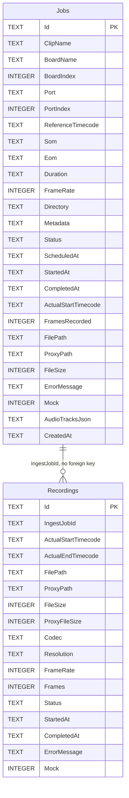

# 8. Data and storage

Line references are to commit `dd8e4a7`.

## How persistence works

Emerald uses a mix. There is **one small database, for ingest jobs only**. Everything else is plain files. Recordings are discovered by listing folders, so the file system is the catalogue of media.

| Data | Store |
|---|---|
| Ingest queue and history | SQLite |
| Settings | JSON |
| Logs | JSONL |
| Bookmarks | JSON, one file per day |
| Recordings | Media files in dated folders |
| Delay | Memory-mapped ring file |
| Live Edit placements and levels | **Memory only. Lost when the window closes.** |
| EDL queue | **Memory only. Lost when the window closes.** |
| Waveforms, probe results, codec names | Memory only |
| Drop marks | Memory only |

## Database

**Technology.** SQLite through EF Core 8.0.11, at `%APPDATA%\Emerald\ingest.db` (`src/Emerald.Ingest/Services/IngestStore.cs:54`). The connection string is `Data Source={path}`, with no options of Emerald's own. The EF Core provider puts a database it creates into WAL mode during `EnsureCreated`, so `ingest.db-wal` and `ingest.db-shm` can sit beside `ingest.db`. Emerald sets no busy timeout.

**Schema management.** `EnsureCreated()`, plus one manual upgrade `AddColumnIfMissing(db, "Jobs", "AudioTracksJson", "TEXT NOT NULL DEFAULT ''")`. There are no EF migrations.

**Concurrency.** Each operation takes a store-wide lock and a new `DbContext`. `Save` upserts a clone, so the UI's object is never tracked.

**Timestamps** are local `DateTime.Now`, not UTC. **Status** is stored as a string.



Nullable in `Jobs`: `ScheduledAt`, `StartedAt`, `CompletedAt`, `FilePath`, `ProxyPath`, `ErrorMessage`. Nullable in `Recordings`: `ProxyPath`, `CompletedAt`, `ErrorMessage`.

Indexes: `IX_Jobs_Status`, `IX_Jobs_Directory_ClipName` (neither unique), `IX_Recordings_IngestJobId`.

There is no delete code, so the database grows with history. Removing a finished job from the queue removes it from the in-memory list only.

## Settings

`%APPDATA%\Emerald\settings.json`, indented, written by `AppSettings.Save` to `settings.json.tmp` and then moved into place.

- **Migration.** If the file is absent, `%APPDATA%\EdlGenerator\settings.json` is read. Separately, on every load, if `recordingSegmentChosen` is false and the segment is 120, it becomes 30. Known issue: the only code that sets `recordingSegmentChosen` is `Profile_Changed`, which never runs because of `_loading`, so a 2-minute choice does not survive a restart.
- **Failure.** A corrupt file silently gives defaults, and the next save overwrites it. A failed save is also silent.
- **Editing by hand.** Edit `settings.json` only with Emerald closed. The running process holds its own copy, does not re-read these values, and overwrites the file when it next saves.

| JSON name | Default | Meaning |
|---|---|---|
| `timecodeApiUrl` | `http://10.0.0.31:8888/api/timecode` | Timecode service |
| `captureBoardIndex`, `capturePort` | 0, `RX0` | Capture input |
| `playbackBoardIndex`, `playbackPort` | 0, `TX0` | Playback output |
| `playbackPorts` | empty | All TX port names, `|` separated |
| `startTimecode`, `som`, `eom`, `postPlay`, `mediaSource` | `00:00:00:00`, empty, empty, `blackScreen`, empty | Last EDL fields. `postPlay` is `blackScreen` or `freezeLastFrame`. |
| `ffmpegPath` | empty | Override. Otherwise beside the app, `PATH`, `C:\ffmpeg\bin`, `C:\Program Files\ffmpeg\bin`. |
| `captureFolder` | empty | Recording output folder |
| `captureFrameRate` | 25 | Fallback when the receiver reports no standard. Also Live Edit's rate. |
| `recordingTitle`, `recordingDescription`, `recordingDuration` | empty | Title sets the file prefix. Duration auto-stops. |
| `recordingStorageLimitGb` | 0 | Rolling store cap, 0 for none |
| `recordingVideoBitrateKbps` | 0 | Proxy bitrate, 0 leaves it to the encoder |
| `recordingAudioBitrateKbps`, `recordingAudioSampleRate` | 192, 48000 | Audio |
| `recordingSegmentSeconds`, `recordingSegmentChosen` | 30, false | Segment length |
| `liveBoardIndex`, `livePorts`, `liveDelaySeconds`, `liveDelayStart`, `liveHeadroomSeconds` | 0, empty, 120, 0, 300 | Last Go Live. `liveDelayStart` is a number: 0 Fixed, 1 FromFirstSegment, 2 WhenFirstSegmentReady. |
| `keepDelayReady` | true | Keep a ring filling while recording, about 6 GB a minute at 1080p25 |
| `softwareRendering` | false | WPF software mode |
| `edlRecordWhileOnAir` | false | EDL records the RX during playout |
| `monitorApi`, `monitorApiPort` | false, 8787 | Remote monitoring |
| `audioTracks` | empty | `label`, `source`, `offsetMs`, `isDefault`, `stream`, `streamDetail`, `gainDb` |
| `ingestBoardIndex`, `ingestPort`, `ingestSom`, `ingestDuration`, `ingestDirectory`, `ingestMetadata`, `ingestTimingMode`, `ingestMockMode` | 0, `RX0`, `01:00:00:00`, `00:15:00:00`, empty, empty, `duration`, false | Last ingest form values. `ingestSom` is the timecode stamped into the clip. `ingestDirectory` empty means the default media folder. `ingestTimingMode` is `duration` or `eom`. `ingestMockMode` simulates boards and the recorder. |
| `tidalLockRingFolder` | empty | Empty means `%LOCALAPPDATA%\Emerald\delay` |
| `logFolder`, `logRetentionDays` | empty, 14 | Empty means `%APPDATA%\Emerald\logs`. 0 means today only, negative keeps everything. |

`recordingVideoBitrateKbps` (0, 1500, 3000, 5000, 8000), `recordingAudioBitrateKbps` (128, 192, 256, 320), `recordingAudioSampleRate` (48000, 44100, 32000) and `recordingSegmentSeconds` (10, 15, 30, 60, 120, 300, 600) accept only those values. Anything else in the file silently falls back to 0, 192, 48000 and 30.

No passwords, keys or tokens are stored in settings.

## Media store layout

The store is `captureFolder`, or `MediaLibrary.DefaultFolder` if that is blank. The default walks up to 6 folders looking for `Emerald.sln` and uses its `media` folder, otherwise it uses `media` beside the executable.

```
<store>\
  low\yyyy-MM-dd_HH-mm-ss\<prefix>_<MMddyyHHmm>_<N>.mp4     proxy segments
  low\yyyy-MM-dd_HH-mm-ss\pruned.ledger                     once anything is pruned
  high\yyyy-MM-dd_HH-mm-ss\<prefix>_<MMddyyHHmm>_<N>.mov    master segments
  high\yyyy-MM-dd_HH-mm-ss\pruned.ledger
  ingest\<name>.mov or .mp4                                 exports
  ingest\<name>.json                                        export sidecar
  ingest\<name>.preview.mp4                                 export viewing copy
  snapshot_yyyy-MM-dd_HH-mm-ss.png                          deck snapshots
<ingest directory>\
  low\<clip>.mp4                                            single-file ingest proxy
  high\<clip>.mov                                           single-file ingest master
```

## Naming conventions

| Thing | Pattern | Example |
|---|---|---|
| Recording folder | `yyyy-MM-dd_HH-mm-ss` | `2026-11-05_00-00-00` |
| Segment | `<prefix>_<MMddyyHHmm>_<N>` | `media_1105260000_12.mov` |
| Default prefix | `media`; a saved title of `capture` maps to it | |
| Ingest clip | `CLIP_yyyyMMdd_HHmmssFF` | `CLIP_20261105_20572612` |
| Export | `{recordingFolder}_{HH-mm-ss-ff}` | `2026-11-05_00-00-00_01-39-10-05` |
| Ring | `tidal-<pid>-<guid>.ring` | |
| Activity log | `emerald-yyyyMMdd[-NNN].jsonl` | `emerald-20261105-001.jsonl` |
| EDL log | `edl-yyyyMMdd.jsonl` | `edl-20261105.jsonl` |
| Bookmarks | `yyyy-MM-dd.json` | |

`N` is unpadded, so File Explorer sorts 10 before 2. Emerald sorts by the number itself.

`RecordingSequence.cs:31` is accurate on numbering. Older comments calling it "the year's running count" are out of date.

## Complete storage inventory

| Path | Format | Writer | Reader | Cleanup |
|---|---|---|---|---|
| `%APPDATA%\Emerald\settings.json` | JSON, atomic | `AppSettings.Save` | `AppSettings.Load` | None |
| `%APPDATA%\EdlGenerator\settings.json` | JSON, legacy | Not written | `AppSettings.Load` if own file absent | None |
| `%APPDATA%\Emerald\ingest.db` | SQLite | `IngestStore` | `IngestStore` | None; it grows |
| `%APPDATA%\Emerald\ingest.db-wal`, `ingest.db-shm` | SQLite WAL companions | SQLite | SQLite | Managed by SQLite |
| `%APPDATA%\Emerald\logs\emerald-*.jsonl` | JSONL, 32 MiB a file | `ActivityLog` | `ActivityLog.ReadDay` | `logRetentionDays`, default 14, at startup only |
| Same folder, `edl-*.jsonl` | JSONL | `EdlLogger` | External tools | **None** |
| `%APPDATA%\Emerald\bookmarks\yyyy-MM-dd.json` | JSON, not atomic | `BookmarkBook` | `BookmarkBook` | Deleted when the day's book is emptied |
| `%LOCALAPPDATA%\Emerald\delay\tidal-*.ring` | Memory-mapped, pre-extended | `DelayLine` | Transmitters, `HeldPicture` | Deleted on last release. Orphans swept at startup. |
| `<store>\low` and `high` segments | MP4, MOV | ffmpeg | `MediaLibrary`, `SegmentWatch` | `StorageWarden`; manual in Live Edit |
| `pruned.ledger` | Text, one line | `PruneLedger` | `MediaLibrary`, `low` copy only | None |
| `<ingest dir>\low` and `high` clips | MP4, MOV | ffmpeg | `IngestMediaRegistrar` | Warden only if the ingest directory is the store |
| `<ingest dir>\low` and `high`, simulate mode | Plain text under `.mp4` and `.mov` names, no video | `MockIngestRecorder` | `IngestMediaRegistrar` | None |
| `<store>\ingest\` exports, sidecars, previews | Media, JSON | `RangeExport` | Live Edit | Manual only, not limited by the warden |
| `<store>\ingest\.<name>.concat.txt` | Text | `RangeExport` | ffmpeg | Deleted after the run |
| `<ingest dir>\.emerald-ingest-<guid>.tmp` | Probe | `DiskSpace` | None | `DeleteOnClose` |
| `<store>\snapshot_*.png` | PNG | `ShellWindow` | Operator | None |
| `%TEMP%\Emerald\thumbs\*.png` | PNG | `ClipThumbnails` | `ClipThumbnails` | None |

## Log formats

**Activity log.** `src/Emerald.Core/ActivityLog.cs`. PascalCase, one object per line, nulls omitted.

```json
{"Seq":42,"At":"2026-09-09T20:57:26.1234567+08:00","Timecode":"20:57:26:03","Source":"TidalLock","Level":"Ok","Message":"Recording rolled at 20:57:26:00; on air at 20:59:26:00.","Event":"tidallock.countingdown","Transient":false}
```

- Sources: `App`, `Capture`, `Preview`, `TidalLock`, `Edl`, `Playout`, `Playback`, `Ingest`, `Media`, `Board`, `LiveEdit`.
- Levels: `Info`, `Ok`, `Warn`, `Error`.
- `Detail` is capped at 4096 characters.
- `Transient` lines stay in memory only.
- 5000 lines stay in the ring, and up to 20,000 can queue for disk.

**EDL log.** `src/Emerald.Core/EdlLogger.cs`. camelCase, nulls omitted. Fields: `timestamp`, `operationId`, `action`, `editId`, `transactionId`, `lockState`, `message`, `rate`, `sourceFiles`, `markIn`, `markOut`, `startFrame`, `endFrame`, `durationFrames`, `durationSeconds`, `selectedFrames`, `sources`, `audio`, `previousVersion`, `updatedVersion`, `conformStatus`, `playbackResponse`, `instruction`, `error`.

Actions: `lockChanged`, `markIn`, `markOut`, `editCreated`, `editModified`, `editDeleted`, `edlGenerated`, `edlUpdated`, `edlSent`, `noEditZone`, `conformStarted`, `playbackAcknowledged`, `playbackRejected`, `operationFailed`.

## Metadata

Recordings carry no database row. What is known about them comes from:

- The folder and file name: start time and order.
- `MediaProbe` and `MediaCodec`: duration, tracks, codec.
- `PruneLedger`: what preceded the oldest surviving segment.

Added audio tracks carry an ffmpeg stream `title`. Exports have a JSON sidecar: `name`, `metadata`, `exported`, `frameRate`, `frames`, `parts[{Path, FromFrame, Frames}]`.

## Cleanup and deletion

### StorageWarden

`src/Emerald.Media/StorageWarden.cs`. Deletes permanently, with no recycle bin.

1. Runs only from the capture deck, every 20 ticks (about 10 s) while the deck is recording. The code also intends a sweep on a limit change (`StorageLimit_Changed`), but that handler never runs because of the `_loading` issue, so a lowered limit takes effect only once a deck recording is running.
2. Counts every file under `low` and `high`. Exports, snapshots and root files are not counted.
3. Groups playable files into segments by write time, rounded to the second, within 1 second. It does not group by name.
4. Excludes files younger than 2 minutes.
5. Deletes oldest first until at or under the limit, always keeping at least 3 eligible segments.
6. Records each deletion in `pruned.ledger`. A locked file is left for the next sweep.

Folders are never removed, so old recording folders can remain holding only a ledger.

### PruneLedger

`src/Emerald.Media/PruneLedger.cs`. One line: `<lastDeletedNumber> <ticksThroughEndOfThatSegment>`. For example, `4420 442003200000` means segment 4420 ended 44200.32 seconds into the folder. Written atomically. This is what lets surviving segments keep their true clock position after older ones are deleted.

### Other deletion

| What | When |
|---|---|
| Ring files | Last `Release`, or `SweepOrphans` at startup |
| Old activity logs | Startup |
| Unreadable clip in Live Edit | `MonitorDelete_Click`, after a Yes/No, removes the file, master, sidecar and preview |
| Empty next-day folders | When a recording stops in the last 10 seconds before midnight |

## Temporary files

| File | Lifetime |
|---|---|
| `settings.json.tmp`, `pruned.ledger.tmp` | Moved into place at once |
| `.<name>.concat.txt` | Duration of an export. Left behind if ffmpeg fails to start. |
| `.emerald-ingest-<guid>.tmp` | Milliseconds |
| Ring files | The recording or delay |
| Thumbnails | Until the OS or a person clears them |

## Backup and recovery

**Backups: Not found in the codebase.** No automated backup of settings, database, bookmarks or media exists. No recycle bin or undo for deletions exists. `readme.md` describes copying files by hand.

Mechanisms that do exist:

| Mechanism | Protects against |
|---|---|
| Atomic write of settings and ledger | Half-written files |
| `IngestControllerService.Recover` | Jobs interrupted by a stop or crash |
| `DelayLine.SweepOrphans` | Rings left by a crash |
| Legacy settings fallback | Migration from the old app |
| Tolerant loaders for bookmarks, ledgers and log lines | Corrupt or torn files |

**To move a machine**, close Emerald, then copy `%APPDATA%\Emerald\settings.json`, plus `ingest.db` and any `ingest.db-wal` and `ingest.db-shm` beside it for history, and `bookmarks\` for notes. Check `captureFolder` afterwards, because it holds the old machine's path. Recorded media is just files.

**Crash and open segments.** A segment gets its index only on close, so a crash loses each open segment in both files, up to one segment's length.
