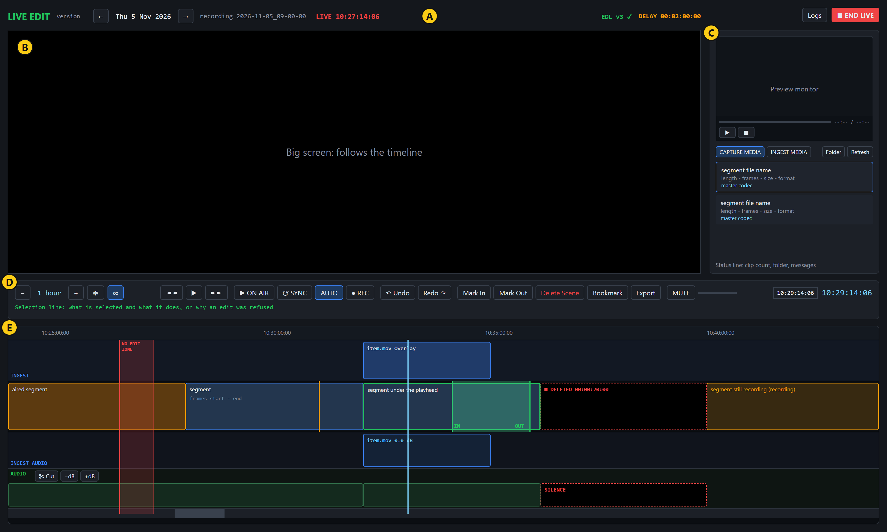
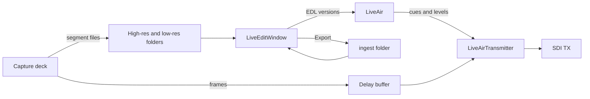
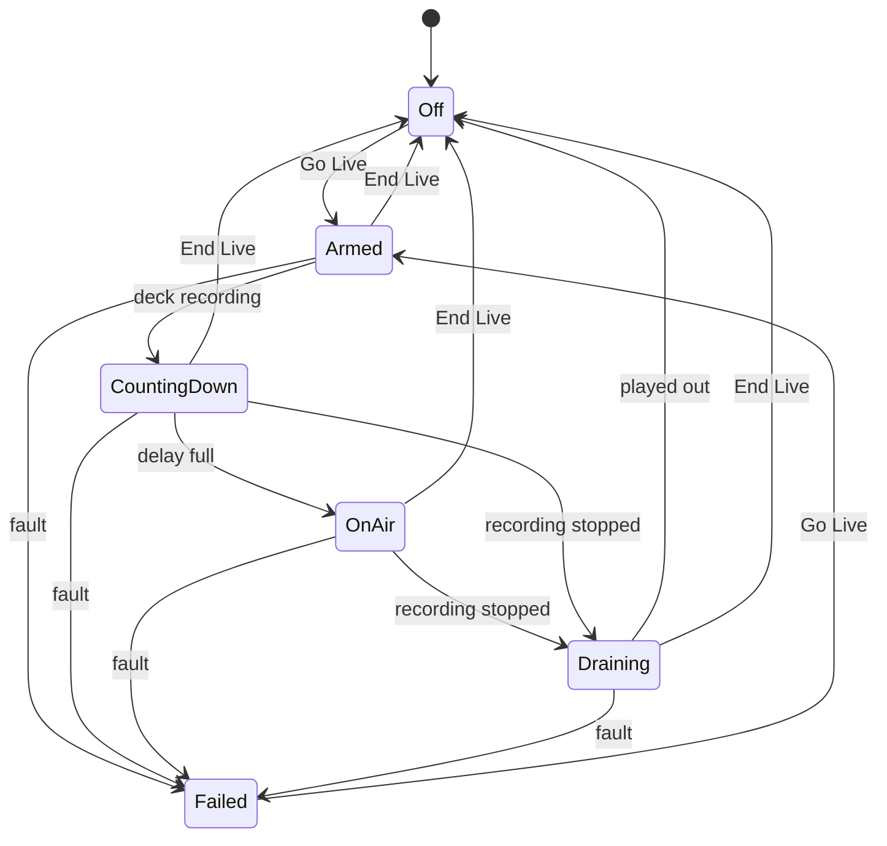
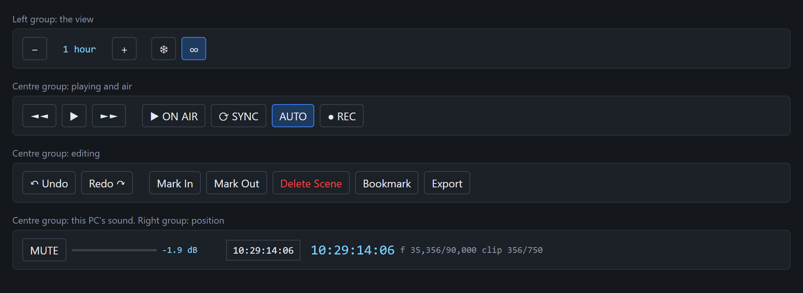

# 13. Live Edit guide

Live Edit is the window where an operator views what has been recorded, marks and exports ranges, drops in other media, deletes scenes, sets sound levels, and puts the delayed recording to air with those edits applied.

This guide covers how the window is built, how to use it, and what every button does. It describes commit `dd8e4a7`, based on reading the source. The window was not run for this guide, so the two figures are drawings made from the window's layout file, not screenshots, and their data is made up.

## The ideas to know first

| Term | Meaning |
|---|---|
| Ruler | The timeline's time scale. It is the time of day, counted from the midnight of the day shown, so a file that began at 11:34:52 is drawn at 11:34:52. |
| Segment | One recorded file. A recording is many segments in a row, 30 seconds each by default. |
| Recording | One folder of segments, named for when it started, such as `2026-11-05_09-00-00`. The timeline shows one recording per day: the one on air, otherwise the newest. |
| Proxy and master | Each segment has a small H.264 proxy, which Live Edit plays, and usually a DNxHD master, which Export cuts from. |
| Playhead | The light blue line. It is where you are looking. |
| On-air mark | The red line. It is where the transmitter is, and it appears only while something is on air. |
| Delay | How far air runs behind the recording. |
| No edit zone | From the on-air mark to 10 seconds ahead of it, shaded red. Air has reached this part or is about to, so it cannot be changed. |
| EDL | The list of edits made on the timeline. Edits change this list only. Nothing on the timeline changes a recorded file. |
| Ingest media | Files placed on the timeline: ranges exported here, or files dragged in from Explorer. |

**Edits reach air only through Go Live.** The playback deck's tidal lock is a separate transmission. It also shows an on-air mark here, and the no edit zone still applies, but it does not play this timeline's edits.

## Structure

### The screen

| Area | Name | What it is for |
|---|---|---|
| A | Header | The day shown, the recording, on-air state, EDL state, delay, Logs and Go Live |
| B | Big screen | Whatever the playhead is on. It belongs to the timeline. |
| C | Media panel | A small preview monitor and two lists: Capture Media and Ingest Media. Previewing here never moves the playhead. |
| D | Transport bar | Playing, air, editing, sound and position controls, with the selection line under them |
| E | Timeline | The ruler and the lanes, top to bottom: ingest picture, segments, ingest sound, recording sound, then the scrollbar |

The two ingest lanes appear only once ingest media is on the timeline. Drag the gap between the big screen and the media panel to resize them, and drag the gap under the preview monitor to make it taller.

### The code

Live Edit is the project `src/Emerald.LiveEdit`. It runs in the same process as the capture deck, which opens it. It references `Emerald.Core` and `Emerald.Media` directly, and uses `Emerald.Video` and `Emerald.Deltacast` through Media.

| File | Lines | Holds |
|---|---|---|
| `LiveEditWindow.xaml` | 781 | The window layout |
| `LiveEditWindow.xaml.cs` | 5,434 | Store listing, player, timeline drawing, marks, keys, export, bookmarks, preview monitor |
| `LiveEditWindow.Live.cs` | 1,024 | No edit zone, Go Live, sending the EDL, delay readout, Delete Scene, Logs |
| `LiveEditWindow.Audio.cs` | 792 | Sound lanes, cuts, levels, waveforms |
| `LiveEditWindow.Undo.cs` | 219 | Undo and redo |
| `LiveEditWindow.Held.cs` | 170 | Showing the unfinished segment from the delay buffer |
| `LiveEditWindow.Recording.cs` | 107 | The REC view |
| `GoLiveDialog`, `IngestDropDialog`, `ExportDialog`, `BookmarkDialog`, `LiveLogWindow` | 1,332 | One dialog or window each, XAML and code |

The rules that need no window live in `src/Emerald.Core`: `IngestPlacement` (placement modes), `IngestTimeline` (ruler to recording frames), `AudioEdits` (levels), `TimelineZoom` (zoom steps), `FramePick` (typed positions), `Bookmarks`, `EdlLedger` (versions and retries), `EdlLogger` and `LiveAir` (transmission state).

### What is saved

| Item | Where | After closing the window |
|---|---|---|
| Placed items, deleted scenes, sound levels, sound cuts | Memory only | **Lost, with no warning unless live** |
| Marks and undo history | Memory only | Lost. Both are also cleared whenever the day changes, including at a midnight rollover. |
| Bookmarks | `%APPDATA%\Emerald\bookmarks\yyyy-MM-dd.json` | Kept |
| Exports | The exports folder: `<store>\ingest\` when the high-res and low-res folders are laid out the old way, otherwise `ingest\` inside the high-res folder. The media, a `.preview.mp4`, and a `.json` with the metadata. | Kept |
| Go Live choices | `settings.json` | Kept |
| Edit history | The `log_edl` table of `emerald.db`, one row per entry with the whole entry as JSON | Kept for `logRetentionDays` (14), then deleted |
| Waveforms | Memory, and `<data folder>\peaks\`, a small file per segment | Kept while used; deleted after `max(30, logRetentionDays)` days unused |

Moving to another day keeps placed items, deleted scenes and sound edits, each at its original moment in time.

### Where it reads from

Live Edit follows the capture deck's two folders: proxies from the low-res folder, masters from the high-res one, which may be on different drives. It reads them fresh from `settings.json` (`AppSettings.SavedStoreFolders`), so a change saved on the deck, or a recording started into new folders, is picked up at the next refresh and logged as `liveedit.capturefolder`. **Folder** on the Capture Media tab opens the old store folder when there is one, otherwise the low-res folder.

**Waveforms are read once.** Drawing a segment's sound means decoding the whole file, from the drive the recorder is writing to. So the first time a segment is shown its waveform is read, one segment at a time, at low priority, and kept on disk. After that, even on another day or after a restart, it comes from the cache. A day not opened before fills in its waveforms gradually. An overlay's waveform is read from its small `.preview.mp4` when there is one.

## How to use it

### Open it

Press **Live Edit** in the navigation at the top of the capture deck. There is no Start Menu shortcut or command-line switch for it. Pressing it again brings the open window to the front.

Do not use the small **Live Edit** button in the deck's lower panel. It opens the playback deck instead ([known issue](#known-issues)).

Closing the capture deck closes Live Edit too.

### Find and watch material

1. Use the **←** and **→** in the header to choose a day. New segments appear by themselves within a couple of seconds of closing.
2. Click the timeline to move the playhead, then press **Space** to play. If the playhead is in a gap, Space goes to the nearest playable segment and plays that.
3. Zoom with the mouse wheel, **+** and **-**. Press the mouse wheel and drag to pan.
4. To reach an exact frame, type it in the go-to box and press **Enter**. [Accepted forms](#typing-a-position) are listed below.
5. To check a file without losing your place, click it in the list to preview it in the small monitor. Double-click it to take the timeline there.

The segment still being recorded is amber and has no file that can be opened yet. Where the delay buffer holds it, the big screen shows it from there, labelled `RECORDING - from the delay buffer`, with picture only. To watch the incoming recording itself, press **● REC**.

### Mark a range

1. Put the playhead on the first frame and press **I** or **Mark In**.
2. Put it on the end and press **O** or **Mark Out**. The range is shaded green, and a small card gives the times and length.

Pressing a mark again on the same frame removes it. A Mark In after the out point removes the out point, and a Mark Out before the in point removes the in point. Playback that starts before Mark Out stops when it reaches it.

### Export a range

1. Mark the range and press **Export**.
2. Check the range shown, change the name if you wish, and add metadata if useful.
3. Press **Export**. The panel switches to Ingest Media and shows progress: the cut takes seconds, and the preview copy can take minutes.

Keep in mind:

- The cut comes from the masters when every segment in the range has one, otherwise from the proxies. A proxy cut starts at the first keyframe at or after Mark In, so it may start late.
- Masters are 5 minutes long, so the newest few minutes are always in a master still being recorded. If the range reaches into it, Export **waits** for that master to close and then cuts from it. The button shows **Waiting for master, m:ss**; press it again to call the export off.
- A proxy still being recorded is left out when the cut is from proxies.
- The export is the recording as captured. Deleted scenes, placed items and sound levels are not applied.
- A name already in the folder is refused rather than overwritten.

### Place ingest media

1. Open **INGEST MEDIA**. To use one of the two range modes, mark a range first.
2. Drag an item from the list onto the segments, or drag a playable file from Explorer. The ruler and the recording's sound lane do not accept a drop.
3. In the dialog, choose a mode and tracks, and check the start under **PLACE AT**.
4. Read the summary box, which says exactly what will happen, then press **Place**.

Choose the mode by what should happen to the recording:

| Mode | Starts at | Runs for | Speed | Effect |
|---|---|---|---|---|
| Overlay | PLACE AT | The file's length | Normal | Covers the recording. Nothing moves. |
| Fit to fill | Mark In | The marked range exactly | Changed to fit | Covers the range. Pitch and motion change. |
| Replace | Mark In | The file or the range, whichever is shorter | Normal | Covers the range. If the file is shorter, the original plays on after it. |
| Insert | PLACE AT | The file's length | Normal | Goes in between. Everything later moves later and the delay grows by the file's length. |

To remove an item, click it on its lane and press **Del**. To change its sound, click it and press **[** or **]**.

### Delete a scene

1. Mark the range and press **Delete Scene**.

On air the range becomes black and silence for its exact length. Nothing moves, the delay stays the same, and the recorded files are untouched.

- **To change one:** click it, which puts the marks on it. Move a mark and press **Delete Scene** again.
- **To put one back:** click it and press **Del**. This works only while its start is ahead of the no edit zone. After that, you can give back only the end: move Mark Out earlier and press Delete Scene.

A range that runs into an ingest item, or across other deleted scenes, is refused.

### Change the sound

1. Click the **AUDIO** lane to pick up a piece of sound. You get the whole segment under the pointer, or the marked range if you click inside it.
2. To set a level on only part of a segment, put the playhead there and press **C** or **✂ Cut** first, then click the piece you want.
3. Press **[** or **]**, or **−dB** or **+dB**, to change it one decibel at a time, from -60 to +12 dB.

These levels go to air and are heard in the preview. The **MUTE** button and the volume slider affect only this PC's speakers. To remove sound completely, delete the scene, which takes the picture too.

### Use bookmarks

Press **B** or **Bookmark**. The dialog lists the day's bookmarks, with the timecode box already filled in from the playhead. Type a name and press **Add**. To change one, select it, edit it and press **Update**. Bookmarks draw as amber lines, and **Up** and **Down** step between them.

### Go live

Place any edits you want ready, then:

1. Press **● Go Live**.
2. Choose the board, TX ports, delay and insert room, and read the disk estimate in the summary box. Insert room cannot be changed once live, so allow for every insert you might add.
3. Press **Go Live**. If the capture deck is not recording, the button shows **■ Waiting to go live** until it starts.
4. Black goes out while the delay fills, and the big screen counts down under **ON AIR IN**. If the deck already has a delay buffer filling with enough room, this wait can be shorter.
5. When on air, the button becomes a solid red **■ END LIVE**, and a red mark and no edit zone appear on the timeline.

**While live,** every edit ahead of the no edit zone is sent to the transmitter as a new EDL version. The header shows `EDL v4 sent`, then `EDL v4 ✓` when the transmitter has taken it. If it says `NOT ACKNOWLEDGED`, press **Ctrl+Shift+E** to send it again. If an edit is refused, the reason appears in red on the selection line. Undo the change or make it further ahead.

**To end,** press the same button and confirm. The TX goes to black immediately, and nothing else on the timeline airs. Closing the window while live asks first, then does the same.

### Compare with air

- **▶ ON AIR** plays from the on-air mark and stays locked to it, so this screen can sit beside the playback monitor. The header shows the difference in frames. Any action that pauses ends the lock.
- **⟳ SYNC** reads the store again, then does the same.
- **AUTO**, on by default, checks every 30 seconds while locked and corrects a drift of more than 2 frames.

### Work past midnight

A recording that runs past midnight continues on the same ruler, after 23:59. The window moves to the next day when the on-air mark does, or at midnight if you stayed on today and nothing holds it back. A time you type past midnight means the one nearest the playhead, or the drop point in the Place dialog, so `00:10:00:00` typed at 00:05 the next morning stays on that morning. To name the later day outright, type `24:10:00:00`. While the ruler runs past a day, the Place dialog shows the date beside PLACE AT.

The ruler only reaches the next day once the recording has. Until then, a time after midnight means the start of the ruler. While something is on air that is refused as being in the no edit zone; with nothing on air it is placed there, so check the time shown before pressing Place. If the window changes day while the Place dialog is open, nothing is placed and you are asked to drop the file again.

## Buttons and controls

The tables list every control in the window, by area. "Key" is the keyboard equivalent.

### Header (area A)

| Control | What it does | Key |
|---|---|---|
| **←** / **→** | Show the day before or after. Going to another day stops the ruler following today, and going back to today resumes it. Clears the marks and undo history. | |
| **Logs** | Opens the [Logs window](#logs-window). | |
| **● Go Live** | Opens the [Go Live dialog](#go-live-dialog). While a transmission is waiting, filling, on air or draining, the button ends it, after you confirm. | |

The Go Live button's label shows the state:

| Label | State |
|---|---|
| ● Go Live | Off or failed |
| ■ Waiting to go live | Waiting for the capture deck to record |
| ■ End Live (on air in 1:23) | Filling the delay |
| ■ END LIVE (solid red) | On air |
| ■ End Live (draining) | Recording stopped, the rest of the delay is playing out |

### Preview monitor (area C)

| Control | What it does | Available |
|---|---|---|
| Seek bar | Scrubs within the file | When its length is known |
| **▶** / **II** | Plays or pauses the preview | When a file has opened |
| **■** | Stops and returns to the file's start | When a file has opened |
| **Delete** | Permanently deletes an unreadable file and its companions (preview copy, metadata, and its master only if that master holds nothing else), after showing the list and size. **Cannot be undone.** It refuses a segment still being recorded. | Only when a file fails to open |

The volume slider and MUTE do not control this monitor. After 5 minutes with nothing playing it closes its file, so the storage limit can delete it; pick the file again to preview it.

### Lists (area C)

| Control | What it does |
|---|---|
| **CAPTURE MEDIA** | Lists the current recording's segments, newest first, with the one being recorded on top. The master column reads **master in-progress** while the 5-minute master holding that segment is still being recorded. |
| **INGEST MEDIA** | Lists exported ranges and any other media in the ingest folder |
| **Folder** | Opens the folder for the tab showing in Explorer |
| **Refresh** | Reads the capture store again. It does not refresh the ingest list: to do that, click **CAPTURE MEDIA** and then **INGEST MEDIA**. |
| Capture list row | Click to preview, double-click to take the timeline there |
| Ingest list row | Click to preview and see its metadata, drag onto the timeline to place |

### View controls (area D, left)

| Control | What it does | Key |
|---|---|---|
| **−** / **+** | Shows more or less time. See [zoom steps](#zoom-steps). | **-** / **+**, wheel |
| **❄** Freeze | While something is on air, the timeline normally slides under a fixed on-air mark. Freeze holds it still and lets the marks move across. It turns on by itself when you scroll or pan. Unfreezing carries on from the stretch on screen. | |
| **∞** Infinite | On (default): every segment as a block, zoomable to the whole day. Off: the recording as one bar showing how much has aired and how much is in hand, and the view opens no wider than the delay. | |

### Playing and air (area D, centre)

| Control | What it does | Key |
|---|---|---|
| **◄◄** / **►►** | Move back or forward one [zoom step](#zoom-steps) | **Shift+←** / **Shift+→** |
| **▶** / **⏸** | Plays or pauses. The button is greyed out when no file is under the playhead, as in a gap, but Space still works. | **Space** |
| **▶ ON AIR** / **■ ON AIR** | Plays locked to the on-air mark, or stops doing so | **Shift+A** |
| **⟳ SYNC** | Reads the store again and locks to the on-air mark | **Shift+S** |
| **AUTO** | Corrects drift every 30 seconds while locked. Has no effect otherwise. | |
| **● REC** / **■ REC** | Shows the incoming recording on the big screen, picture only, or goes back. Only while recording. Moving the playhead also goes back. | **R** |

### Editing (area D, centre)

| Control | What it does | Key | Available |
|---|---|---|---|
| **↶ Undo** / **Redo ↷** | Undo or redo placements, deleted scenes, levels and sound cuts, up to 50 steps. Marks and bookmarks are not included. A run of level presses counts as one step. Refused if it would change the no edit zone. | **Ctrl+Z** / **Ctrl+Y** or **Ctrl+Shift+Z** | When there is something to undo or redo |
| **Mark In** / **Mark Out** | Set the mark at the playhead, or remove it if it is already there | **I** / **O** | Always |
| **Delete Scene** | Makes the marked range black and silence on air, or changes the selected deleted scene to that range | | Both marks set |
| **Bookmark** | Opens the [Bookmarks dialog](#bookmarks-dialog) | **B** | Always |
| **Export** | Opens the [Export dialog](#export-dialog) | | Both marks set |

### Sound on this PC (area D, centre)

| Control | What it does | Key |
|---|---|---|
| **MUTE** | Silences the timeline's preview on this PC | **M** |
| Volume slider | Sets how loud the timeline's preview plays on this PC, with the level shown in dB beside it | |

Neither changes anything recorded or on air.

### Position (area D, right)

| Control | What it does |
|---|---|
| Go-to box | Type a position and press **Enter** to go there, or **Esc** to cancel |
| Timecode | The playhead's time. Display only. |
| `f 35,356/90,000  clip 356/750` | Frames into the recording and into the current file. Display only. |

### Timeline (area E)

| Part | Left click | Notes |
|---|---|---|
| Ruler | Moves the playhead | Middle-drag pans |
| INGEST lane | Selects the item and moves the playhead | Refused in the no edit zone. Accepts a drop. |
| Segments lane | Moves the playhead and shows a details card for the segment or bookmark. A deleted scene is selected with its marks. | Refused in the no edit zone, and the playhead stays put. Accepts a drop. |
| INGEST AUDIO lane | Picks up that item's sound and moves the playhead | Refused in the no edit zone. Accepts a drop. |
| AUDIO lane | Picks up a piece of sound and moves the playhead | Middle-drag pans |
| Scrollbar | Scrolls without moving the playhead | Turns Freeze on |
| **×** on a details card | Closes the card | |

To put the playhead inside the no edit zone, click the ruler or press **A**.

| Button on the AUDIO lane | What it does | Key |
|---|---|---|
| **✂ Cut** | Divides the sound at the playhead so each side can be set separately. Does not change what airs. | **C** |
| **−dB** / **+dB** | Lowers or raises the sound picked up by 1 dB | **[** / **]** |

The **[** and **]** keys also work on an ingest item selected on its picture lane. The two buttons do not: for those, click the item on the INGEST AUDIO lane.

### Other keys

| Key | What it does |
|---|---|
| **←** / **→** | One frame, at any zoom |
| **Ctrl+←** / **Ctrl+→** | One second |
| **Home** / **End** | First frame of the first segment, or last frame of the last |
| **A** | Go to the on-air mark |
| **↑** / **↓** | Previous or next bookmark, showing its note |
| **Del** or **Backspace** | Remove the selected item, or restore the selected deleted scene |
| **Ctrl+Shift+E** | Send the EDL again |

Keys do nothing while the cursor is in a text box.

### Zoom steps

The window opens at 1 hour.

| Width shown | ◄◄ / ►► step | | Width shown | ◄◄ / ►► step |
|---|---|---|---|---|
| 24 hours | 1 hour | | 1 min | 1 s |
| 12 hours | 30 min | | 30 s | 1 s |
| 6 hours | 15 min | | 10 s | ½ s |
| 3 hours | 10 min | | 2 s | 5 frames |
| 1 hour | 1 min | | 1 s | 1 frame |
| 30 min | 30 s | | frames (20 across) | 1 frame |
| 10 min | 10 s | | | |
| 5 min | 5 s | | | |

### Typing a position

These work in the go-to box. The Place and Bookmarks boxes use the same rules, but read a relative form differently: Place counts from the drop point, and Bookmarks from the playhead, or from the selected bookmark when you press Update.

| Type | Means |
|---|---|
| `10:23:45:12` | That timecode |
| `24:10:00:00` | Past midnight: that place on the ruler, the next day. Refused if the ruler does not reach it. |
| `10:23:45` | That time, frame 0 |
| `23:45` | Minutes and seconds in the playhead's current hour |
| `35000` | Frame number, counted from the midnight the ruler starts on |
| `+50` / `-50` | Frames from the playhead |
| `+2s` / `-2s` | Seconds from the playhead |

## Dialogs

### Go Live dialog

| Control | What it does |
|---|---|
| Board | Boards that have a TX port |
| TX ports | Tick the ports to send on. A port another transmission holds is greyed out, with its user named. |
| Delay | No delay, 30 s, 1, 2, 5 or 10 min, **from first segment**, or **when first segment is ready**. The last two settle the delay from how much is recorded when the deck hands over. |
| Insert room | How much the delay may grow from inserts: none to 30 min. This sets the size of the delay buffer on disk. |
| Summary | The delay, the most it can grow to, about how much disk the buffer needs, and the ports |
| **Cancel** / **Go Live** | Go Live needs a board and at least one port, and saves these choices for next time |

### Place ingest media dialog

| Control | What it does |
|---|---|
| Overlay, Fit to fill, Replace, Insert | The [placement modes](#place-ingest-media). Fit to fill and Replace are greyed out with no marked range. |
| PLACE AT box | Where the item starts, already filled in from the drop point. Locked to Mark In for the two range modes. |
| **Drop point** | Puts the box back to where the file was dropped |
| Video and audio, Video only, Audio only | Which tracks air. Video only keeps the recording's sound, or silence under an Insert. Audio only keeps the recording's picture, or black under an Insert. A file with one track offers only that track. |
| Summary box | What this choice will do. A problem shown here in red also disables Place. |
| **Cancel** / **Place** | Cancel places nothing |

### Export dialog

| Control | What it does |
|---|---|
| Name | The file name, already suggested. The extension is added for you. |
| Metadata | Free text, saved to the `.json` beside the export and shown when the item is selected |
| **Cancel** / **Export** | Export is unavailable if the range covers no finished media |

### Bookmarks dialog

| Control | What it does |
|---|---|
| List | The day's bookmarks. Selecting one loads it into the fields, and double-clicking goes to it. |
| Name, Timecode | The fields for Add and Update |
| **Add** | Adds a bookmark at that timecode. One bookmark per frame. |
| **Update** | Changes the selected bookmark, including moving it |
| **Delete** | Removes the selected bookmark, without asking |
| **Go to** | Closes the dialog and moves the playhead to the selected bookmark |
| **Close** | Closes the dialog. Changes are saved at that point. |

### Logs window

The top list shows every placed item and deleted scene in the order air reaches it: **ON AIR AT**, **IN** (time until then), **ITEM**, **LENGTH** and **STATUS**.

| Status | Meaning |
|---|---|
| NOT LIVE | Nothing is live |
| WAITING | Live, not yet reached |
| CUED | Its media is open and ready |
| ON AIR | Playing now |
| AIRED | Played |
| MISSED | Air passed it and it did not play |
| PAST | Behind the mark, with nothing live from here |
| FAILED | It could not play |

The lower list is Live Edit's part of the application log. **Clear** empties this view only, and the record on disk is kept.

## Reading the screen

### Timeline colours

| Looks like | Means |
|---|---|
| Blue block | Segment not yet aired |
| Green outline | The segment loaded in the player |
| Orange block | Already aired |
| Amber, labelled `(recording)` | Still being recorded. Its length is assumed until it closes. |
| Green shading with green lines | Marked range and marks |
| Amber line | Bookmark |
| Short black line at the bottom of the lane | Frames lost here. Hover for details. |
| Black block with red outline, `■ DELETED` | Deleted scene. Dashed until conformed, then solid with `v12 ✓`. `SILENCE` on the sound lane. |
| Blue block on the INGEST lane | Placed item. Dashed outline means its speed is changed. |
| Grey cover over a segment | The part a placed item replaces |
| Green waveform | Sound still to air. Amber once aired. Light blue on the ingest sound lane. |
| Amber shading on the AUDIO lane | Changed level, with its dB |
| White line on the AUDIO lane | A sound cut |

"Conformed" means the transmitter has confirmed this edit as it reached the no edit zone.

### Readouts

| Where | Example | Means |
|---|---|---|
| Header | `no on-air mark - tidal lock is off` | Nothing is on air, and why |
| Header | `LIVE 10:27:14:06` | Live Edit's transmission and where it is |
| Header | `ON AIR 10:27:14:06` | The playback deck's transmission, which does not play these edits |
| Header | `DELAY 00:02:00:00 → 00:02:30:00 in 1:23` | The delay now, what it becomes, and how soon |
| Header | `EDL v4 ✓` | The transmitter is on the latest version |
| Selection line | `AUDIO 10:00:00:00 - 10:00:30:00 ...` | What is selected, or in red, why an edit was refused |
| Under the lists | `58 clips in D:\...` | Clip count, folder and other messages |

### Messages

| Message | What to do |
|---|---|
| `NO EDIT ZONE - ...` | Work further ahead of the on-air mark. |
| `That insert would make the delay ... room for ...` | Remove an insert, or go live again with more insert room. Deleting a scene does not make room, despite the message: a deleted scene no longer changes the delay. |
| `PLAYBACK REFUSED THE EDL - version ...` | Undo the change. See B1 under [Known issues](#known-issues). |
| `Click the audio lane to pick up a piece of sound first` | Click the AUDIO lane, then adjust. |
| `The marked range runs into an ingest item or a scene cut.` | Delete the scene on either side of the item. |
| `Cannot go live: ffmpeg was not found` | Install ffmpeg or set its path. See [Installation](09_INSTALLATION_AND_DEPLOYMENT.md). |
| `No board with a TX port was found.` | Check the card and its driver. |
| `... no preview copy beside it` | Export the range again. |

## Known issues

These are faults in the current code, not setup mistakes. IDs refer to the [technical assessment](11_TECHNICAL_ASSESSMENT.md). Entries marked "new" were found while writing this guide and are not in the assessment. None of these has been fixed unless its row says so.

### Can affect air

| ID | Problem | What to do |
|---|---|---|
| A3 | **Fixed in code.** The sound of a placed item was read at the wrong position and stayed in the first moments of the file. The fix is tested through the decoder but has not been heard at the card. | Listen to one placed item on a test output before relying on placed sound. |
| A2 | Stopping the recording while live freezes the output on a silent frame within about a second, instead of playing out the delay. If the recording stopped before the delay filled, it holds black. | Press **END LIVE** when ready to leave air. |
| B24 | Losing the source on a delayed feed holds a frozen, silent frame and does not fail. | Watch the output, and press **END LIVE** if needed. |
| A4 | A source with more than one audio pair corrupts the sound on air. The recording is correct. | Use one pair until this is fixed. |
| B1 | Once an edit is refused as too late, every later edit is refused until it is undone. | Undo the refused change. |
| B20 | Inserts placed before Go Live are not checked against insert room, which can cause black on air. | Allow enough insert room for them. |

### Can cost work or give wrong results

| ID | Problem | What to do |
|---|---|---|
| | Placed items, deleted scenes and sound edits are not saved. | Keep the window open for the whole job. |
| B2 | With an insert before the marks, Export takes the wrong material, off by the insert's length. | Export before placing inserts, or check the result. |
| B17 | Go Live and other windows can overwrite each other's saved settings. | Check your settings after using Go Live. |

### Minor

| ID | Problem | What to do |
|---|---|---|
| New | The small **Live Edit** button in the capture deck's lower panel opens the playback deck. (`src/Emerald.App/ShellWindow.xaml:1052`) | Use the top navigation. |
| New | **Refresh** on the Ingest tab reloads the capture list, not the ingest list. (`src/Emerald.LiveEdit/LiveEditWindow.xaml.cs:875`) | Switch tabs and back. |
| New | The **▶** button is greyed out while the big screen shows the unfinished segment from the delay buffer, including while it plays. (`src/Emerald.LiveEdit/LiveEditWindow.xaml.cs:3812`) | Use **Space**. |
| B18 | The last segment can stay marked as recording after a stop, which also holds back the day rollover. | Press **Refresh** if it does not clear. |
| C14 | The on-air mark is wrong during Fit to fill. | Trust the output, not the mark, for that stretch. |
| C15 | A deleted scene isn't black in the preview on frames from the delay buffer. Air is not affected. | None needed. |
| C16 | The Export button becomes available again during an export. | Wait for the banner to finish. |
| C49 | The placeholder can read "about every 0 min". | Ignore the figure. |

## Not verified

- **The window was not run for this guide.** Behaviour comes from the code, and no control was clicked. Colours and labels come from the code, but exact appearance and how the symbols display were not seen.
- **Nothing was seen on a card.** That includes everything about what airs.
- **The new known issues** were found by reading the code and were not reproduced in the running app.
