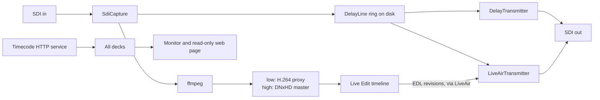

# Emerald technical documentation

Emerald is a Windows desktop application (C#, WPF, .NET 8) for broadcast plants. It records SDI video on DELTACAST cards, delays it on disk, lets an operator edit the delayed feed, and transmits it back out on SDI.

These documents describe commit `dd8e4a7`, based on reading its source. No source code was changed to write them. A second-pass audit compared every document with the source: see the [audit report](AUDIT_REPORT.md).

## Documents

| # | Document | Read it for |
|---|---|---|
| 1 | [Project overview](01_PROJECT_OVERVIEW.md) | Purpose, features, technologies, glossary |
| 2 | [Project structure](02_PROJECT_STRUCTURE.md) | Every project and important file |
| 3 | [System architecture](03_SYSTEM_ARCHITECTURE.md) | Diagrams, shared state, threads, error handling |
| 4 | [System workflows](04_SYSTEM_WORKFLOW.md) | Step-by-step, per module |
| 5 | [Media processing](05_MEDIA_PROCESSING.md) | Capture, ffmpeg commands, delay, output |
| 6 | [Hardware integration](06_HARDWARE_INTEGRATION.md) | SDK calls, RX and TX, arbitration |
| 7 | [API and communication](07_API_AND_COMMUNICATION.md) | HTTP routes, payloads, events, handshake |
| 8 | [Data and storage](08_DATA_AND_STORAGE.md) | Database, settings, file layout, cleanup |
| 9 | [Installation and deployment](09_INSTALLATION_AND_DEPLOYMENT.md) | Setup, commands, publish, install |
| 10 | [Troubleshooting](10_TROUBLESHOOTING.md) | Symptoms and fixes |
| 11 | [Technical assessment](11_TECHNICAL_ASSESSMENT.md) | Faults found, risks, debt |
| 12 | [Developer guide](12_DEVELOPER_GUIDE.md) | How to change things |
| 13 | [Live Edit guide](13_LIVE_EDIT_GUIDE.md) | Live Edit alone: its structure, how to use it, and every button |
| | [Audit report](AUDIT_REPORT.md) | What was verified and corrected, and what remains unverified |

## The system in one picture

## Architecture summary

- **One process, many windows.** A receiver allows one open handle, and `RxLease` arbitrates it inside the process. A second launch hands its request to the first through a named pipe.
- **Layered, one-way references.** Core, then Deltacast, Video and Media, with the UI projects on top. The code graph reports no import cycles.
- **Two branches from each frame.** The capture slot loop passes each frame to the encoder (files) and to the ring (air). Each has a bounded queue that refuses rather than waits, so neither can stall the card.
- **Frames as the clock.** The card paces capture and transmission, by blocking on a slot. Positions are counted in frames.
- **ffmpeg as child processes** for all encoding and for decoding to air. On-screen playback uses WPF's `MediaElement`. Capture sends raw video over stdin and audio over a named pipe, and decoding reads both from stdout.
- **Two state machines without video.** `TidalLock` and `LiveAir` coordinate windows and engines.
- **Files as the catalogue.** Recordings are found by listing dated folders. SQLite holds ingest jobs and their results only.
- **Almost no network.** A client for the timecode service, and an optional read-only monitoring page with no authentication.

## Read these files first

| # | File | Why |
|---|---|---|
| 1 | `src/Emerald.App/App.xaml.cs` | Startup, and why there is one process |
| 2 | `src/Emerald.Video/SdiCapture.cs` | The slot loop |
| 3 | `src/Emerald.Video/RecordingProfile.cs` | ffmpeg arguments |
| 4 | `src/Emerald.Video/DelayLine.cs`, `DelayPacer.cs` | The delay |
| 5 | `src/Emerald.Video/LiveAirTransmitter.cs` | What goes to air |
| 6 | `src/Emerald.Core/TidalLock.cs`, `LiveAir.cs` | State machines |
| 7 | `src/Emerald.Core/EdlLedger.cs` | The EDL handshake |
| 8 | `src/Emerald.Media/MediaLibrary.cs` | Files to timeline |
| 9 | `src/Emerald.App/ShellWindow.xaml.cs` | The capture deck |
| 10 | `src/Emerald.LiveEdit/LiveEditWindow.Live.cs` | Go Live |

[The developer guide](12_DEVELOPER_GUIDE.md#understanding-the-application) gives a reading order.

## Important findings

The review found faults that affect what goes to air. **None was reproduced on hardware**, since these come from reading the code. The top ones, detailed in [the assessment](11_TECHNICAL_ASSESSMENT.md):

1. Delayed feeds freeze about half a second after a recording stops, instead of playing out.
2. Audio of placed items in Live Edit is read at the wrong position.
3. A deleted scene's picture can reach air during a frame repeat.
4. Changing board or port on the capture deck doesn't move the preview, so what is monitored can differ from what is recorded. A new board also keeps the old board's port list.
5. Feeds with more than one audio pair are corrupted in the delayed output.

## How far this was verified

| Check | Result |
|---|---|
| Source read | All of `src/`, by module, then again in a separate audit against these documents. XAML files were reviewed for names, handlers and bindings rather than visual layout, apart from `LiveEditWindow.xaml`. Tests were read where a claim depends on them. |
| Test suite | Passed at this commit, with `TEMP` on a drive with room and ffmpeg on `PATH`: Core 400, Edl 27, Ingest 119, Video 231, 777 in total. None exercises a card. |
| Run on a card | No. No hardware behaviour was observed. |
| VideoMaster SDK semantics | Not verified. Headers are not in the repository. |
| Timecode service | Not verified. Only the client's expectations are known. |
| A real `settings.json` | Compared for media paths only |

See [what could not be fully analysed](11_TECHNICAL_ASSESSMENT.md#what-could-not-be-fully-analysed). File references, links and diagram syntax were checked by script when this was written.
